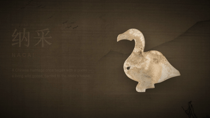

# Chinese Wedding and Funeral Rituals: A Reference Corpus

**Languages:** [简体中文](./README.md) · **English**

[](https://github.com/servanter/china-wedding-funeral-rituals/actions/workflows/check-structure.yml)
[](https://github.com/servanter/china-wedding-funeral-rituals)


> An open-source corpus systematically documenting traditional Chinese marriage rites (jiali) and funeral rites (xiongli). It is organised as “category → sub-category → entry”, with one standalone Markdown document per entry.

## About



[▶ Watch the full demo video (mp4, play locally after download)](assets/videos/nacai-mix.mp4)

This corpus covers three parts:

1. **Marriage rites (jiali)**: the Six Rites of the Zhou canon, pre-wedding custom, wedding-day ceremonies, post-wedding custom, wedding objects, appellations, auspicious dating and taboos, and the regional and ethnic variants of marriage custom.
2. **Funeral rites (xiongli)**: initial mourning, encoffining, lying in state, procession and burial, post-burial sacrifices, the five degrees of mourning, funerary objects and mingqi, mourning attire regulations, funeral appellations, auspicious dating and taboos, and the regional and ethnic variants of funeral custom.
3. **Appendices**: traditional kinship terms, document templates for wedding and funeral rites, and foundational concepts of the ritual order.

## Statistics

| Book | Sub-categories | Entries |
| --- | --- | --- |
| **01 Marriage Rites (Jiali, the Rites of Festivity)** | 9 | 169 |
| | [The Six Rites of the Zhou Canon](./en/docs/01-marriage-rites/01-01-six-rites/README.md) (10) · [Pre-Wedding Customs](./en/docs/01-marriage-rites/01-02-pre-wedding-customs/README.md) (15) · [Wedding-Day Ceremonies](./en/docs/01-marriage-rites/01-03-wedding-day-ceremony/README.md) (17) · [Post-Wedding Customs](./en/docs/01-marriage-rites/01-04-post-wedding-customs/README.md) (8) · [Wedding Objects and Attire](./en/docs/01-marriage-rites/01-05-wedding-objects/README.md) (16) · [Wedding and Affinal Appellations](./en/docs/01-marriage-rites/01-06-wedding-appellations/README.md) (8) · [Auspicious Dating and Taboos in Marriage](./en/docs/01-marriage-rites/01-07-wedding-auspicious-taboos/README.md) (8) · [Han Regional Variants of Marriage Custom](./en/docs/01-marriage-rites/01-08-han-regional-variants/README.md) (32) · [Marriage Customs of the Ethnic Minorities](./en/docs/01-marriage-rites/01-09-ethnic-minority-marriage/README.md) (55) | |
| **02 Funeral Rites (Xiongli, the Rites of Mourning)** | 12 | 204 |
| | [Initial Mourning](./en/docs/02-funeral-rites/02-01-initial-mourning/README.md) (10) · [Encoffining](./en/docs/02-funeral-rites/02-02-encoffining/README.md) (10) · [Lying in State](./en/docs/02-funeral-rites/02-03-lying-in-state/README.md) (11) · [Funeral Procession and Burial](./en/docs/02-funeral-rites/02-04-funeral-procession-burial/README.md) (15) · [Post-Burial Sacrifices](./en/docs/02-funeral-rites/02-05-post-burial-sacrifices/README.md) (14) · [The Five Degrees of Mourning](./en/docs/02-funeral-rites/02-06-five-degrees-mourning/README.md) (12) · [Funeral Objects and Mingqi](./en/docs/02-funeral-rites/02-07-funeral-objects-mingqi/README.md) (15) · [Mourning Attire Regulations](./en/docs/02-funeral-rites/02-08-mourning-attire-regulations/README.md) (10) · [Funeral Appellations](./en/docs/02-funeral-rites/02-09-funeral-appellations/README.md) (10) · [Auspicious Dating and Taboos in Funerals](./en/docs/02-funeral-rites/02-10-funeral-auspicious-taboos/README.md) (10) · [Han Regional Variants of Funeral Custom](./en/docs/02-funeral-rites/02-11-han-regional-variants/README.md) (32) · [Funeral Customs of the Ethnic Minorities](./en/docs/02-funeral-rites/02-12-ethnic-minority-funeral/README.md) (55) | |
| **03 Appendices** | 3 | 42 |
| | [Traditional Kinship Terms](./en/docs/03-appendix/03-01-kinship-terms/README.md) (8) · [Document Templates for Wedding and Funeral Rites](./en/docs/03-appendix/03-02-document-templates/README.md) (14) · [Foundational Concepts of the Ritual Order](./en/docs/03-appendix/03-03-ritual-concepts/README.md) (20) | |
| **Total** | **24** | **415** |

415 entries in total, each a standalone Markdown document.

## Translation status

The index and metadata of this corpus are bilingual. Entry bodies are translated progressively: **410 / 415** entries currently have an English body. Entries without one link to the Chinese original and are marked `Chinese` in the index below.

## Repository layout

```text
china-wedding-funeral-rituals/
├── README.md                # Chinese entry point: table of contents and full index
├── README.en.md             # English entry point
├── LICENSE                  # Text licence (CC BY-SA 4.0)
├── LICENSE-CODE             # Script licence (MIT)
├── assets/                  # Images, diagrams and demo video
├── scripts/
│   ├── generate-skeleton.mjs  # Directory skeleton and index generation
│   ├── check-structure.mjs    # Structure validation (used by CI)
│   ├── i18n.mjs               # Batch EN translation and index sync
│   └── progress.mjs           # Translation progress stats
├── docs/                    # Chinese corpus
│   ├── 01-marriage-rites/
│   ├── 02-funeral-rites/
│   └── 03-appendix/
└── en/
    └── docs/                # English index layer and translated entry bodies
```

## Full entry index

## 01 Marriage Rites (Jiali, the Rites of Festivity)

Marriage belongs to the jiali, the festive rites, among the traditional five categories of ceremony. This book follows nine dimensions — ritual origin, pre-wedding custom, the wedding day, post-wedding custom, objects, appellations, auspicious dating, region and ethnicity — assembling the full chain of ceremonial steps from the Six Rites of the pre-Qin period down to contemporary Chinese weddings, together with regional and ethnic variants.

### 01-01 The Six Rites of the Zhou Canon

> Directory: [`en/docs/01-marriage-rites/01-01-six-rites/`](./en/docs/01-marriage-rites/01-01-six-rites/README.md) · Chinese original: [`docs/01-marriage-rites/01-01-six-rites/`](./docs/01-marriage-rites/01-01-six-rites/README.md) · 10 entries

| ID | Entry | Summary | Body |
| --- | --- | --- | --- |
| 01-01-01 | [Betrothal Proposal (Nacai)](./en/docs/01-marriage-rites/01-01-six-rites/01-betrothal-proposal-nacai.md) | The groom's family sends a matchmaker to open the proposal, presenting a wild goose; the first of the Six Rites. | English |
| 01-01-02 | [Requesting the Bride's Name (Wenming)](./en/docs/01-marriage-rites/01-01-six-rites/02-requesting-the-brides-name-wenming.md) | Asking the bride's name and birth date in order to divine the auspiciousness of the match. | English |
| 01-01-03 | [Announcing the Favourable Divination (Naji)](./en/docs/01-marriage-rites/01-01-six-rites/03-announcing-the-favourable-divination-naji.md) | The divination proves auspicious and is reported to the bride's family, whereupon the betrothal is settled. | English |
| 01-01-04 | [Presentation of Betrothal Gifts (Nazheng)](./en/docs/01-marriage-rites/01-01-six-rites/04-presentation-of-betrothal-gifts-nazheng.md) | The formal presentation of betrothal gifts; the origin of later dowry negotiation and of the rite of major betrothal. | English |
| 01-01-05 | [Requesting the Wedding Date (Qingqi)](./en/docs/01-marriage-rites/01-01-six-rites/05-requesting-the-wedding-date-qingqi.md) | The groom's family fixes a date and asks the bride's family to approve it. | English |
| 01-01-06 | [Personal Reception of the Bride (Qinying)](./en/docs/01-marriage-rites/01-01-six-rites/06-personal-reception-of-the-bride-qinying.md) | The groom goes in person to escort his bride; the completion of the Six Rites. | English |
| 01-01-07 | [Origins of the Six Rites and the Shihunli of the Yili](./en/docs/01-marriage-rites/01-01-six-rites/07-six-rites-and-the-shihunli.md) | The ritual classic's text, the reconstruction of its ceremonial steps, and the textual basis of the Six Rites. | English |
| 01-01-08 | [Simplification of the Six Rites and Later Transformations](./en/docs/01-marriage-rites/01-01-six-rites/08-simplification-of-the-six-rites-and-later-transformations.md) | The merging of the rites into three or four steps, and the evolution of modern-style weddings. | English |
| 01-01-09 | [Exogamy of the Same Surname and Zhou Marriage Institutions](./en/docs/01-marriage-rites/01-01-six-rites/09-exogamy-of-the-same-surname-and-zhou-marriage-institutions.md) | Clan exogamy, the concubine-accompanying system, and the ritual basis of one principal wife with secondary consorts. | English |
| 01-01-10 | [Matchmakers and the Maxim “Parents' Command, the Go-Between's Word”](./en/docs/01-marriage-rites/01-01-six-rites/10-matchmakers-and-the-maxim.md) | Official and private matchmakers, and the professionalisation of the go-between. | English |

### 01-02 Pre-Wedding Customs

> Directory: [`en/docs/01-marriage-rites/01-02-pre-wedding-customs/`](./en/docs/01-marriage-rites/01-02-pre-wedding-customs/README.md) · Chinese original: [`docs/01-marriage-rites/01-02-pre-wedding-customs/`](./docs/01-marriage-rites/01-02-pre-wedding-customs/README.md) · 15 entries

| ID | Entry | Summary | Body |
| --- | --- | --- | --- |
| 01-02-01 | [Proposal and Matchmaking](./en/docs/01-marriage-rites/01-02-pre-wedding-customs/01-proposal-and-matchmaking.md) | The matchmaker's introduction and the two families' mutual enquiries into standing and means. | English |
| 01-02-02 | [Meeting the Prospect (Inspecting the Household)](./en/docs/01-marriage-rites/01-02-pre-wedding-customs/02-meeting-the-prospect-inspecting-the-household.md) | The two families assess character, means and social standing before agreeing. | English |
| 01-02-03 | [Horoscope Matching (Hehun)](./en/docs/01-marriage-rites/01-02-pre-wedding-customs/03-horoscope-matching-hehun.md) | Exchange of horoscope cards and divination of the match by the eight birth characters. | English |
| 01-02-04 | [Minor Betrothal (Xiaoding)](./en/docs/01-marriage-rites/01-02-pre-wedding-customs/04-minor-betrothal-xiaoding.md) | A preliminary engagement marked by a small betrothal gift from the groom’s family. | English |
| 01-02-05 | [Major Betrothal (Dading)](./en/docs/01-marriage-rites/01-02-pre-wedding-customs/05-major-betrothal-dading.md) | The formal presentation of betrothal gifts, by which the engagement takes effect. | English |
| 01-02-06 | [Negotiating Bride-Price and Dowry](./en/docs/01-marriage-rites/01-02-pre-wedding-customs/06-negotiating-bride-price-and-dowry.md) | Settlement of the bride-price, return gifts and dowry, and the handling of disputes. | English |
| 01-02-07 | [Betrothal Contracts and Engagement Documents](./en/docs/01-marriage-rites/01-02-pre-wedding-customs/07-betrothal-contracts-and-engagement-documents.md) | The legal and customary force of the betrothal contract, and the procedures of agreement and repudiation. | English |
| 01-02-08 | [Sending the Date (Song Rizi)](./en/docs/01-marriage-rites/01-02-pre-wedding-customs/08-sending-the-date-song-rizi.md) | The chosen wedding date is notified to the bride's family on a written date card. | English |
| 01-02-09 | [Urging the Trousseau (Cuizhuang)](./en/docs/01-marriage-rites/01-02-pre-wedding-customs/09-urging-the-trousseau-cuizhuang.md) | As the date approaches, the groom's family sends gifts to hasten the bride's preparations. | English |
| 01-02-10 | [Setting and Dressing the Bridal Bed](./en/docs/01-marriage-rites/01-02-pre-wedding-customs/10-setting-and-dressing-the-bridal-bed.md) | Installing the bridal bed, spreading it with auspicious items, and reciting blessings. | English |
| 01-02-11 | [Coming-of-Age Coiffure and Face Threading](./en/docs/01-marriage-rites/01-02-pre-wedding-customs/11-coming-of-age-coiffure-and-face-threading.md) | The bride's change of hairstyle and hairpin, and the threading of her face before leaving home. | English |
| 01-02-12 | [Preparing and Delivering the Dowry](./en/docs/01-marriage-rites/01-02-pre-wedding-customs/12-preparing-and-delivering-the-dowry.md) | Categories of trousseau, the order of the delivery procession, and the customs observed along the way. | English |
| 01-02-13 | [Bridal Lament (Kujia)](./en/docs/01-marriage-rites/01-02-pre-wedding-customs/13-bridal-lament-kujia.md) | Genres of bridal lament songs, their verse structure and emotional function. | English |
| 01-02-14 | [Announcing the Marriage to the Ancestors](./en/docs/01-marriage-rites/01-02-pre-wedding-customs/14-announcing-the-marriage-to-the-ancestors.md) | The family rite of informing the ancestors of the coming wedding and asking their blessing. | English |
| 01-02-15 | [Child Brides, Prenatal Betrothals and Infant Betrothals (A Critical Survey)](./en/docs/01-marriage-rites/01-02-pre-wedding-customs/15-child-brides-and-infant-betrothal.md) | Causes, forms and a critical examination of malformed marriage customs of the old order. | English |

### 01-03 Wedding-Day Ceremonies

> Directory: [`en/docs/01-marriage-rites/01-03-wedding-day-ceremony/`](./en/docs/01-marriage-rites/01-03-wedding-day-ceremony/README.md) · Chinese original: [`docs/01-marriage-rites/01-03-wedding-day-ceremony/`](./docs/01-marriage-rites/01-03-wedding-day-ceremony/README.md) · 17 entries

| ID | Entry | Summary | Body |
| --- | --- | --- | --- |
| 01-03-01 | [Escorting the Bride: The Wedding Procession](./en/docs/01-marriage-rites/01-03-wedding-day-ceremony/01-escorting-the-bride-the-wedding-procession.md) | The make-up and route of the escort party, its attendants, drums and insignia. | English |
| 01-03-02 | [Blocking the Door and the Door-Opening Gift](./en/docs/01-marriage-rites/01-03-wedding-day-ceremony/02-blocking-the-door-and-the-door-opening-gift.md) | The bride's family bars the door and demands red packets, answered with songs and verse contests. | English |
| 01-03-03 | [Bowing in the Hall (The Three Bows)](./en/docs/01-marriage-rites/01-03-wedding-day-ceremony/03-bowing-in-the-hall-the-three-bows.md) | Bowing to Heaven and Earth, then to the parents, then to each other, and the meaning of each bow. | English |
| 01-03-04 | [Sharing the Cup (Hejin)](./en/docs/01-marriage-rites/01-03-wedding-day-ceremony/04-sharing-the-cup-hejin.md) | A gourd split in two, from which bride and groom each drink: a rite of bodily union. | English |
| 01-03-05 | [Binding the Hair and Tying the Red Cord](./en/docs/01-marriage-rites/01-03-wedding-day-ceremony/05-binding-the-hair-and-tying-the-red-cord.md) | The symbolism of binding the couple's hair as husband and wife, of the red cord and the lover's knot. | English |
| 01-03-06 | [Scattering the Bed (Sazhang)](./en/docs/01-marriage-rites/01-03-wedding-day-ceremony/06-scattering-the-bed-sazhang.md) | Dates, chestnuts and grains are scattered into the bedchamber with wishes for many sons. | English |
| 01-03-07 | [Lifting the Veil with the Steelyard](./en/docs/01-marriage-rites/01-03-wedding-day-ceremony/07-lifting-the-veil-with-the-steelyard.md) | The rite of lifting the bridal veil with an auspicious steelyard, and its felicitous sayings. | English |
| 01-03-08 | [Sitting in the Curtained Bed and Sharing the Bed](./en/docs/01-marriage-rites/01-03-wedding-day-ceremony/08-sitting-in-the-curtained-bed-and-sharing-the-bed.md) | The couple sits beneath the canopy to receive congratulations, then retires together. | English |
| 01-03-09 | [Presentation at the Ancestral Temple (Miaojian)](./en/docs/01-marriage-rites/01-03-wedding-day-ceremony/09-presentation-at-the-ancestral-temple-miaojian.md) | The bride meets her parents-in-law and pays homage at the family shrine, thereby formally assuming her duties as wife. | English |
| 01-03-10 | [Wedding Banquet and Toasting Etiquette](./en/docs/01-marriage-rites/01-03-wedding-day-ceremony/10-wedding-banquet-and-toasting-etiquette.md) | Seating order, sequence of courses, and the rules governing the couple's toasts. | English |
| 01-03-11 | [Roughhousing in the Nuptial Chamber](./en/docs/01-marriage-rites/01-03-wedding-day-ceremony/11-roughhousing-in-the-nuptial-chamber.md) | Types of raucous chamber games, regional differences, and their ritual function. | English |
| 01-03-12 | [Meeting the Relatives and Ranking by Generation](./en/docs/01-marriage-rites/01-03-wedding-day-ceremony/12-meeting-the-relatives-and-ranking-by-generation.md) | The bride's introduction to the kin group, her bows of greeting and her changes of address. | English |
| 01-03-13 | [Returning to the Bride's Family (Huimen)](./en/docs/01-marriage-rites/01-03-wedding-day-ceremony/13-returning-to-the-brides-family-huimen.md) | The timing and ceremonial of the couple's visit to the bride's home after the wedding. | English |
| 01-03-14 | [The Bridal Sedan Chair and Its Regulations](./en/docs/01-marriage-rites/01-03-wedding-day-ceremony/14-the-bridal-sedan-chair-and-its-regulations.md) | Construction and decoration of the sedan, the rules of carrying it, and the rites of mounting and alighting. | English |
| 01-03-15 | [Matrons of Honour, Bridesmaids and Groomsmen](./en/docs/01-marriage-rites/01-03-wedding-day-ceremony/15-matrons-of-honour-bridesmaids-and-groomsmen.md) | The roles, duties and auspicious qualifications of the wedding attendants. | English |
| 01-03-16 | [Wedding Officers and the Master of Ceremonies (Lisheng)](./en/docs/01-marriage-rites/01-03-wedding-day-ceremony/16-wedding-officers-and-the-master-of-ceremonies-lisheng.md) | The spoken formulas of the master of ceremonies, the ritual assistants and the stewards. | English |
| 01-03-17 | [The Contemporary Chinese Wedding: An Integrated Programme](./en/docs/01-marriage-rites/01-03-wedding-day-ceremony/17-contemporary-chinese-wedding.md) | How traditional rites are retained, simplified or rearranged in modern weddings. | English |

### 01-04 Post-Wedding Customs

> Directory: [`en/docs/01-marriage-rites/01-04-post-wedding-customs/`](./en/docs/01-marriage-rites/01-04-post-wedding-customs/README.md) · Chinese original: [`docs/01-marriage-rites/01-04-post-wedding-customs/`](./docs/01-marriage-rites/01-04-post-wedding-customs/README.md) · 8 entries

| ID | Entry | Summary | Body |
| --- | --- | --- | --- |
| 01-04-01 | [Third-Day Return Visit](./en/docs/01-marriage-rites/01-04-post-wedding-customs/01-third-day-return-visit.md) | The bride's visit home on the third day, with its rites and gifts. | English |
| 01-04-02 | [The Joint Return and the Month-Long Stay](./en/docs/01-marriage-rites/01-04-post-wedding-customs/02-the-joint-return-and-the-month-long-stay.md) | Customs of the couple returning together to the bride's home, and of the bride staying a full month. | English |
| 01-04-03 | [Thanking the Matchmaker](./en/docs/01-marriage-rites/01-04-post-wedding-customs/03-thanking-the-matchmaker.md) | Gifts, etiquette and proverbs attending the reward of the go-between. | English |
| 01-04-04 | [Sending Lamps and Praying for Sons](./en/docs/01-marriage-rites/01-04-post-wedding-customs/04-sending-lamps-and-praying-for-sons.md) | The bride's natal family sends lamps and figurines of children in hope of offspring. | English |
| 01-04-05 | [First Month, Hundredth Day and First Birthday](./en/docs/01-marriage-rites/01-04-post-wedding-customs/05-first-month-hundredth-day-and-first-birthday.md) | The child-rearing rites of the full month, the hundredth day and the grasping ceremony. | English |
| 01-04-06 | [Acknowledging and Visiting the New Kin](./en/docs/01-marriage-rites/01-04-post-wedding-customs/06-acknowledging-and-visiting-the-new-kin.md) | Seasonal visits and rules of gift exchange between the newly allied families. | English |
| 01-04-07 | [Household Division and Establishing a New House](./en/docs/01-marriage-rites/01-04-post-wedding-customs/07-household-division-and-establishing-a-new-house.md) | Customary constraints on setting up an independent household and dividing family property. | English |
| 01-04-08 | [Wedding Anniversaries](./en/docs/01-marriage-rites/01-04-post-wedding-customs/08-wedding-anniversaries.md) | The shift from the traditional return visit to the modern wedding anniversary. | English |

### 01-05 Wedding Objects and Attire

> Directory: [`en/docs/01-marriage-rites/01-05-wedding-objects/`](./en/docs/01-marriage-rites/01-05-wedding-objects/README.md) · Chinese original: [`docs/01-marriage-rites/01-05-wedding-objects/`](./docs/01-marriage-rites/01-05-wedding-objects/README.md) · 16 entries

| ID | Entry | Summary | Body |
| --- | --- | --- | --- |
| 01-05-01 | [Objects of the Six Rites: the Wild Goose, Dark-and-Crimson Silks, and Paired Hides](./en/docs/01-marriage-rites/01-05-wedding-objects/01-objects-of-the-six-rites.md) | The gifts prescribed by the ritual classics and their ceremonial meaning. | English |
| 01-05-02 | [The Bridal Sedan (Huajiao)](./en/docs/01-marriage-rites/01-05-wedding-objects/02-the-bridal-sedan-huajiao.md) | The form and decoration of the bridal sedan, the regulations for carrying it, and the rental trade that supplied it. | English |
| 01-05-03 | [The Bridal Veil (Gaitou)](./en/docs/01-marriage-rites/01-05-wedding-objects/03-the-bridal-veil-gaitou.md) | The form and materials of the veil, and the origins of its symbolism of concealment. | English |
| 01-05-04 | [Wedding Attire: Phoenix Crown and Rosy Robe, and the Qun Gua](./en/docs/01-marriage-rites/01-05-wedding-objects/04-wedding-attire-phoenix-crown-and-rosy-robe-and-the-qun-gua.md) | The forms of wedding dress through the dynasties, with their rank distinctions and regional variants. | English |
| 01-05-05 | [Wedding Shoes (Caitang Xie)](./en/docs/01-marriage-rites/01-05-wedding-objects/05-wedding-shoes-caitang-xie.md) | Embroidered shoes, the hall-treading shoe, and shoe customs linked to the bride's delayed removal to her husband's house. | English |
| 01-05-06 | [Auspicious Quilts and Pillows](./en/docs/01-marriage-rites/01-05-wedding-objects/06-auspicious-quilts-and-pillows.md) | Rules for stitching dragon-and-phoenix quilts and auspicious pillows, and for laying them out. | English |
| 01-05-07 | [Wedding Candles and Dragon-and-Phoenix Candles](./en/docs/01-marriage-rites/01-05-wedding-objects/07-wedding-candles-and-dragon-and-phoenix-candles.md) | The forms of the bridal candle, the rite of lighting it, and the taboos attached to it. | English |
| 01-05-08 | [Hejin Cups and Crossed-Cup Wine Vessels](./en/docs/01-marriage-rites/01-05-wedding-objects/08-hejin-cups-and-crossed-cup-wine-vessels.md) | The shapes and uses of hejin cups and of the vessels used for the crossed-cup toast. | English |
| 01-05-09 | [The Auspicious Steelyard and Other Lucky Objects](./en/docs/01-marriage-rites/01-05-wedding-objects/09-the-auspicious-steelyard-and-other-lucky-objects.md) | The uses of the steelyard, the ruyi sceptre, the grain measure and the foot rule. | English |
| 01-05-10 | [Wedding Cards (Dragon-and-Phoenix Cards) and Invitations](./en/docs/01-marriage-rites/01-05-wedding-objects/10-wedding-cards-dragon-and-phoenix-cards-and-invitations.md) | The form, layout and etiquette of delivering wedding invitations. | English |
| 01-05-11 | [Dowry Chests and the Descendants Bucket](./en/docs/01-marriage-rites/01-05-wedding-objects/11-dowry-chests-and-the-descendants-bucket.md) | The conventions governing trousseau chests, the descendants bucket and other dowry gear. | English |
| 01-05-12 | [Drums, Suona and Festive Instruments](./en/docs/01-marriage-rites/01-05-wedding-objects/12-drums-suona-and-festive-instruments.md) | The make-up of the wedding band, its tunes, and its sequence of performance. | English |
| 01-05-13 | [Firecrackers and Festive Fireworks](./en/docs/01-marriage-rites/01-05-wedding-objects/13-firecrackers-and-festive-fireworks.md) | How firecrackers are set off at weddings, in what order, and with what regional differences. | English |
| 01-05-14 | [The Heaven-and-Earth Table and Its Offerings](./en/docs/01-marriage-rites/01-05-wedding-objects/14-the-heaven-and-earth-table-and-its-offerings.md) | The arrangement of the table, the incense stand and offerings, and the rite of announcement. | English |
| 01-05-15 | [Double Happiness, Wedding Couplets and Paper Cuts](./en/docs/01-marriage-rites/01-05-wedding-objects/15-double-happiness-wedding-couplets-and-paper-cuts.md) | The writing and posting of auspicious characters and couplets, and the motifs of paper cutting. | English |
| 01-05-16 | [Auspicious Motifs: Dragon and Phoenix, Mandarin Ducks, Pomegranate, Double Happiness](./en/docs/01-marriage-rites/01-05-wedding-objects/16-auspicious-motifs.md) | The symbolic repertoire of wedding decoration. | English |

### 01-06 Wedding and Affinal Appellations

> Directory: [`en/docs/01-marriage-rites/01-06-wedding-appellations/`](./en/docs/01-marriage-rites/01-06-wedding-appellations/README.md) · Chinese original: [`docs/01-marriage-rites/01-06-wedding-appellations/`](./docs/01-marriage-rites/01-06-wedding-appellations/README.md) · 8 entries

| ID | Entry | Summary | Body |
| --- | --- | --- | --- |
| 01-06-01 | [Marriage-Related Kinship Terms: An Overview](./en/docs/01-marriage-rites/01-06-wedding-appellations/01-marriage-related-kinship-terms-an-overview.md) | How kinship terms change before and after marriage, and the framework as a whole. | English |
| 01-06-02 | [Names for the Matchmaker: Moon Old Man, Red Maid, Ice Man](./en/docs/01-marriage-rites/01-06-wedding-appellations/02-names-for-the-matchmaker-moon-old-man-red-maid-ice-man.md) | The origins and uses of the matchmaker's literary and colloquial titles. | English |
| 01-06-03 | [The Titles of Groom and Bride](./en/docs/01-marriage-rites/01-06-wedding-appellations/03-the-titles-of-groom-and-bride.md) | The origins of xinlang, xinniang, guanren and niangzi. | English |
| 01-06-04 | [Terms for the In-Laws (Qingjia)](./en/docs/01-marriage-rites/01-06-wedding-appellations/04-terms-for-the-in-laws-qingjia.md) | The usage of terms for affinal elders, and their regional variants. | English |
| 01-06-05 | [Terms among Affinal Kin: Sisters-in-Law, Co-Brothers-in-Law, Aunts and Sons-in-Law](./en/docs/01-marriage-rites/01-06-wedding-appellations/05-affinal-kin-terms.md) | The terminology for same-generation and half-affinal relationships. | English |
| 01-06-06 | [Terms for Legitimate and Secondary Status: Principal Wife, Successor Wife, Concubine](./en/docs/01-marriage-rites/01-06-wedding-appellations/06-legitimate-and-secondary-status-terms.md) | Terms relating to principal wives, successor wives, concubines and children born of concubines. | English |
| 01-06-07 | [Terms for Marriageable Age (Jiji, Ruoguan, Daizi, Chuge)](./en/docs/01-marriage-rites/01-06-wedding-appellations/07-terms-for-marriageable-age-jiji-ruoguan-daizi-chuge.md) | The appellations marking stages of marriageable age, and their ritual basis. | English |
| 01-06-08 | [The Verb System of Marriage (Qu, Jia, Shi, Gui, Zhui)](./en/docs/01-marriage-rites/01-06-wedding-appellations/08-the-verb-system-of-marriage-qu-jia-shi-gui-zhui.md) | The verbs denoting marriage relations and the differences in their meanings. | English |

### 01-07 Auspicious Dating and Taboos in Marriage

> Directory: [`en/docs/01-marriage-rites/01-07-wedding-auspicious-taboos/`](./en/docs/01-marriage-rites/01-07-wedding-auspicious-taboos/README.md) · Chinese original: [`docs/01-marriage-rites/01-07-wedding-auspicious-taboos/`](./docs/01-marriage-rites/01-07-wedding-auspicious-taboos/README.md) · 8 entries

| ID | Entry | Summary | Body |
| --- | --- | --- | --- |
| 01-07-01 | [Choosing an Auspicious Wedding Date: Yellow-Road Days and the Zhoutang Chart](./en/docs/01-marriage-rites/01-07-wedding-auspicious-taboos/01-choosing-an-auspicious-wedding-date-yellow-road-days-and-the-zhoutang-chart.md) | How auspicious and inauspicious days are determined, and how the zhoutang chart is used. | English |
| 01-07-02 | [Eight-Character Matching and Fate-Based Prohibitions](./en/docs/01-marriage-rites/01-07-wedding-auspicious-taboos/02-eight-character-matching-and-fate-based-prohibitions.md) | Methods of judging a match by the eight birth characters, the nayin pitches and the spirit-killers. | English |
| 01-07-03 | [Zodiac Clashes and the Six Conflicts](./en/docs/01-marriage-rites/01-07-wedding-auspicious-taboos/03-zodiac-clashes-and-the-six-conflicts.md) | The six clashes, six harmonies and three harmonies among the zodiac animals, and the rules for matching them. | English |
| 01-07-04 | [Monthly Prohibitions: Years Without Spring and Widow Years](./en/docs/01-marriage-rites/01-07-wedding-auspicious-taboos/04-monthly-prohibitions-years-without-spring-and-widow-years.md) | The origins of prohibitions attaching to years without a solar spring, to one's own zodiac year, and to other periods. | English |
| 01-07-05 | [Behavioural Taboos at Weddings](./en/docs/01-marriage-rites/01-07-wedding-auspicious-taboos/05-behavioural-taboos-at-weddings.md) | Prohibitions on breaking objects, weeping, sweeping and the like. | English |
| 01-07-06 | [Taboos Concerning Persons](./en/docs/01-marriage-rites/01-07-wedding-auspicious-taboos/06-taboos-concerning-persons.md) | Excluding widows, zodiac-clashing persons and mourners from the wedding. | English |
| 01-07-07 | [Taboos on Routes and Directions](./en/docs/01-marriage-rites/01-07-wedding-auspicious-taboos/07-taboos-on-routes-and-directions.md) | The bride-escort route, the rule against retracing one's steps, and auspicious directions. | English |
| 01-07-08 | [Wedding Meeting Wedding, and Clashing with Another Bridal Sedan](./en/docs/01-marriage-rites/01-07-wedding-auspicious-taboos/08-wedding-meeting-wedding-and-clashing-with-another-bridal-sedan.md) | How a clash between two wedding processions is avoided or resolved. | English |

### 01-08 Han Regional Variants of Marriage Custom

> Directory: [`en/docs/01-marriage-rites/01-08-han-regional-variants/`](./en/docs/01-marriage-rites/01-08-han-regional-variants/README.md) · Chinese original: [`docs/01-marriage-rites/01-08-han-regional-variants/`](./docs/01-marriage-rites/01-08-han-regional-variants/README.md) · 32 entries

| ID | Entry | Summary | Body |
| --- | --- | --- | --- |
| 01-08-01 | [Beijing Marriage Customs](./en/docs/01-marriage-rites/01-08-han-regional-variants/01-beijing-marriage-customs.md) | Rituals, objects, taboos and local variants of Han Chinese marriage custom in Beijing. | English |
| 01-08-02 | [Tianjin Marriage Customs](./en/docs/01-marriage-rites/01-08-han-regional-variants/02-tianjin-marriage-customs.md) | Rituals, objects, taboos and local variants of Han Chinese marriage custom in Tianjin. | English |
| 01-08-03 | [Hebei Marriage Customs](./en/docs/01-marriage-rites/01-08-han-regional-variants/03-hebei-marriage-customs.md) | Rituals, objects, taboos and local variants of Han Chinese marriage custom in Hebei. | English |
| 01-08-04 | [Shanxi Marriage Customs](./en/docs/01-marriage-rites/01-08-han-regional-variants/04-shanxi-marriage-customs.md) | Rituals, objects, taboos and local variants of Han Chinese marriage custom in Shanxi. (Shanxi merchant customs) | English |
| 01-08-05 | [Inner Mongolia Marriage Customs](./en/docs/01-marriage-rites/01-08-han-regional-variants/05-inner-mongolia-marriage-customs.md) | Rituals, objects, taboos and local variants of Han Chinese marriage custom in Inner Mongolia. (migration customs of the Western Passage) | English |
| 01-08-06 | [Liaoning Marriage Customs](./en/docs/01-marriage-rites/01-08-han-regional-variants/06-liaoning-marriage-customs.md) | Rituals, objects, taboos and local variants of Han Chinese marriage custom in Liaoning. | English |
| 01-08-07 | [Jilin Marriage Customs](./en/docs/01-marriage-rites/01-08-han-regional-variants/07-jilin-marriage-customs.md) | Rituals, objects, taboos and local variants of Han Chinese marriage custom in Jilin. | English |
| 01-08-08 | [Heilongjiang Marriage Customs](./en/docs/01-marriage-rites/01-08-han-regional-variants/08-heilongjiang-marriage-customs.md) | Rituals, objects, taboos and local variants of Han Chinese marriage custom in Heilongjiang. | English |
| 01-08-09 | [Shanghai Marriage Customs](./en/docs/01-marriage-rites/01-08-han-regional-variants/09-shanghai-marriage-customs.md) | Rituals, objects, taboos and local variants of Han Chinese marriage custom in Shanghai. | English |
| 01-08-10 | [Jiangsu Marriage Customs](./en/docs/01-marriage-rites/01-08-han-regional-variants/10-jiangsu-marriage-customs.md) | Rituals, objects, taboos and local variants of Han Chinese marriage custom in Jiangsu. | English |
| 01-08-11 | [Zhejiang Marriage Customs](./en/docs/01-marriage-rites/01-08-han-regional-variants/11-zhejiang-marriage-customs.md) | Rituals, objects, taboos and local variants of Han Chinese marriage custom in Zhejiang. | English |
| 01-08-12 | [Anhui Marriage Customs](./en/docs/01-marriage-rites/01-08-han-regional-variants/12-anhui-marriage-customs.md) | Rituals, objects, taboos and local variants of Han Chinese marriage custom in Anhui. (including the Huizhou sub-group) | English |
| 01-08-13 | [Fujian Marriage Customs](./en/docs/01-marriage-rites/01-08-han-regional-variants/13-fujian-marriage-customs.md) | Rituals, objects, taboos and local variants of Han Chinese marriage custom in Fujian. (including the Minnan and Fuzhou sub-groups) | English |
| 01-08-14 | [Jiangxi Marriage Customs](./en/docs/01-marriage-rites/01-08-han-regional-variants/14-jiangxi-marriage-customs.md) | Rituals, objects, taboos and local variants of Han Chinese marriage custom in Jiangxi. | English |
| 01-08-15 | [Shandong Marriage Customs](./en/docs/01-marriage-rites/01-08-han-regional-variants/15-shandong-marriage-customs.md) | Rituals, objects, taboos and local variants of Han Chinese marriage custom in Shandong. | English |
| 01-08-16 | [Henan Marriage Customs](./en/docs/01-marriage-rites/01-08-han-regional-variants/16-henan-marriage-customs.md) | Rituals, objects, taboos and local variants of Han Chinese marriage custom in Henan. | English |
| 01-08-17 | [Hubei Marriage Customs](./en/docs/01-marriage-rites/01-08-han-regional-variants/17-hubei-marriage-customs.md) | Rituals, objects, taboos and local variants of Han Chinese marriage custom in Hubei. | English |
| 01-08-18 | [Hunan Marriage Customs](./en/docs/01-marriage-rites/01-08-han-regional-variants/18-hunan-marriage-customs.md) | Rituals, objects, taboos and local variants of Han Chinese marriage custom in Hunan. | English |
| 01-08-19 | [Guangdong Marriage Customs](./en/docs/01-marriage-rites/01-08-han-regional-variants/19-guangdong-marriage-customs.md) | Rituals, objects, taboos and local variants of Han Chinese marriage custom in Guangdong. (including the Cantonese, Chaoshan and Hakka sub-groups) | English |
| 01-08-20 | [Guangxi Marriage Customs](./en/docs/01-marriage-rites/01-08-han-regional-variants/20-guangxi-marriage-customs.md) | Rituals, objects, taboos and local variants of Han Chinese marriage custom in Guangxi. | English |
| 01-08-21 | [Hainan Marriage Customs](./en/docs/01-marriage-rites/01-08-han-regional-variants/21-hainan-marriage-customs.md) | Rituals, objects, taboos and local variants of Han Chinese marriage custom in Hainan. | English |
| 01-08-22 | [Chongqing Marriage Customs](./en/docs/01-marriage-rites/01-08-han-regional-variants/22-chongqing-marriage-customs.md) | Rituals, objects, taboos and local variants of Han Chinese marriage custom in Chongqing. | English |
| 01-08-23 | [Sichuan Marriage Customs](./en/docs/01-marriage-rites/01-08-han-regional-variants/23-sichuan-marriage-customs.md) | Rituals, objects, taboos and local variants of Han Chinese marriage custom in Sichuan. | English |
| 01-08-24 | [Guizhou Marriage Customs](./en/docs/01-marriage-rites/01-08-han-regional-variants/24-guizhou-marriage-customs.md) | Rituals, objects, taboos and local variants of Han Chinese marriage custom in Guizhou. | English |
| 01-08-25 | [Yunnan Marriage Customs](./en/docs/01-marriage-rites/01-08-han-regional-variants/25-yunnan-marriage-customs.md) | Rituals, objects, taboos and local variants of Han Chinese marriage custom in Yunnan. | English |
| 01-08-26 | [Shaanxi Marriage Customs](./en/docs/01-marriage-rites/01-08-han-regional-variants/26-shaanxi-marriage-customs.md) | Rituals, objects, taboos and local variants of Han Chinese marriage custom in Shaanxi. | English |
| 01-08-27 | [Gansu Marriage Customs](./en/docs/01-marriage-rites/01-08-han-regional-variants/27-gansu-marriage-customs.md) | Rituals, objects, taboos and local variants of Han Chinese marriage custom in Gansu. | English |
| 01-08-28 | [Qinghai Marriage Customs](./en/docs/01-marriage-rites/01-08-han-regional-variants/28-qinghai-marriage-customs.md) | Rituals, objects, taboos and local variants of Han Chinese marriage custom in Qinghai. | English |
| 01-08-29 | [Ningxia Marriage Customs](./en/docs/01-marriage-rites/01-08-han-regional-variants/29-ningxia-marriage-customs.md) | Rituals, objects, taboos and local variants of Han Chinese marriage custom in Ningxia. | English |
| 01-08-30 | [Xinjiang Marriage Customs](./en/docs/01-marriage-rites/01-08-han-regional-variants/30-xinjiang-marriage-customs.md) | Rituals, objects, taboos and local variants of Han Chinese marriage custom in Xinjiang. (garrison-farming migration customs) | English |
| 01-08-31 | [Taiwan Marriage Customs](./en/docs/01-marriage-rites/01-08-han-regional-variants/31-taiwan-marriage-customs.md) | Rituals, objects, taboos and local variants of Han Chinese marriage custom in Taiwan. | English |
| 01-08-32 | [Hong Kong and Macau Marriage Customs](./en/docs/01-marriage-rites/01-08-han-regional-variants/32-hong-kong-and-macau-marriage-customs.md) | Rituals, objects, taboos and local variants of Han Chinese marriage custom in Hong Kong and Macau. | English |

### 01-09 Marriage Customs of the Ethnic Minorities

> Directory: [`en/docs/01-marriage-rites/01-09-ethnic-minority-marriage/`](./en/docs/01-marriage-rites/01-09-ethnic-minority-marriage/README.md) · Chinese original: [`docs/01-marriage-rites/01-09-ethnic-minority-marriage/`](./docs/01-marriage-rites/01-09-ethnic-minority-marriage/README.md) · 55 entries

| ID | Entry | Summary | Body |
| --- | --- | --- | --- |
| 01-09-01 | [Mongolian Marriage Customs](./en/docs/01-marriage-rites/01-09-ethnic-minority-marriage/01-mongolian-marriage-customs.md) | Courtship, betrothal negotiation, wedding ceremonies and post-wedding customs of the Mongolian people. | English |
| 01-09-02 | [Hui Marriage Customs](./en/docs/01-marriage-rites/01-09-ethnic-minority-marriage/02-hui-marriage-customs.md) | Courtship, betrothal negotiation, wedding ceremonies and post-wedding customs of the Hui people. | English |
| 01-09-03 | [Tibetan Marriage Customs](./en/docs/01-marriage-rites/01-09-ethnic-minority-marriage/03-tibetan-marriage-customs.md) | Courtship, betrothal negotiation, wedding ceremonies and post-wedding customs of the Tibetan people. | English |
| 01-09-04 | [Uyghur Marriage Customs](./en/docs/01-marriage-rites/01-09-ethnic-minority-marriage/04-uyghur-marriage-customs.md) | Courtship, betrothal negotiation, wedding ceremonies and post-wedding customs of the Uyghur people. | English |
| 01-09-05 | [Miao Marriage Customs](./en/docs/01-marriage-rites/01-09-ethnic-minority-marriage/05-miao-marriage-customs.md) | Courtship, betrothal negotiation, wedding ceremonies and post-wedding customs of the Miao people. | English |
| 01-09-06 | [Yi Marriage Customs](./en/docs/01-marriage-rites/01-09-ethnic-minority-marriage/06-yi-marriage-customs.md) | Courtship, betrothal negotiation, wedding ceremonies and post-wedding customs of the Yi people. | English |
| 01-09-07 | [Zhuang Marriage Customs](./en/docs/01-marriage-rites/01-09-ethnic-minority-marriage/07-zhuang-marriage-customs.md) | Courtship, betrothal negotiation, wedding ceremonies and post-wedding customs of the Zhuang people. | English |
| 01-09-08 | [Bouyei Marriage Customs](./en/docs/01-marriage-rites/01-09-ethnic-minority-marriage/08-bouyei-marriage-customs.md) | Courtship, betrothal negotiation, wedding ceremonies and post-wedding customs of the Bouyei people. | English |
| 01-09-09 | [Korean Marriage Customs](./en/docs/01-marriage-rites/01-09-ethnic-minority-marriage/09-korean-marriage-customs.md) | Courtship, betrothal negotiation, wedding ceremonies and post-wedding customs of the Korean people. | English |
| 01-09-10 | [Manchu Marriage Customs](./en/docs/01-marriage-rites/01-09-ethnic-minority-marriage/10-manchu-marriage-customs.md) | Courtship, betrothal negotiation, wedding ceremonies and post-wedding customs of the Manchu people. | English |
| 01-09-11 | [Dong Marriage Customs](./en/docs/01-marriage-rites/01-09-ethnic-minority-marriage/11-dong-marriage-customs.md) | Courtship, betrothal negotiation, wedding ceremonies and post-wedding customs of the Dong people. | English |
| 01-09-12 | [Yao Marriage Customs](./en/docs/01-marriage-rites/01-09-ethnic-minority-marriage/12-yao-marriage-customs.md) | Courtship, betrothal negotiation, wedding ceremonies and post-wedding customs of the Yao people. | English |
| 01-09-13 | [Bai Marriage Customs](./en/docs/01-marriage-rites/01-09-ethnic-minority-marriage/13-bai-marriage-customs.md) | Courtship, betrothal negotiation, wedding ceremonies and post-wedding customs of the Bai people. | English |
| 01-09-14 | [Tujia Marriage Customs](./en/docs/01-marriage-rites/01-09-ethnic-minority-marriage/14-tujia-marriage-customs.md) | Courtship, betrothal negotiation, wedding ceremonies and post-wedding customs of the Tujia people. | English |
| 01-09-15 | [Hani Marriage Customs](./en/docs/01-marriage-rites/01-09-ethnic-minority-marriage/15-hani-marriage-customs.md) | Courtship, betrothal negotiation, wedding ceremonies and post-wedding customs of the Hani people. | English |
| 01-09-16 | [Kazakh Marriage Customs](./en/docs/01-marriage-rites/01-09-ethnic-minority-marriage/16-kazakh-marriage-customs.md) | Courtship, betrothal negotiation, wedding ceremonies and post-wedding customs of the Kazakh people. | English |
| 01-09-17 | [Dai Marriage Customs](./en/docs/01-marriage-rites/01-09-ethnic-minority-marriage/17-dai-marriage-customs.md) | Courtship, betrothal negotiation, wedding ceremonies and post-wedding customs of the Dai people. | English |
| 01-09-18 | [Li Marriage Customs](./en/docs/01-marriage-rites/01-09-ethnic-minority-marriage/18-li-marriage-customs.md) | Courtship, betrothal negotiation, wedding ceremonies and post-wedding customs of the Li people. | English |
| 01-09-19 | [Lisu Marriage Customs](./en/docs/01-marriage-rites/01-09-ethnic-minority-marriage/19-lisu-marriage-customs.md) | Courtship, betrothal negotiation, wedding ceremonies and post-wedding customs of the Lisu people. | English |
| 01-09-20 | [Wa Marriage Customs](./en/docs/01-marriage-rites/01-09-ethnic-minority-marriage/20-wa-marriage-customs.md) | Courtship, betrothal negotiation, wedding ceremonies and post-wedding customs of the Wa people. | English |
| 01-09-21 | [She Marriage Customs](./en/docs/01-marriage-rites/01-09-ethnic-minority-marriage/21-she-marriage-customs.md) | Courtship, betrothal negotiation, wedding ceremonies and post-wedding customs of the She people. | English |
| 01-09-22 | [Gaoshan Marriage Customs](./en/docs/01-marriage-rites/01-09-ethnic-minority-marriage/22-gaoshan-marriage-customs.md) | Courtship, betrothal negotiation, wedding ceremonies and post-wedding customs of the Gaoshan people. | English |
| 01-09-23 | [Lahu Marriage Customs](./en/docs/01-marriage-rites/01-09-ethnic-minority-marriage/23-lahu-marriage-customs.md) | Courtship, betrothal negotiation, wedding ceremonies and post-wedding customs of the Lahu people. | English |
| 01-09-24 | [Sui Marriage Customs](./en/docs/01-marriage-rites/01-09-ethnic-minority-marriage/24-sui-marriage-customs.md) | Courtship, betrothal negotiation, wedding ceremonies and post-wedding customs of the Sui people. | English |
| 01-09-25 | [Dongxiang Marriage Customs](./en/docs/01-marriage-rites/01-09-ethnic-minority-marriage/25-dongxiang-marriage-customs.md) | Courtship, betrothal negotiation, wedding ceremonies and post-wedding customs of the Dongxiang people. | English |
| 01-09-26 | [Naxi Marriage Customs](./en/docs/01-marriage-rites/01-09-ethnic-minority-marriage/26-naxi-marriage-customs.md) | Courtship, betrothal negotiation, wedding ceremonies and post-wedding customs of the Naxi people. | English |
| 01-09-27 | [Jingpo Marriage Customs](./en/docs/01-marriage-rites/01-09-ethnic-minority-marriage/27-jingpo-marriage-customs.md) | Courtship, betrothal negotiation, wedding ceremonies and post-wedding customs of the Jingpo people. | English |
| 01-09-28 | [Kyrgyz Marriage Customs](./en/docs/01-marriage-rites/01-09-ethnic-minority-marriage/28-kyrgyz-marriage-customs.md) | Courtship, betrothal negotiation, wedding ceremonies and post-wedding customs of the Kyrgyz people. | English |
| 01-09-29 | [Tu Marriage Customs](./en/docs/01-marriage-rites/01-09-ethnic-minority-marriage/29-tu-marriage-customs.md) | Courtship, betrothal negotiation, wedding ceremonies and post-wedding customs of the Tu people. | English |
| 01-09-30 | [Daur Marriage Customs](./en/docs/01-marriage-rites/01-09-ethnic-minority-marriage/30-daur-marriage-customs.md) | Courtship, betrothal negotiation, wedding ceremonies and post-wedding customs of the Daur people. | English |
| 01-09-31 | [Mulao Marriage Customs](./en/docs/01-marriage-rites/01-09-ethnic-minority-marriage/31-mulao-marriage-customs.md) | Courtship, betrothal negotiation, wedding ceremonies and post-wedding customs of the Mulao people. | English |
| 01-09-32 | [Qiang Marriage Customs](./en/docs/01-marriage-rites/01-09-ethnic-minority-marriage/32-qiang-marriage-customs.md) | Courtship, betrothal negotiation, wedding ceremonies and post-wedding customs of the Qiang people. | English |
| 01-09-33 | [Blang Marriage Customs](./en/docs/01-marriage-rites/01-09-ethnic-minority-marriage/33-blang-marriage-customs.md) | Courtship, betrothal negotiation, wedding ceremonies and post-wedding customs of the Blang people. | English |
| 01-09-34 | [Salar Marriage Customs](./en/docs/01-marriage-rites/01-09-ethnic-minority-marriage/34-salar-marriage-customs.md) | Courtship, betrothal negotiation, wedding ceremonies and post-wedding customs of the Salar people. | English |
| 01-09-35 | [Maonan Marriage Customs](./en/docs/01-marriage-rites/01-09-ethnic-minority-marriage/35-maonan-marriage-customs.md) | Courtship, betrothal negotiation, wedding ceremonies and post-wedding customs of the Maonan people. | English |
| 01-09-36 | [Gelao Marriage Customs](./en/docs/01-marriage-rites/01-09-ethnic-minority-marriage/36-gelao-marriage-customs.md) | Courtship, betrothal negotiation, wedding ceremonies and post-wedding customs of the Gelao people. | English |
| 01-09-37 | [Xibe Marriage Customs](./en/docs/01-marriage-rites/01-09-ethnic-minority-marriage/37-xibe-marriage-customs.md) | Courtship, betrothal negotiation, wedding ceremonies and post-wedding customs of the Xibe people. | English |
| 01-09-38 | [Achang Marriage Customs](./en/docs/01-marriage-rites/01-09-ethnic-minority-marriage/38-achang-marriage-customs.md) | Courtship, betrothal negotiation, wedding ceremonies and post-wedding customs of the Achang people. | English |
| 01-09-39 | [Pumi Marriage Customs](./en/docs/01-marriage-rites/01-09-ethnic-minority-marriage/39-pumi-marriage-customs.md) | Courtship, betrothal negotiation, wedding ceremonies and post-wedding customs of the Pumi people. | English |
| 01-09-40 | [Tajik Marriage Customs](./en/docs/01-marriage-rites/01-09-ethnic-minority-marriage/40-tajik-marriage-customs.md) | Courtship, betrothal negotiation, wedding ceremonies and post-wedding customs of the Tajik people. | English |
| 01-09-41 | [Nu Marriage Customs](./en/docs/01-marriage-rites/01-09-ethnic-minority-marriage/41-nu-marriage-customs.md) | Courtship, betrothal negotiation, wedding ceremonies and post-wedding customs of the Nu people. | English |
| 01-09-42 | [Uzbek Marriage Customs](./en/docs/01-marriage-rites/01-09-ethnic-minority-marriage/42-uzbek-marriage-customs.md) | Courtship, betrothal negotiation, wedding ceremonies and post-wedding customs of the Uzbek people. | English |
| 01-09-43 | [Russian Marriage Customs](./en/docs/01-marriage-rites/01-09-ethnic-minority-marriage/43-russian-marriage-customs.md) | Courtship, betrothal negotiation, wedding ceremonies and post-wedding customs of the Russian people. | English |
| 01-09-44 | [Evenki Marriage Customs](./en/docs/01-marriage-rites/01-09-ethnic-minority-marriage/44-evenki-marriage-customs.md) | Courtship, betrothal negotiation, wedding ceremonies and post-wedding customs of the Evenki people. | English |
| 01-09-45 | [De'ang Marriage Customs](./en/docs/01-marriage-rites/01-09-ethnic-minority-marriage/45-deang-marriage-customs.md) | Courtship, betrothal negotiation, wedding ceremonies and post-wedding customs of the De'ang people. | English |
| 01-09-46 | [Bonan Marriage Customs](./en/docs/01-marriage-rites/01-09-ethnic-minority-marriage/46-bonan-marriage-customs.md) | Courtship, betrothal negotiation, wedding ceremonies and post-wedding customs of the Bonan people. | English |
| 01-09-47 | [Yugur Marriage Customs](./en/docs/01-marriage-rites/01-09-ethnic-minority-marriage/47-yugur-marriage-customs.md) | Courtship, betrothal negotiation, wedding ceremonies and post-wedding customs of the Yugur people. | English |
| 01-09-48 | [Jing Marriage Customs](./en/docs/01-marriage-rites/01-09-ethnic-minority-marriage/48-jing-marriage-customs.md) | Courtship, betrothal negotiation, wedding ceremonies and post-wedding customs of the Jing people. | English |
| 01-09-49 | [Tatar Marriage Customs](./en/docs/01-marriage-rites/01-09-ethnic-minority-marriage/49-tatar-marriage-customs.md) | Courtship, betrothal negotiation, wedding ceremonies and post-wedding customs of the Tatar people. | English |
| 01-09-50 | [Derung Marriage Customs](./en/docs/01-marriage-rites/01-09-ethnic-minority-marriage/50-derung-marriage-customs.md) | Courtship, betrothal negotiation, wedding ceremonies and post-wedding customs of the Derung people. | English |
| 01-09-51 | [Oroqen Marriage Customs](./en/docs/01-marriage-rites/01-09-ethnic-minority-marriage/51-oroqen-marriage-customs.md) | Courtship, betrothal negotiation, wedding ceremonies and post-wedding customs of the Oroqen people. | English |
| 01-09-52 | [Hezhen Marriage Customs](./en/docs/01-marriage-rites/01-09-ethnic-minority-marriage/52-hezhen-marriage-customs.md) | Courtship, betrothal negotiation, wedding ceremonies and post-wedding customs of the Hezhen people. | English |
| 01-09-53 | [Monba Marriage Customs](./en/docs/01-marriage-rites/01-09-ethnic-minority-marriage/53-monba-marriage-customs.md) | Courtship, betrothal negotiation, wedding ceremonies and post-wedding customs of the Monba people. | English |
| 01-09-54 | [Lhoba Marriage Customs](./en/docs/01-marriage-rites/01-09-ethnic-minority-marriage/54-lhoba-marriage-customs.md) | Courtship, betrothal negotiation, wedding ceremonies and post-wedding customs of the Lhoba people. | English |
| 01-09-55 | [Jino Marriage Customs](./en/docs/01-marriage-rites/01-09-ethnic-minority-marriage/55-jino-marriage-customs.md) | Courtship, betrothal negotiation, wedding ceremonies and post-wedding customs of the Jino people. | English |

## 02 Funeral Rites (Xiongli, the Rites of Mourning)

Funerals belong to the xiongli, the mourning rites, among the traditional five categories of ceremony. This book follows twelve dimensions — initial mourning, encoffining, lying in state, procession and burial, post-burial sacrifices, the five degrees of mourning, funerary objects and mingqi, mourning attire, appellations, auspicious dating, region and ethnicity — assembling the full chain of custom from the Shisangli of the Yili down to contemporary funeral reform.

### 02-01 Initial Mourning

> Directory: [`en/docs/02-funeral-rites/02-01-initial-mourning/`](./en/docs/02-funeral-rites/02-01-initial-mourning/README.md) · Chinese original: [`docs/02-funeral-rites/02-01-initial-mourning/`](./docs/02-funeral-rites/02-01-initial-mourning/README.md) · 10 entries

| ID | Entry | Summary | Body |
| --- | --- | --- | --- |
| 02-01-01 | [Testing the Breath with Silk Floss (Shukuang) and Changing the Mat](./en/docs/02-funeral-rites/02-01-initial-mourning/01-testing-the-breath-with-silk-floss.md) | Moving the dying onto a fresh mat, and holding silk floss to the nostrils to confirm that life has ended. | English |
| 02-01-02 | [The Rite of Recall (Fuli): Summoning the Soul](./en/docs/02-funeral-rites/02-01-initial-mourning/02-the-rite-of-recall-fuli-summoning-the-soul.md) | Climbing to the roof and calling northward, then covering the body with garments in the hope of revival. | English |
| 02-01-03 | [Washing the Dead (Muyu)](./en/docs/02-funeral-rites/02-01-initial-mourning/03-washing-the-dead-muyu.md) | Washing the corpse, trimming the nails and binding the hair in preparation for the mouth-filling rite. | English |
| 02-01-04 | [Filling the Mouth (Hanfan)](./en/docs/02-funeral-rites/02-01-initial-mourning/04-filling-the-mouth-hanfan.md) | Rice, shells, jade or pearls are placed in the mouth of the deceased, so as not to leave it empty. | English |
| 02-01-05 | [Dressing the Dead (Xishi) and Changing Garments](./en/docs/02-funeral-rites/02-01-initial-mourning/05-dressing-the-dead-xishi-and-changing-garments.md) | Dressing the deceased in new clothes, and adding the face cover, the eye screen and the hand binders. | English |
| 02-01-06 | [Setting the Offerings and Curtaining the Hall](./en/docs/02-funeral-rites/02-01-initial-mourning/06-setting-the-offerings-and-curtaining-the-hall.md) | Setting up a spirit seat with offerings, and screening off the hall to separate inner from outer quarters. | English |
| 02-01-07 | [Announcing the Death and Obituary Notices](./en/docs/02-funeral-rites/02-01-initial-mourning/07-announcing-the-death-and-obituary-notices.md) | Informing kin and friends by obituary, with regional variations in how the news is carried. | English |
| 02-01-08 | [Hastening to the Funeral (Bensang)](./en/docs/02-funeral-rites/02-01-initial-mourning/08-hastening-to-the-funeral-bensang.md) | The rite of hurrying to the mourning, the order of wailing positions, and the limits placed on travel. | English |
| 02-01-09 | [Appointing the Chief Mourner and the Funeral Staff](./en/docs/02-funeral-rites/02-01-initial-mourning/09-chief-mourner-and-funeral-staff.md) | The division of labour among the chief mourner, the mistress of the house, the overseer, the scribe and the quartermaster. | English |
| 02-01-10 | [Condolence Visits and Receiving Mourners](./en/docs/02-funeral-rites/02-01-initial-mourning/10-condolence-visits-and-receiving-mourners.md) | The rites by which visitors pay their respects, present grave-gifts and offerings, and receive acknowledgement. | English |

### 02-02 Encoffining

> Directory: [`en/docs/02-funeral-rites/02-02-encoffining/`](./en/docs/02-funeral-rites/02-02-encoffining/README.md) · Chinese original: [`docs/02-funeral-rites/02-02-encoffining/`](./docs/02-funeral-rites/02-02-encoffining/README.md) · 10 entries

| ID | Entry | Summary | Body |
| --- | --- | --- | --- |
| 02-02-01 | [Minor Dressing (Xiaolian)](./en/docs/02-funeral-rites/02-02-encoffining/01-minor-dressing-xiaolian.md) | Clothing the deceased upon the bed, setting offerings, and the kin's ritual wailing and stamping. | English |
| 02-02-02 | [Major Dressing (Dalian)](./en/docs/02-funeral-rites/02-02-encoffining/02-major-dressing-dalian.md) | Lifting the body into the coffin and laying out the grave-clothes: the great parting of life and death. | English |
| 02-02-03 | [Timing and Taboos for Encoffining](./en/docs/02-funeral-rites/02-02-encoffining/03-timing-and-taboos-for-encoffining.md) | Choosing an auspicious hour for encoffining, avoiding clashes, and observing related prohibitions. | English |
| 02-02-04 | [Coffins and Outer Coffins: Form and Materials](./en/docs/02-funeral-rites/02-02-encoffining/04-coffins-and-outer-coffins-form-and-materials.md) | Rank regulations, timbers, joinery and lacquering of coffins through the dynasties. | English |
| 02-02-05 | [Laying Out the Coffin](./en/docs/02-funeral-rites/02-02-encoffining/05-laying-out-the-coffin.md) | The order in which padding, pillows and grave goods are placed inside the coffin. | English |
| 02-02-06 | [Closing and Nailing the Coffin](./en/docs/02-funeral-rites/02-02-encoffining/06-closing-and-nailing-the-coffin.md) | Closing the lid, driving the wedges, sealing with lacquer, and the family's final farewell. | English |
| 02-02-07 | [Opening the Eyes (Kaiguang)](./en/docs/02-funeral-rites/02-02-encoffining/07-opening-the-eyes-kaiguang.md) | The rites of opening the eyes and the ears, with their auspicious formulas. | English |
| 02-02-08 | [Grave Goods for Encoffining: the Dog-Beating Stick, the Grain Bag and Others](./en/docs/02-funeral-rites/02-02-encoffining/08-grave-goods-for-encoffining.md) | The dog-beating stick, the five-grain bag, the bridge-crossing cakes and other such items. | English |
| 02-02-09 | [Mourning Wails and Lament Songs](./en/docs/02-funeral-rites/02-02-encoffining/09-mourning-wails-and-lament-songs.md) | Lamentation customs at encoffining, and the genres of lament song. | English |
| 02-02-10 | [Regional Differences in Encoffining](./en/docs/02-funeral-rites/02-02-encoffining/10-regional-differences-in-encoffining.md) | Differences in procedure, objects and folk detail between north and south. | English |

### 02-03 Lying in State

> Directory: [`en/docs/02-funeral-rites/02-03-lying-in-state/`](./en/docs/02-funeral-rites/02-03-lying-in-state/README.md) · Chinese original: [`docs/02-funeral-rites/02-03-lying-in-state/`](./docs/02-funeral-rites/02-03-lying-in-state/README.md) · 11 entries

| ID | Entry | Summary | Body |
| --- | --- | --- | --- |
| 02-03-01 | [Arranging the Mourning Hall](./en/docs/02-funeral-rites/02-03-lying-in-state/01-arranging-the-mourning-hall.md) | The disposition of the spirit tablet, portrait, drapes, paper offerings, incense and candles. | English |
| 02-03-02 | [Duration of Lying in State and the Choice of Days](./en/docs/02-funeral-rites/02-03-lying-in-state/02-duration-of-lying-in-state-and-the-choice-of-days.md) | The grounds for lying in state three or five days, and the regional habits that govern it. | English |
| 02-03-03 | [Keeping Vigil (Shouling)](./en/docs/02-funeral-rites/02-03-lying-in-state/03-keeping-vigil-shouling.md) | Kin take turns keeping watch through the night, tending the incense and candles and accompanying the dead. | English |
| 02-03-04 | [Morning and Evening Offerings, and the Serving of Meals](./en/docs/02-funeral-rites/02-03-lying-in-state/04-morning-and-evening-offerings-and-the-serving-of-meals.md) | Offerings at dawn and dusk, the serving of rice, the burning of incense and the rhythm of wailing. | English |
| 02-03-05 | [Lament Melodies and Weeping over the Dead](./en/docs/02-funeral-rites/02-03-lying-in-state/05-lament-melodies-and-weeping-over-the-dead.md) | The regional tunes and words of lamentation, and the trade of the professional mourner. | English |
| 02-03-06 | [Buddhist Rites for the Dead](./en/docs/02-funeral-rites/02-03-lying-in-state/06-buddhist-rites-for-the-dead.md) | The liturgies of guiding the dead, the yoga flame-mouth rite and the Mengshan food offering. | English |
| 02-03-07 | [Daoist Liturgies and the Breaking of Hell](./en/docs/02-funeral-rites/02-03-lying-in-state/07-daoist-liturgies-and-the-breaking-of-hell.md) | The Daoist rites of breaking hell, refining the soul and summoning the spirit. | English |
| 02-03-08 | [Confucian Family Offering: the Three Libations](./en/docs/02-funeral-rites/02-03-lying-in-state/08-confucian-family-offering.md) | The Confucian funeral programme of first, second and third libations, with the reading of the eulogy. | English |
| 02-03-09 | [Incense before the Spirit Tablet and Rites of Condolence](./en/docs/02-funeral-rites/02-03-lying-in-state/09-incense-before-the-spirit-tablet-and-rites-of-condolence.md) | The rules for offering incense, bowing, expressing condolence, and the filial reply. | English |
| 02-03-10 | [Elegies, Mourning Couplets and Mourning Banners](./en/docs/02-funeral-rites/02-03-lying-in-state/10-elegies-couplets-and-banners.md) | The genres of elegy, mourning couplet and mourning banner, and where each is displayed. | English |
| 02-03-11 | [Taboos of the Mourning Hall](./en/docs/02-funeral-rites/02-03-lying-in-state/11-taboos-of-the-mourning-hall.md) | Prohibitions on conduct, speech and zodiac clashes within the mourning hall. | English |

### 02-04 Funeral Procession and Burial

> Directory: [`en/docs/02-funeral-rites/02-04-funeral-procession-burial/`](./en/docs/02-funeral-rites/02-04-funeral-procession-burial/README.md) · Chinese original: [`docs/02-funeral-rites/02-04-funeral-procession-burial/`](./docs/02-funeral-rites/02-04-funeral-procession-burial/README.md) · 15 entries

| ID | Entry | Summary | Body |
| --- | --- | --- | --- |
| 02-04-01 | [Choosing the Day and Hour of the Procession](./en/docs/02-funeral-rites/02-04-funeral-procession-burial/01-choosing-the-day-and-hour-of-the-procession.md) | The selection of the burial date and hour, and the avoidance of days of repeated bereavement. | English |
| 02-04-02 | [Raising the Coffin and Taking Leave of the Spirit](./en/docs/02-funeral-rites/02-04-funeral-procession-burial/02-raising-the-coffin-and-taking-leave-of-the-spirit.md) | The rites of raising the coffin, taking leave, wailing aloud, and carrying the coffin out of the door. | English |
| 02-04-03 | [Smashing the Mourning Basin (Shuaipen)](./en/docs/02-funeral-rites/02-04-funeral-procession-burial/03-smashing-the-mourning-basin-shuaipen.md) | The rite of shattering the mourning basin, and its interpretation as a symbol of inheritance. | English |
| 02-04-04 | [The Funeral Procession and Its Insignia](./en/docs/02-funeral-rites/02-04-funeral-procession-burial/04-the-funeral-procession-and-its-insignia.md) | Coffin-pullers, name banners, drums, paper offerings, and the order of the procession. | English |
| 02-04-05 | [Roadside Offerings (Luji)](./en/docs/02-funeral-rites/02-04-funeral-procession-burial/05-roadside-offerings-luji.md) | The custom of kin and friends setting out offerings at crossroads and thoroughfares. | English |
| 02-04-06 | [Soul-Guiding Banners and Scattered Paper Money](./en/docs/02-funeral-rites/02-04-funeral-procession-burial/06-soul-guiding-banners-and-scattered-paper-money.md) | The forms of the guiding banner and the paper "road-buying" money, and the manner of scattering them. | English |
| 02-04-07 | [Coffin Canopy and Bearing the Coffin (Gangfang)](./en/docs/02-funeral-rites/02-04-funeral-procession-burial/07-coffin-canopy-and-bearing.md) | The canopy, ropes and pall-bearers, eight or sixteen in number, and the regulations of their trade. | English |
| 02-04-08 | [Burial: Lowering the Coffin and Raising the Mound](./en/docs/02-funeral-rites/02-04-funeral-procession-burial/08-burial-lowering-the-coffin-and-raising-the-mound.md) | Orientation by compass, lowering the coffin, covering it with earth, and building the grave mound. | English |
| 02-04-09 | [Choosing the Grave Site and Geomancy of the Yin Dwelling](./en/docs/02-funeral-rites/02-04-funeral-procession-burial/09-choosing-the-grave-site-and-geomancy-of-the-yin-dwelling.md) | Site selection according to the landscape school and the cosmological school of fengshui. | English |
| 02-04-10 | [Fixing the Apex, Orienting the Grave and the Compass Divisions](./en/docs/02-funeral-rites/02-04-funeral-procession-burial/10-fixing-the-apex-orienting-the-grave-and-the-compass-divisions.md) | The operation of locating the apex, fixing the orientation, and setting the compass divisions. | English |
| 02-04-11 | [Grave Goods and the Placement of Mingqi](./en/docs/02-funeral-rites/02-04-funeral-procession-burial/11-grave-goods-and-the-placement-of-mingqi.md) | The categories and positions of burial goods, and the ritual constraints placed upon them. | English |
| 02-04-12 | [Modes of Disposal: Earth, Fire, Water, Sky, Tree, Cliff and Stupa Burial](./en/docs/02-funeral-rites/02-04-funeral-procession-burial/12-modes-of-disposal.md) | The geographic distribution and cultural explanation of the principal modes of burial. | English |
| 02-04-13 | [Joint Burial and Reburial](./en/docs/02-funeral-rites/02-04-funeral-procession-burial/13-joint-burial-and-reburial.md) | The customs of burying husband and wife together, of subordinate burial, and of reburial or removal. | English |
| 02-04-14 | [Returning the Spirit and Acknowledging Thanks](./en/docs/02-funeral-rites/02-04-funeral-procession-burial/14-returning-the-spirit-and-acknowledging-thanks.md) | The rites of bringing the spirit home, installing it, and thanking the mourners and helpers. | English |
| 02-04-15 | [Modern Funeral Services and Cremation](./en/docs/02-funeral-rites/02-04-funeral-procession-burial/15-modern-funeral-and-cremation.md) | The modern sequence of transporting the body, holding a farewell ceremony, and cremation. | English |

### 02-05 Post-Burial Sacrifices

> Directory: [`en/docs/02-funeral-rites/02-05-post-burial-sacrifices/`](./en/docs/02-funeral-rites/02-05-post-burial-sacrifices/README.md) · Chinese original: [`docs/02-funeral-rites/02-05-post-burial-sacrifices/`](./docs/02-funeral-rites/02-05-post-burial-sacrifices/README.md) · 14 entries

| ID | Entry | Summary | Body |
| --- | --- | --- | --- |
| 02-05-01 | [The Third-Day Rite (Fusan) and Rounding the Grave](./en/docs/02-funeral-rites/02-05-post-burial-sacrifices/01-third-day-rite-and-rounding-the-grave.md) | Repairing the grave and wailing over it on the third day after burial. | English |
| 02-05-02 | [The Seven-Day Rites (Zuoqi)](./en/docs/02-funeral-rites/02-05-post-burial-sacrifices/02-the-seven-day-rites-zuoqi.md) | The cycle of offerings from the first to the seventh seven-day period, and its regional variants. | English |
| 02-05-03 | [The Hundred-Day Offering](./en/docs/02-funeral-rites/02-05-post-burial-sacrifices/03-the-hundred-day-offering.md) | The rites and offerings made on the hundredth day after death. | English |
| 02-05-04 | [Anniversary Offerings: Xiaoxiang and Daxiang](./en/docs/02-funeral-rites/02-05-post-burial-sacrifices/04-anniversary-offerings-xiaoxiang-and-daxiang.md) | The dates, mourning dress and ceremonies of the first and second anniversaries. | English |
| 02-05-05 | [Removing Mourning and the Dan Sacrifice](./en/docs/02-funeral-rites/02-05-post-burial-sacrifices/05-removing-mourning-and-the-dan-sacrifice.md) | The timing and ceremony of the dan sacrifice, and the ending of the mourning period. | English |
| 02-05-06 | [Qingming Grave Sweeping](./en/docs/02-funeral-rites/02-05-post-burial-sacrifices/06-qingming-grave-sweeping.md) | Sweeping the grave, adding earth and hanging paper, and the merging of the Cold Food and Qingming festivals. | English |
| 02-05-07 | [Ancestral Offerings at the Zhongyuan Festival](./en/docs/02-funeral-rites/02-05-post-burial-sacrifices/07-ancestral-offerings-at-the-zhongyuan-festival.md) | The fusion of mid-seventh-month ancestral offerings, floating lanterns and the Ullambana assembly. | English |
| 02-05-08 | [Sending Winter Clothes at the Cold-Clothes Festival](./en/docs/02-funeral-rites/02-05-post-burial-sacrifices/08-sending-winter-clothes-at-the-cold-clothes-festival.md) | The origins and rites of burning winter clothing for the dead on the first day of the tenth month. | English |
| 02-05-09 | [Ancestral Offerings at Midwinter and on New Year's Eve](./en/docs/02-funeral-rites/02-05-post-burial-sacrifices/09-ancestral-offerings-at-midwinter-and-on-new-years-eve.md) | The two seasonal nodes of ancestral sacrifice, and the rites of domestic offering. | English |
| 02-05-10 | [Offerings on the Death Day and the Birthday](./en/docs/02-funeral-rites/02-05-post-burial-sacrifices/10-offerings-on-the-death-day-and-the-birthday.md) | The family rules for offerings on the anniversary of death and on the posthumous birthday. | English |
| 02-05-11 | [Offerings at the Family Shrine and Lineage Hall](./en/docs/02-funeral-rites/02-05-post-burial-sacrifices/11-offerings-at-the-family-shrine-and-lineage-hall.md) | The ancestral institutions of the family shrine and the lineage hall, and the clan sacrifices. | English |
| 02-05-12 | [Grave Offerings and Hall Offerings Compared](./en/docs/02-funeral-rites/02-05-post-burial-sacrifices/12-grave-offerings-and-hall-offerings-compared.md) | The differences between grave and hall offerings in space, time and participants. | English |
| 02-05-13 | [Offerings, Paper Effigies and Spirit Money](./en/docs/02-funeral-rites/02-05-post-burial-sacrifices/13-offerings-paper-effigies-and-spirit-money.md) | The kinds and conventions of seasonal offerings, paper figures and burnt paper money. | English |
| 02-05-14 | [Modern Memorial Services and Online Grave Sweeping](./en/docs/02-funeral-rites/02-05-post-burial-sacrifices/14-modern-memorial-services-and-online-mourning.md) | Memorial gatherings, online mourning and ecological burial as new forms. | English |

### 02-06 The Five Degrees of Mourning

> Directory: [`en/docs/02-funeral-rites/02-06-five-degrees-mourning/`](./en/docs/02-funeral-rites/02-06-five-degrees-mourning/README.md) · Chinese original: [`docs/02-funeral-rites/02-06-five-degrees-mourning/`](./docs/02-funeral-rites/02-06-five-degrees-mourning/README.md) · 12 entries

| ID | Entry | Summary | Body |
| --- | --- | --- | --- |
| 02-06-01 | [The Five Degrees of Mourning: An Overview](./en/docs/02-funeral-rites/02-06-five-degrees-mourning/01-five-degrees-of-mourning.md) | Grading mourning by closeness of kinship, and the framework of the five degrees and the nine generations. | English |
| 02-06-02 | [Zhan Cui (Three Years)](./en/docs/02-funeral-rites/02-06-five-degrees-mourning/02-zhan-cui-three-years.md) | The heaviest mourning grade: a son for his father, a wife for her husband, a minister for his lord. | English |
| 02-06-03 | [Zi Cui: Three Years, with Staff, without Staff, and Three Months](./en/docs/02-funeral-rites/02-06-five-degrees-mourning/03-zi-cui-three-years-staff-period-no-staff-period-three-months.md) | The four sub-grades of zi cui, the kin to whom each applies, and the differences among them. | English |
| 02-06-04 | [Da Gong (Nine Months)](./en/docs/02-funeral-rites/02-06-five-degrees-mourning/04-da-gong-nine-months.md) | The nine-month grade of da gong: its range of kin and the details of the attire. | English |
| 02-06-05 | [Xiao Gong (Five Months)](./en/docs/02-funeral-rites/02-06-five-degrees-mourning/05-xiao-gong-five-months.md) | The five-month grade of xiao gong and the corresponding range of kin. | English |
| 02-06-06 | [Si Ma (Three Months)](./en/docs/02-funeral-rites/02-06-five-degrees-mourning/06-si-ma-three-months.md) | The lightest of the five grades and the kin it covers. | English |
| 02-06-07 | [Bared Arm and Removed Cap; Kin Beyond Mourning](./en/docs/02-funeral-rites/02-06-five-degrees-mourning/07-tan-mian-and-kin-beyond-the-five-degrees.md) | The rite of baring the arm and removing the cap, and the relations maintained beyond the five degrees. | English |
| 02-06-08 | [Raised, Lowered and Reciprocal Mourning](./en/docs/02-funeral-rites/02-06-five-degrees-mourning/08-increased-mourning-reduced-mourning-and-reciprocal-mourning.md) | The rules by which mourning grades are adjusted according to lineage law and obligation. | English |
| 02-06-09 | [Chart of the Nine Generations and the Five Degrees of Mourning](./en/docs/02-funeral-rites/02-06-five-degrees-mourning/09-the-nine-generation-mourning-degree-chart.md) | Chart of the mourning grades from great-great-grandfather to great-great-grandson. | English |
| 02-06-10 | [Mourning for the Kin of Mother, Wife and Daughters](./en/docs/02-funeral-rites/02-06-five-degrees-mourning/10-mourning-for-maternal-and-affinal-kin.md) | The mourning grades for the mother's kin, the wife's kin, and the kin of one's sisters and daughters. | English |
| 02-06-11 | [The Five Degrees and Lineage Law](./en/docs/02-funeral-rites/02-06-five-degrees-mourning/11-the-five-degrees-and-the-lineage-system.md) | The links between mourning grades, clan organisation and the inheritance of property. | English |
| 02-06-12 | [Survivals of the Five Degrees Today](./en/docs/02-funeral-rites/02-06-five-degrees-mourning/12-modern-remnants-of-the-five-degrees.md) | Traces of the five degrees in contemporary mourning dress and mourning practice. | English |

### 02-07 Funeral Objects and Mingqi

> Directory: [`en/docs/02-funeral-rites/02-07-funeral-objects-mingqi/`](./en/docs/02-funeral-rites/02-07-funeral-objects-mingqi/README.md) · Chinese original: [`docs/02-funeral-rites/02-07-funeral-objects-mingqi/`](./docs/02-funeral-rites/02-07-funeral-objects-mingqi/README.md) · 15 entries

| ID | Entry | Summary | Body |
| --- | --- | --- | --- |
| 02-07-01 | [The Origin of Mingqi and Its Ritual Regulation](./en/docs/02-funeral-rites/02-07-funeral-objects-mingqi/01-origins-and-ritual-regulation-of-mingqi.md) | The principle that mingqi are "prepared but unusable", and their forms through the dynasties. | English |
| 02-07-02 | [Coffins, Outer Coffins and Coffin Ornament](./en/docs/02-funeral-rites/02-07-funeral-objects-mingqi/02-coffin-inner-and-outer-and-coffin-furniture.md) | The hierarchy of inner and outer coffins, and the system of coffin ornament. | English |
| 02-07-03 | [Longevity Garments: Form and Convention](./en/docs/02-funeral-rites/02-07-funeral-objects-mingqi/03-grave-clothes.md) | The number of layers, the colours and the materials of grave clothes, and the taboos of dressing the dead. | English |
| 02-07-04 | [Spirit Tablets and Ancestral Tablets](./en/docs/02-funeral-rites/02-07-funeral-objects-mingqi/04-spirit-tablet-and-ancestral-tablet.md) | The forms of the spirit tablet and the wooden ancestral tablet, the rite of dotting the tablet, and its maintenance. | English |
| 02-07-05 | [Name Banners and Soul-Summoning Pennants](./en/docs/02-funeral-rites/02-07-funeral-objects-mingqi/05-name-banner-and-soul-recalling-banner.md) | The forms and uses of the banner bearing the posthumous title, and of the pennant that leads the spirit. | English |
| 02-07-06 | [Paper Effigies: Figures, Horses and Houses](./en/docs/02-funeral-rites/02-07-funeral-objects-mingqi/06-paper-effigies.md) | The categories of paper offerings, the craft of making them, and the conventions of burning them. | English |
| 02-07-07 | [Spirit Money and Paper Coins](./en/docs/02-funeral-rites/02-07-funeral-objects-mingqi/07-spirit-money-and-paper-coins.md) | The evolution of struck paper money and paper coins, and the customs of burning them. | English |
| 02-07-08 | [Mourning Basins and Wailing Staves](./en/docs/02-funeral-rites/02-07-funeral-objects-mingqi/08-mourning-basin-and-weeping-staff.md) | The forms and uses of the mourning basin and the filial staff. | English |
| 02-07-09 | [Instruments of Funerary Ritual: Hand-Bell, Wooden Fish and Bell](./en/docs/02-funeral-rites/02-07-funeral-objects-mingqi/09-funerary-ritual-instruments.md) | The forms and uses of the instruments employed in Buddhist and Daoist rites for the dead. | English |
| 02-07-10 | [Mourning Couplets, Banners and Wreaths](./en/docs/02-funeral-rites/02-07-funeral-objects-mingqi/10-elegiac-couplets-hangings-and-wreaths.md) | The written formats and positions of mourning couplets, mourning banners and wreaths. | English |
| 02-07-11 | [Grave Stelae, Epitaphs and Spirit-Way Stelae](./en/docs/02-funeral-rites/02-07-funeral-objects-mingqi/11-grave-stelae-and-epitaphs.md) | The literary forms and physical shapes of grave stelae, epitaph tablets and spirit-way monuments. | English |
| 02-07-12 | [Burial Goods: Pottery Figures, Jades and Bronzes](./en/docs/02-funeral-rites/02-07-funeral-objects-mingqi/12-grave-goods.md) | The categories of burial goods through the dynasties, as revealed by excavation. | English |
| 02-07-13 | [Tomb Guardian Beasts and Apotropaic Mingqi](./en/docs/02-funeral-rites/02-07-funeral-objects-mingqi/13-tomb-guardian-beasts-and-apotropaic-mingqi.md) | The forms of tomb guardian beasts, apotropaic figures and related objects. | English |
| 02-07-14 | [Land Purchase Deeds and Notices to the Underworld](./en/docs/02-funeral-rites/02-07-funeral-objects-mingqi/14-underworld-land-deeds-and-notices.md) | The textual format and religious meaning of land deeds and notices addressed to the netherworld. | English |
| 02-07-15 | [Contemporary Funeral Supplies](./en/docs/02-funeral-rites/02-07-funeral-objects-mingqi/15-contemporary-funeral-supplies.md) | Urns, wreaths, electronic offerings and other modern funeral goods. | English |

### 02-08 Mourning Attire Regulations

> Directory: [`en/docs/02-funeral-rites/02-08-mourning-attire-regulations/`](./en/docs/02-funeral-rites/02-08-mourning-attire-regulations/README.md) · Chinese original: [`docs/02-funeral-rites/02-08-mourning-attire-regulations/`](./docs/02-funeral-rites/02-08-mourning-attire-regulations/README.md) · 10 entries

| ID | Entry | Summary | Body |
| --- | --- | --- | --- |
| 02-08-01 | [The Cut of Mourning Attire](./en/docs/02-funeral-rites/02-08-mourning-attire-regulations/01-mourning-attire-cutting-and-construction.md) | The differences in cut and construction among the five grades of mourning dress. | English |
| 02-08-02 | [Materials and Specifications of Mourning Attire](./en/docs/02-funeral-rites/02-08-mourning-attire-regulations/02-mourning-attire-materials-and-grades.md) | The graded rules on the count of hemp threads, on raw versus bleached cloth, and on coarseness. | English |
| 02-08-03 | [Headwear: Cap, Head-Band and Waist-Band](./en/docs/02-funeral-rites/02-08-mourning-attire-regulations/03-headwear.md) | The forms of the mourning cap, the head band and the waist band, and of the binding cords. | English |
| 02-08-04 | [The Mourning Staff](./en/docs/02-funeral-rites/02-08-mourning-attire-regulations/04-mourning-staff.md) | The materials, lengths and etiquette of the bamboo staff and the pared staff. | English |
| 02-08-05 | [Changing and Removing Mourning Attire](./en/docs/02-funeral-rites/02-08-mourning-attire-regulations/05-changing-and-removing-the-mourning-attire.md) | The points in time and the ceremonies at which mourning dress is taken up, changed and laid aside. | English |
| 02-08-06 | [Terms of Mourning and Their Observances](./en/docs/02-funeral-rites/02-08-mourning-attire-regulations/06-mourning-period-and-rites.md) | The number of months of each mourning grade, and the observances kept within the period. | English |
| 02-08-07 | [Mourning Attire and Social Rank](./en/docs/02-funeral-rites/02-08-mourning-attire-regulations/07-mourning-attire-and-status-rank.md) | Differences in mourning regulation for the sovereign, the feudal lords, the great officers, the knights and the commoners. | English |
| 02-08-08 | [Mourning Regulations for Women](./en/docs/02-funeral-rites/02-08-mourning-attire-regulations/08-mourning-attire-for-women.md) | Changes in a woman's mourning obligations before and after marriage. | English |
| 02-08-09 | [Taboos and Restrictions of Daily Life in Mourning](./en/docs/02-funeral-rites/02-08-mourning-attire-regulations/09-mourning-taboos-and-living-restrictions.md) | Restrictions on dwelling, diet, speech and marriage during the mourning period. | English |
| 02-08-10 | [Contemporary Mourning Dress: Filial Cloth, Armband and White Flower](./en/docs/02-funeral-rites/02-08-mourning-attire-regulations/10-contemporary-mourning-dress.md) | The modern forms of filial cloth, armbands, black crepe and white flowers. | English |

### 02-09 Funeral Appellations

> Directory: [`en/docs/02-funeral-rites/02-09-funeral-appellations/`](./en/docs/02-funeral-rites/02-09-funeral-appellations/README.md) · Chinese original: [`docs/02-funeral-rites/02-09-funeral-appellations/`](./docs/02-funeral-rites/02-09-funeral-appellations/README.md) · 10 entries

| ID | Entry | Summary | Body |
| --- | --- | --- | --- |
| 02-09-01 | [Funeral Appellations: An Overview](./en/docs/02-funeral-rites/02-09-funeral-appellations/01-funeral-appellations-overview.md) | The overall classification and usage of appellations in the context of death and mourning. | English |
| 02-09-02 | [Appellations for the Deceased: Late Father, Late Mother](./en/docs/02-funeral-rites/02-09-funeral-appellations/02-terms-for-the-deceased-xian-kao-xian-bi.md) | The occasions on which one speaks of a late father, a late mother, a deceased wife and the like. | English |
| 02-09-03 | [Chief Mourner, Filial Son, Filial Daughter and Filial Daughter-in-Law](./en/docs/02-funeral-rites/02-09-funeral-appellations/03-mourning-master-and-filial-son-and-daughter.md) | The definition of the principal mourner and the filial kin, and the duties attaching to each. | English |
| 02-09-04 | [Gu Zi, Ai Zi and Gu Ai Zi](./en/docs/02-funeral-rites/02-09-funeral-appellations/04-gu-zi-ai-zi-gu-ai-zi.md) | The conventions governing the self-designations used by the bereaved in an obituary. | English |
| 02-09-05 | [Self-Appellation in Mourning and the Format of Obituaries](./en/docs/02-funeral-rites/02-09-funeral-appellations/05-mourning-self-appellations-and-obituary-formats.md) | The layout conventions for kinship terms in obituaries, with model texts. | English |
| 02-09-06 | [Substitutes for "To Die": Beng, Hong, Zu, Bulu](./en/docs/02-funeral-rites/02-09-funeral-appellations/06-euphemisms-for-death-by-rank-beng-hong-zu-bulu.md) | The graded substitutes for the word "die", and the wider range of euphemisms in popular use. | English |
| 02-09-07 | [Mourning Leave, Observance and Recall to Office](./en/docs/02-funeral-rites/02-09-funeral-appellations/07-dingyou-shouzhi-and-duoqing.md) | The institution of mourning leave for officials, its term, and the practice of recall. | English |
| 02-09-08 | [Posthumous Titles, Temple Names and the Naming of Tablets](./en/docs/02-funeral-rites/02-09-funeral-appellations/08-posthumous-name-temple-name-and-spirit-lord-title.md) | The rules for composing posthumous titles and temple names, and for inscribing spirit tablets. | English |
| 02-09-09 | [Appellations of Funeral Officers](./en/docs/02-funeral-rites/02-09-funeral-appellations/09-funeral-functionary-titles.md) | The titles of the great guest, the ritual assistant, the master of ceremonies and the pall-bearers. | English |
| 02-09-10 | [Words of Condolence and Appellations in Mourning Visits](./en/docs/02-funeral-rites/02-09-funeral-appellations/10-condolence-phrases-and-mourning-visit-titles.md) | The appellations and formulas used in condolence, in mourning visits and in funerary gifts. | English |

### 02-10 Auspicious Dating and Taboos in Funerals

> Directory: [`en/docs/02-funeral-rites/02-10-funeral-auspicious-taboos/`](./en/docs/02-funeral-rites/02-10-funeral-auspicious-taboos/README.md) · Chinese original: [`docs/02-funeral-rites/02-10-funeral-auspicious-taboos/`](./docs/02-funeral-rites/02-10-funeral-auspicious-taboos/README.md) · 10 entries

| ID | Entry | Summary | Body |
| --- | --- | --- | --- |
| 02-10-01 | [Choosing Days in Mourning and Avoiding Repeated Bereavement](./en/docs/02-funeral-rites/02-10-funeral-auspicious-taboos/01-choosing-the-funeral-date-and-the-zhongshang-taboo.md) | Prohibitions on days of repeated and triple bereavement, and the means of neutralising them. | English |
| 02-10-02 | [The Number of Days Lying in State and the Prohibition of Sevens](./en/docs/02-funeral-rites/02-10-funeral-auspicious-taboos/02-length-of-lying-in-state-and-the-sevens.md) | Conventions about odd and even numbers of days in state, and about dates falling on a seven. | English |
| 02-10-03 | [The Hour and Direction of the Procession](./en/docs/02-funeral-rites/02-10-funeral-auspicious-taboos/03-hour-and-direction-of-the-procession.md) | The hour of the funeral, the direction in which the coffin leaves the house, and the directions to be avoided. | English |
| 02-10-04 | [Grave Geomancy and the Ten Unsuitable Sites](./en/docs/02-funeral-rites/02-10-funeral-auspicious-taboos/04-grave-site-fengshui-and-the-ten-no-burials.md) | The ten unsuitable sites, the orientation of sand and water, and related prohibitions in siting a grave. | English |
| 02-10-05 | [Taboos of Encoffining](./en/docs/02-funeral-rites/02-10-funeral-auspicious-taboos/05-encoffining-taboos.md) | Prohibitions such as letting tears fall on the corpse, or letting a cat approach it. | English |
| 02-10-06 | [Dietary Taboos in Mourning](./en/docs/02-funeral-rites/02-10-funeral-auspicious-taboos/06-dietary-taboos-in-the-mourning-period.md) | Rules against meat and wine, and in favour of plain fare, during the mourning period. | English |
| 02-10-07 | [Behavioural Taboos in Mourning](./en/docs/02-funeral-rites/02-10-funeral-auspicious-taboos/07-behavioural-taboos-in-the-mourning-period.md) | Restrictions on cutting the hair, on entertainments, and on visiting the houses of others. | English |
| 02-10-08 | [Taboos on Social Contact for the Mourning](./en/docs/02-funeral-rites/02-10-funeral-auspicious-taboos/08-social-taboos-for-the-mourner.md) | Prohibitions on marriage, on feasting and on New Year visits while in mourning. | English |
| 02-10-09 | [Clashes and Zodiac Taboos](./en/docs/02-funeral-rites/02-10-funeral-auspicious-taboos/09-sha-clash-and-zodiac-taboos.md) | Zodiac conflicts, offence against the year god, and the arrangements made to avoid them. | English |
| 02-10-10 | [Customs of Seeking Good Fortune and Warding off Evil](./en/docs/02-funeral-rites/02-10-funeral-auspicious-taboos/10-auspice-seeking-and-evil-warding-customs.md) | Peach branches, cinnabar, talismanic writing and other apotropaic practices, with explanations. | English |

### 02-11 Han Regional Variants of Funeral Custom

> Directory: [`en/docs/02-funeral-rites/02-11-han-regional-variants/`](./en/docs/02-funeral-rites/02-11-han-regional-variants/README.md) · Chinese original: [`docs/02-funeral-rites/02-11-han-regional-variants/`](./docs/02-funeral-rites/02-11-han-regional-variants/README.md) · 32 entries

| ID | Entry | Summary | Body |
| --- | --- | --- | --- |
| 02-11-01 | [Beijing Funeral Customs](./en/docs/02-funeral-rites/02-11-han-regional-variants/01-beijing-funeral-customs.md) | Rituals, objects, taboos and local variants of Han Chinese funeral custom in Beijing. | English |
| 02-11-02 | [Tianjin Funeral Customs](./en/docs/02-funeral-rites/02-11-han-regional-variants/02-tianjin-funeral-customs.md) | Rituals, objects, taboos and local variants of Han Chinese funeral custom in Tianjin. | English |
| 02-11-03 | [Hebei Funeral Customs](./en/docs/02-funeral-rites/02-11-han-regional-variants/03-hebei-funeral-customs.md) | Rituals, objects, taboos and local variants of Han Chinese funeral custom in Hebei. | English |
| 02-11-04 | [Shanxi Funeral Customs](./en/docs/02-funeral-rites/02-11-han-regional-variants/04-shanxi-funeral-customs.md) | Rituals, objects, taboos and local variants of Han Chinese funeral custom in Shanxi. (Shanxi merchant customs) | English |
| 02-11-05 | [Inner Mongolia Funeral Customs](./en/docs/02-funeral-rites/02-11-han-regional-variants/05-inner-mongolia-funeral-customs.md) | Rituals, objects, taboos and local variants of Han Chinese funeral custom in Inner Mongolia. (migration customs of the Western Passage) | English |
| 02-11-06 | [Liaoning Funeral Customs](./en/docs/02-funeral-rites/02-11-han-regional-variants/06-liaoning-funeral-customs.md) | Rituals, objects, taboos and local variants of Han Chinese funeral custom in Liaoning. | English |
| 02-11-07 | [Jilin Funeral Customs](./en/docs/02-funeral-rites/02-11-han-regional-variants/07-jilin-funeral-customs.md) | Rituals, objects, taboos and local variants of Han Chinese funeral custom in Jilin. | English |
| 02-11-08 | [Heilongjiang Funeral Customs](./en/docs/02-funeral-rites/02-11-han-regional-variants/08-heilongjiang-funeral-customs.md) | Rituals, objects, taboos and local variants of Han Chinese funeral custom in Heilongjiang. | English |
| 02-11-09 | [Shanghai Funeral Customs](./en/docs/02-funeral-rites/02-11-han-regional-variants/09-shanghai-funeral-customs.md) | Rituals, objects, taboos and local variants of Han Chinese funeral custom in Shanghai. | English |
| 02-11-10 | [Jiangsu Funeral Customs](./en/docs/02-funeral-rites/02-11-han-regional-variants/10-jiangsu-funeral-customs.md) | Rituals, objects, taboos and local variants of Han Chinese funeral custom in Jiangsu. | English |
| 02-11-11 | [Zhejiang Funeral Customs](./en/docs/02-funeral-rites/02-11-han-regional-variants/11-zhejiang-funeral-customs.md) | Rituals, objects, taboos and local variants of Han Chinese funeral custom in Zhejiang. | English |
| 02-11-12 | [Anhui Funeral Customs](./en/docs/02-funeral-rites/02-11-han-regional-variants/12-anhui-funeral-customs.md) | Rituals, objects, taboos and local variants of Han Chinese funeral custom in Anhui. (including the Huizhou sub-group) | English |
| 02-11-13 | [Fujian Funeral Customs](./en/docs/02-funeral-rites/02-11-han-regional-variants/13-fujian-funeral-customs.md) | Rituals, objects, taboos and local variants of Han Chinese funeral custom in Fujian. (including the Minnan and Fuzhou sub-groups) | English |
| 02-11-14 | [Jiangxi Funeral Customs](./en/docs/02-funeral-rites/02-11-han-regional-variants/14-jiangxi-funeral-customs.md) | Rituals, objects, taboos and local variants of Han Chinese funeral custom in Jiangxi. | English |
| 02-11-15 | [Shandong Funeral Customs](./en/docs/02-funeral-rites/02-11-han-regional-variants/15-shandong-funeral-customs.md) | Rituals, objects, taboos and local variants of Han Chinese funeral custom in Shandong. | English |
| 02-11-16 | [Henan Funeral Customs](./en/docs/02-funeral-rites/02-11-han-regional-variants/16-henan-funeral-customs.md) | Rituals, objects, taboos and local variants of Han Chinese funeral custom in Henan. | English |
| 02-11-17 | [Hubei Funeral Customs](./en/docs/02-funeral-rites/02-11-han-regional-variants/17-hubei-funeral-customs.md) | Rituals, objects, taboos and local variants of Han Chinese funeral custom in Hubei. | English |
| 02-11-18 | [Hunan Funeral Customs](./en/docs/02-funeral-rites/02-11-han-regional-variants/18-hunan-funeral-customs.md) | Rituals, objects, taboos and local variants of Han Chinese funeral custom in Hunan. | English |
| 02-11-19 | [Guangdong Funeral Customs](./en/docs/02-funeral-rites/02-11-han-regional-variants/19-guangdong-funeral-customs.md) | Rituals, objects, taboos and local variants of Han Chinese funeral custom in Guangdong. (including the Cantonese, Chaoshan and Hakka sub-groups) | English |
| 02-11-20 | [Guangxi Funeral Customs](./en/docs/02-funeral-rites/02-11-han-regional-variants/20-guangxi-funeral-customs.md) | Rituals, objects, taboos and local variants of Han Chinese funeral custom in Guangxi. | English |
| 02-11-21 | [Hainan Funeral Customs](./en/docs/02-funeral-rites/02-11-han-regional-variants/21-hainan-funeral-customs.md) | Rituals, objects, taboos and local variants of Han Chinese funeral custom in Hainan. | English |
| 02-11-22 | [Chongqing Funeral Customs](./en/docs/02-funeral-rites/02-11-han-regional-variants/22-chongqing-funeral-customs.md) | Rituals, objects, taboos and local variants of Han Chinese funeral custom in Chongqing. | English |
| 02-11-23 | [Sichuan Funeral Customs](./en/docs/02-funeral-rites/02-11-han-regional-variants/23-sichuan-funeral-customs.md) | Rituals, objects, taboos and local variants of Han Chinese funeral custom in Sichuan. | English |
| 02-11-24 | [Guizhou Funeral Customs](./en/docs/02-funeral-rites/02-11-han-regional-variants/24-guizhou-funeral-customs.md) | Rituals, objects, taboos and local variants of Han Chinese funeral custom in Guizhou. | English |
| 02-11-25 | [Yunnan Funeral Customs](./docs/02-funeral-rites/02-11-han-regional-variants/25-云南汉族丧俗.md) | Rituals, objects, taboos and local variants of Han Chinese funeral custom in Yunnan. | Chinese |
| 02-11-26 | [Shaanxi Funeral Customs](./docs/02-funeral-rites/02-11-han-regional-variants/26-陕西丧俗.md) | Rituals, objects, taboos and local variants of Han Chinese funeral custom in Shaanxi. | Chinese |
| 02-11-27 | [Gansu Funeral Customs](./docs/02-funeral-rites/02-11-han-regional-variants/27-甘肃丧俗.md) | Rituals, objects, taboos and local variants of Han Chinese funeral custom in Gansu. | Chinese |
| 02-11-28 | [Qinghai Funeral Customs](./en/docs/02-funeral-rites/02-11-han-regional-variants/28-qinghai-funeral-customs.md) | Rituals, objects, taboos and local variants of Han Chinese funeral custom in Qinghai. | English |
| 02-11-29 | [Ningxia Funeral Customs](./docs/02-funeral-rites/02-11-han-regional-variants/29-宁夏丧俗.md) | Rituals, objects, taboos and local variants of Han Chinese funeral custom in Ningxia. | Chinese |
| 02-11-30 | [Xinjiang Funeral Customs](./docs/02-funeral-rites/02-11-han-regional-variants/30-新疆汉族丧俗.md) | Rituals, objects, taboos and local variants of Han Chinese funeral custom in Xinjiang. (garrison-farming migration customs) | Chinese |
| 02-11-31 | [Taiwan Funeral Customs](./en/docs/02-funeral-rites/02-11-han-regional-variants/31-taiwan-han-funeral-customs.md) | Rituals, objects, taboos and local variants of Han Chinese funeral custom in Taiwan. | English |
| 02-11-32 | [Hong Kong and Macau Funeral Customs](./en/docs/02-funeral-rites/02-11-han-regional-variants/32-hong-kong-and-macao-funeral-customs.md) | Rituals, objects, taboos and local variants of Han Chinese funeral custom in Hong Kong and Macau. | English |

### 02-12 Funeral Customs of the Ethnic Minorities

> Directory: [`en/docs/02-funeral-rites/02-12-ethnic-minority-funeral/`](./en/docs/02-funeral-rites/02-12-ethnic-minority-funeral/README.md) · Chinese original: [`docs/02-funeral-rites/02-12-ethnic-minority-funeral/`](./docs/02-funeral-rites/02-12-ethnic-minority-funeral/README.md) · 55 entries

| ID | Entry | Summary | Body |
| --- | --- | --- | --- |
| 02-12-01 | [Mongolian Funeral Customs](./en/docs/02-funeral-rites/02-12-ethnic-minority-funeral/01-mongolian-funeral-customs.md) | Dying, mourning, modes of burial and post-burial sacrifices among the Mongolian people. | English |
| 02-12-02 | [Hui Funeral Customs](./en/docs/02-funeral-rites/02-12-ethnic-minority-funeral/02-hui-funeral-customs.md) | Dying, mourning, modes of burial and post-burial sacrifices among the Hui people. | English |
| 02-12-03 | [Tibetan Funeral Customs](./en/docs/02-funeral-rites/02-12-ethnic-minority-funeral/03-tibetan-funeral-customs.md) | Dying, mourning, modes of burial and post-burial sacrifices among the Tibetan people. | English |
| 02-12-04 | [Uyghur Funeral Customs](./en/docs/02-funeral-rites/02-12-ethnic-minority-funeral/04-uyghur-funeral-customs.md) | Dying, mourning, modes of burial and post-burial sacrifices among the Uyghur people. | English |
| 02-12-05 | [Miao Funeral Customs](./en/docs/02-funeral-rites/02-12-ethnic-minority-funeral/05-miao-funeral-customs.md) | Dying, mourning, modes of burial and post-burial sacrifices among the Miao people. | English |
| 02-12-06 | [Yi Funeral Customs](./en/docs/02-funeral-rites/02-12-ethnic-minority-funeral/06-yi-funeral-customs.md) | Dying, mourning, modes of burial and post-burial sacrifices among the Yi people. | English |
| 02-12-07 | [Zhuang Funeral Customs](./en/docs/02-funeral-rites/02-12-ethnic-minority-funeral/07-zhuang-funeral-customs.md) | Dying, mourning, modes of burial and post-burial sacrifices among the Zhuang people. | English |
| 02-12-08 | [Bouyei Funeral Customs](./en/docs/02-funeral-rites/02-12-ethnic-minority-funeral/08-bouyei-funeral-customs.md) | Dying, mourning, modes of burial and post-burial sacrifices among the Bouyei people. | English |
| 02-12-09 | [Korean Funeral Customs](./en/docs/02-funeral-rites/02-12-ethnic-minority-funeral/09-korean-funeral-customs.md) | Dying, mourning, modes of burial and post-burial sacrifices among the Korean people. | English |
| 02-12-10 | [Manchu Funeral Customs](./en/docs/02-funeral-rites/02-12-ethnic-minority-funeral/10-manchu-funeral-customs.md) | Dying, mourning, modes of burial and post-burial sacrifices among the Manchu people. | English |
| 02-12-11 | [Dong Funeral Customs](./en/docs/02-funeral-rites/02-12-ethnic-minority-funeral/11-dong-funeral-customs.md) | Dying, mourning, modes of burial and post-burial sacrifices among the Dong people. | English |
| 02-12-12 | [Yao Funeral Customs](./en/docs/02-funeral-rites/02-12-ethnic-minority-funeral/12-yao-funeral-customs.md) | Dying, mourning, modes of burial and post-burial sacrifices among the Yao people. | English |
| 02-12-13 | [Bai Funeral Customs](./en/docs/02-funeral-rites/02-12-ethnic-minority-funeral/13-bai-funeral-customs.md) | Dying, mourning, modes of burial and post-burial sacrifices among the Bai people. | English |
| 02-12-14 | [Tujia Funeral Customs](./en/docs/02-funeral-rites/02-12-ethnic-minority-funeral/14-tujia-funeral-customs.md) | Dying, mourning, modes of burial and post-burial sacrifices among the Tujia people. | English |
| 02-12-15 | [Hani Funeral Customs](./en/docs/02-funeral-rites/02-12-ethnic-minority-funeral/15-hani-funeral-customs.md) | Dying, mourning, modes of burial and post-burial sacrifices among the Hani people. | English |
| 02-12-16 | [Kazakh Funeral Customs](./en/docs/02-funeral-rites/02-12-ethnic-minority-funeral/16-kazakh-funeral-customs.md) | Dying, mourning, modes of burial and post-burial sacrifices among the Kazakh people. | English |
| 02-12-17 | [Dai Funeral Customs](./en/docs/02-funeral-rites/02-12-ethnic-minority-funeral/17-dai-funeral-customs.md) | Dying, mourning, modes of burial and post-burial sacrifices among the Dai people. | English |
| 02-12-18 | [Li Funeral Customs](./en/docs/02-funeral-rites/02-12-ethnic-minority-funeral/18-li-funeral-customs.md) | Dying, mourning, modes of burial and post-burial sacrifices among the Li people. | English |
| 02-12-19 | [Lisu Funeral Customs](./en/docs/02-funeral-rites/02-12-ethnic-minority-funeral/19-lisu-funeral-customs.md) | Dying, mourning, modes of burial and post-burial sacrifices among the Lisu people. | English |
| 02-12-20 | [Wa Funeral Customs](./en/docs/02-funeral-rites/02-12-ethnic-minority-funeral/20-wa-funeral-customs.md) | Dying, mourning, modes of burial and post-burial sacrifices among the Wa people. | English |
| 02-12-21 | [She Funeral Customs](./en/docs/02-funeral-rites/02-12-ethnic-minority-funeral/21-she-funeral-customs.md) | Dying, mourning, modes of burial and post-burial sacrifices among the She people. | English |
| 02-12-22 | [Gaoshan Funeral Customs](./en/docs/02-funeral-rites/02-12-ethnic-minority-funeral/22-gaoshan-funeral-customs.md) | Dying, mourning, modes of burial and post-burial sacrifices among the Gaoshan people. | English |
| 02-12-23 | [Lahu Funeral Customs](./en/docs/02-funeral-rites/02-12-ethnic-minority-funeral/23-lahu-funeral-customs.md) | Dying, mourning, modes of burial and post-burial sacrifices among the Lahu people. | English |
| 02-12-24 | [Sui Funeral Customs](./en/docs/02-funeral-rites/02-12-ethnic-minority-funeral/24-shui-funeral-customs.md) | Dying, mourning, modes of burial and post-burial sacrifices among the Sui people. | English |
| 02-12-25 | [Dongxiang Funeral Customs](./en/docs/02-funeral-rites/02-12-ethnic-minority-funeral/25-dongxiang-funeral-customs.md) | Dying, mourning, modes of burial and post-burial sacrifices among the Dongxiang people. | English |
| 02-12-26 | [Naxi Funeral Customs](./en/docs/02-funeral-rites/02-12-ethnic-minority-funeral/26-naxi-funeral-customs.md) | Dying, mourning, modes of burial and post-burial sacrifices among the Naxi people. | English |
| 02-12-27 | [Jingpo Funeral Customs](./en/docs/02-funeral-rites/02-12-ethnic-minority-funeral/27-jingpo-funeral-customs.md) | Dying, mourning, modes of burial and post-burial sacrifices among the Jingpo people. | English |
| 02-12-28 | [Kyrgyz Funeral Customs](./en/docs/02-funeral-rites/02-12-ethnic-minority-funeral/28-kyrgyz-funeral-customs.md) | Dying, mourning, modes of burial and post-burial sacrifices among the Kyrgyz people. | English |
| 02-12-29 | [Tu Funeral Customs](./en/docs/02-funeral-rites/02-12-ethnic-minority-funeral/29-tu-funeral-customs.md) | Dying, mourning, modes of burial and post-burial sacrifices among the Tu people. | English |
| 02-12-30 | [Daur Funeral Customs](./en/docs/02-funeral-rites/02-12-ethnic-minority-funeral/30-daur-funeral-customs.md) | Dying, mourning, modes of burial and post-burial sacrifices among the Daur people. | English |
| 02-12-31 | [Mulao Funeral Customs](./en/docs/02-funeral-rites/02-12-ethnic-minority-funeral/31-mulao-funeral-customs.md) | Dying, mourning, modes of burial and post-burial sacrifices among the Mulao people. | English |
| 02-12-32 | [Qiang Funeral Customs](./en/docs/02-funeral-rites/02-12-ethnic-minority-funeral/32-qiang-funeral-customs.md) | Dying, mourning, modes of burial and post-burial sacrifices among the Qiang people. | English |
| 02-12-33 | [Blang Funeral Customs](./en/docs/02-funeral-rites/02-12-ethnic-minority-funeral/33-blang-funeral-customs.md) | Dying, mourning, modes of burial and post-burial sacrifices among the Blang people. | English |
| 02-12-34 | [Salar Funeral Customs](./en/docs/02-funeral-rites/02-12-ethnic-minority-funeral/34-salar-funeral-customs.md) | Dying, mourning, modes of burial and post-burial sacrifices among the Salar people. | English |
| 02-12-35 | [Maonan Funeral Customs](./en/docs/02-funeral-rites/02-12-ethnic-minority-funeral/35-maonan-funeral-customs.md) | Dying, mourning, modes of burial and post-burial sacrifices among the Maonan people. | English |
| 02-12-36 | [Gelao Funeral Customs](./en/docs/02-funeral-rites/02-12-ethnic-minority-funeral/36-gelao-funeral-customs.md) | Dying, mourning, modes of burial and post-burial sacrifices among the Gelao people. | English |
| 02-12-37 | [Xibe Funeral Customs](./en/docs/02-funeral-rites/02-12-ethnic-minority-funeral/37-xibe-funeral-customs.md) | Dying, mourning, modes of burial and post-burial sacrifices among the Xibe people. | English |
| 02-12-38 | [Achang Funeral Customs](./en/docs/02-funeral-rites/02-12-ethnic-minority-funeral/38-achang-funeral-customs.md) | Dying, mourning, modes of burial and post-burial sacrifices among the Achang people. | English |
| 02-12-39 | [Pumi Funeral Customs](./en/docs/02-funeral-rites/02-12-ethnic-minority-funeral/39-pumi-funeral-customs.md) | Dying, mourning, modes of burial and post-burial sacrifices among the Pumi people. | English |
| 02-12-40 | [Tajik Funeral Customs](./en/docs/02-funeral-rites/02-12-ethnic-minority-funeral/40-tajik-funeral-customs.md) | Dying, mourning, modes of burial and post-burial sacrifices among the Tajik people. | English |
| 02-12-41 | [Nu Funeral Customs](./en/docs/02-funeral-rites/02-12-ethnic-minority-funeral/41-nu-funeral-customs.md) | Dying, mourning, modes of burial and post-burial sacrifices among the Nu people. | English |
| 02-12-42 | [Uzbek Funeral Customs](./en/docs/02-funeral-rites/02-12-ethnic-minority-funeral/42-uzbek-funeral-customs.md) | Dying, mourning, modes of burial and post-burial sacrifices among the Uzbek people. | English |
| 02-12-43 | [Russian Funeral Customs](./en/docs/02-funeral-rites/02-12-ethnic-minority-funeral/43-russian-funeral-customs.md) | Dying, mourning, modes of burial and post-burial sacrifices among the Russian people. | English |
| 02-12-44 | [Evenki Funeral Customs](./en/docs/02-funeral-rites/02-12-ethnic-minority-funeral/44-evenki-funeral-customs.md) | Dying, mourning, modes of burial and post-burial sacrifices among the Evenki people. | English |
| 02-12-45 | [De'ang Funeral Customs](./en/docs/02-funeral-rites/02-12-ethnic-minority-funeral/45-deang-funeral-customs.md) | Dying, mourning, modes of burial and post-burial sacrifices among the De'ang people. | English |
| 02-12-46 | [Bonan Funeral Customs](./en/docs/02-funeral-rites/02-12-ethnic-minority-funeral/46-bonan-funeral-customs.md) | Dying, mourning, modes of burial and post-burial sacrifices among the Bonan people. | English |
| 02-12-47 | [Yugur Funeral Customs](./en/docs/02-funeral-rites/02-12-ethnic-minority-funeral/47-yugur-funeral-customs.md) | Dying, mourning, modes of burial and post-burial sacrifices among the Yugur people. | English |
| 02-12-48 | [Jing Funeral Customs](./en/docs/02-funeral-rites/02-12-ethnic-minority-funeral/48-jing-funeral-customs.md) | Dying, mourning, modes of burial and post-burial sacrifices among the Jing people. | English |
| 02-12-49 | [Tatar Funeral Customs](./en/docs/02-funeral-rites/02-12-ethnic-minority-funeral/49-tatar-funeral-customs.md) | Dying, mourning, modes of burial and post-burial sacrifices among the Tatar people. | English |
| 02-12-50 | [Derung Funeral Customs](./en/docs/02-funeral-rites/02-12-ethnic-minority-funeral/50-derung-funeral-customs.md) | Dying, mourning, modes of burial and post-burial sacrifices among the Derung people. | English |
| 02-12-51 | [Oroqen Funeral Customs](./en/docs/02-funeral-rites/02-12-ethnic-minority-funeral/51-oroqen-funeral-customs.md) | Dying, mourning, modes of burial and post-burial sacrifices among the Oroqen people. | English |
| 02-12-52 | [Hezhen Funeral Customs](./en/docs/02-funeral-rites/02-12-ethnic-minority-funeral/52-hezhen-funeral-customs.md) | Dying, mourning, modes of burial and post-burial sacrifices among the Hezhen people. | English |
| 02-12-53 | [Monba Funeral Customs](./en/docs/02-funeral-rites/02-12-ethnic-minority-funeral/53-monba-funeral-customs.md) | Dying, mourning, modes of burial and post-burial sacrifices among the Monba people. | English |
| 02-12-54 | [Lhoba Funeral Customs](./en/docs/02-funeral-rites/02-12-ethnic-minority-funeral/54-lhoba-funeral-customs.md) | Dying, mourning, modes of burial and post-burial sacrifices among the Lhoba people. | English |
| 02-12-55 | [Jino Funeral Customs](./en/docs/02-funeral-rites/02-12-ethnic-minority-funeral/55-jino-funeral-customs.md) | Dying, mourning, modes of burial and post-burial sacrifices among the Jino people. | English |

## 03 Appendices

Three appendices that supply the background for the two main books: kinship terminology, document templates for wedding and funeral rites, and foundational concepts of the ritual order.

### 03-01 Traditional Kinship Terms

> Directory: [`en/docs/03-appendix/03-01-kinship-terms/`](./en/docs/03-appendix/03-01-kinship-terms/README.md) · Chinese original: [`docs/03-appendix/03-01-kinship-terms/`](./docs/03-appendix/03-01-kinship-terms/README.md) · 8 entries

| ID | Entry | Summary | Body |
| --- | --- | --- | --- |
| 03-01-01 | [Kinship Terms: An Overview](./en/docs/03-appendix/03-01-kinship-terms/01-kinship-terms-an-overview.md) | The three systems of agnatic, maternal and afinal kin, and their internal layering. | English |
| 03-01-02 | [Agnatic Terms: the Paternal Nine Generations](./en/docs/03-appendix/03-01-kinship-terms/02-agnatic-terms.md) | The table of terms for the paternal nine generations, from great-great-grandfather to great-great-grandson. | English |
| 03-01-03 | [Maternal Kin Terms](./en/docs/03-appendix/03-01-kinship-terms/03-maternal-kin-terms.md) | Terms for kin on the mother's side: maternal grandparents, maternal uncles, maternal aunts and their children. | English |
| 03-01-04 | [Affinal Terms: the Wife's Kin](./en/docs/03-appendix/03-01-kinship-terms/04-affinal-terms.md) | Terms for the wife's kin, and the ways in which they address one another. | English |
| 03-01-05 | [Direct and Collateral Terms Compared](./en/docs/03-appendix/03-01-kinship-terms/05-direct-and-collateral-terms-compared.md) | A comparative table of direct and collateral terms, in both ascending and descending directions. | English |
| 03-01-06 | [Honorific and Self-Deprecating Terms](./en/docs/03-appendix/03-01-kinship-terms/06-honorific-and-self-deprecating-terms.md) | Honorifics, humble forms and written usages in dealings among kin. | English |
| 03-01-07 | [Historical Evolution of Kinship Terms](./en/docs/03-appendix/03-01-kinship-terms/07-historical-evolution-of-kinship-terms.md) | Substitution, simplification and refinement of kinship terms from antiquity to the present. | English |
| 03-01-08 | [Regional Differences in Kinship Terms](./en/docs/03-appendix/03-01-kinship-terms/08-regional-differences-in-kinship-terms.md) | A survey of differences between the Mandarin area and the major dialect regions. | English |

### 03-02 Document Templates for Wedding and Funeral Rites

> Directory: [`en/docs/03-appendix/03-02-document-templates/`](./en/docs/03-appendix/03-02-document-templates/README.md) · Chinese original: [`docs/03-appendix/03-02-document-templates/`](./docs/03-appendix/03-02-document-templates/README.md) · 14 entries

| ID | Entry | Summary | Body |
| --- | --- | --- | --- |
| 03-02-01 | [Wedding and Funeral Documents: An Overview](./en/docs/03-appendix/03-02-document-templates/01-wedding-and-funeral-documents-an-overview.md) | The genres, layout, appellations and paper conventions of documents used in wedding and funeral rites. | English |
| 03-02-02 | [Model Horoscope Card (Gengtie)](./en/docs/03-appendix/03-02-document-templates/02-model-horoscope-card-gengtie.md) | The format, phrasing and model text of the horoscope card. | English |
| 03-02-03 | [Model Marriage Contract: the Dragon-and-Phoenix Card](./en/docs/03-appendix/03-02-document-templates/03-model-marriage-contract.md) | The fixed formulas of the marriage contract, with model texts for both families. | English |
| 03-02-04 | [Model Betrothal Letter and Gift List](./en/docs/03-appendix/03-02-document-templates/04-model-betrothal-letter-and-gift-list.md) | The formats and worked examples of the betrothal letter, the gift list and the reply. | English |
| 03-02-05 | [Model Invitation Cards and Letters](./en/docs/03-appendix/03-02-document-templates/05-model-invitation-cards-and-letters.md) | A comparison of the traditional invitation card with the modern invitation letter. | English |
| 03-02-06 | [Model Ceremonial Formulas for Weddings](./en/docs/03-appendix/03-02-document-templates/06-model-ceremonial-formulas-for-weddings.md) | Examples of the celebrant’s formulas for each stage of the wedding. | English |
| 03-02-07 | [Model Elegy](./en/docs/03-appendix/03-02-document-templates/07-model-elegy.md) | The formats and model texts of family and public elegies. | English |
| 03-02-08 | [Model Obituary](./en/docs/03-appendix/03-02-document-templates/08-model-obituary.md) | The layout of an obituary, the signatures of the bereaved, and model texts. | English |
| 03-02-09 | [Model Memorial Address and Mourning Announcement](./en/docs/03-appendix/03-02-document-templates/09-model-memorial-address-and-mourning-announcement.md) | Examples of memorial addresses and of the mourning announcement. | English |
| 03-02-10 | [Model Mourning Couplets and Banners](./en/docs/03-appendix/03-02-document-templates/10-model-mourning-couplets-and-banners.md) | The rules of tone and parallelism for mourning couplets, with examples of each kind. | English |
| 03-02-11 | [Model Grave Inscription and Epitaph](./en/docs/03-appendix/03-02-document-templates/11-model-grave-inscription-and-epitaph.md) | The conventions and model texts of grave inscriptions and epitaph tablets. | English |
| 03-02-12 | [Model Thank-You Card and Letter of Acknowledgement](./en/docs/03-appendix/03-02-document-templates/12-model-thank-you-card-and-letter-of-acknowledgement.md) | The formats and examples of funeral thank-you cards and letters. | English |
| 03-02-13 | [Model Ancestral Invocation](./en/docs/03-appendix/03-02-document-templates/13-model-ancestral-invocation.md) | The format and model texts of seasonal invocations addressed to the ancestors. | English |
| 03-02-14 | [Modern Electronic Obituaries and Memorial Messages](./en/docs/03-appendix/03-02-document-templates/14-electronic-obituaries-and-memorial-messages.md) | Examples of group-chat obituaries and online memorial messages. | English |

### 03-03 Foundational Concepts of the Ritual Order

> Directory: [`en/docs/03-appendix/03-03-ritual-concepts/`](./en/docs/03-appendix/03-03-ritual-concepts/README.md) · Chinese original: [`docs/03-appendix/03-03-ritual-concepts/`](./docs/03-appendix/03-03-ritual-concepts/README.md) · 20 entries

| ID | Entry | Summary | Body |
| --- | --- | --- | --- |
| 03-03-01 | [The Five Rites: Ji, Xiong, Jun, Bin and Jia](./en/docs/03-appendix/03-03-ritual-concepts/01-five-rites.md) | The classification of all rites into five categories in the Rites of Zhou, and what each contains. | English |
| 03-03-02 | [The Relation between Ritual and Custom](./en/docs/03-appendix/03-03-ritual-concepts/02-the-relation-between-ritual-and-custom.md) | The interaction between codified ritual and folk custom, and the process by which ritual becomes custom. | English |
| 03-03-03 | [Lineage Law](./en/docs/03-appendix/03-03-ritual-concepts/03-lineage-law.md) | The greater and lesser lines, primogeniture, and the organisation of the clan. | English |
| 03-03-04 | [The Zhao-Mu System](./en/docs/03-appendix/03-03-ritual-concepts/04-the-zhao-mu-system.md) | The principle of zhao and mu alternation, and its expression in temple and cemetery order. | English |
| 03-03-05 | [Temple Regulations and Ancestral Sacrifice](./en/docs/03-appendix/03-03-ritual-concepts/05-temple-regulations-and-ancestral-sacrifice.md) | The hierarchy of ancestral temples, from the sovereign’s seven temples to the knight’s single temple. | English |
| 03-03-06 | [Legitimate and Secondary Descent, and Inheritance](./en/docs/03-appendix/03-03-ritual-concepts/06-legitimate-and-secondary-descent.md) | The distinction between sons by the principal wife and sons by concubines, and the rules of succession. | English |
| 03-03-07 | [The Auspicious Rites (Jili): An Outline](./en/docs/03-appendix/03-03-ritual-concepts/07-auspicious-rites.md) | The classification of sacrificial rites and their principal ceremonies. | English |
| 03-03-08 | [The Festive Rites (Jiali): An Outline](./en/docs/03-appendix/03-03-ritual-concepts/08-festive-rites.md) | Capping, marriage, banqueting, archery and congratulatory rites. | English |
| 03-03-09 | [The Mourning Rites (Xiongli): An Outline](./en/docs/03-appendix/03-03-ritual-concepts/09-mourning-rites.md) | Mourning, famine relief, condolence, exorcism and relief rites. | English |
| 03-03-10 | [The Guest Rites and the Military Rites: An Outline](./en/docs/03-appendix/03-03-ritual-concepts/10-guest-and-military-rites.md) | Audiences, embassies and alliances, and the rites of war and of the hunt. | English |
| 03-03-11 | [The Three Ritual Classics: Yili, Liji and Zhouli](./en/docs/03-appendix/03-03-ritual-concepts/11-three-ritual-classics.md) | The contents, mutual relations and historical value of the three ritual classics. | English |
| 03-03-12 | [Ritual Codification through the Dynasties](./en/docs/03-appendix/03-03-ritual-concepts/12-ritual-codification.md) | Revisions of the ritual codes from Han to Qing, and changes in wedding and funeral regulation. | English |
| 03-03-13 | [Ritual Vessels and the Hierarchy of Rank](./en/docs/03-appendix/03-03-ritual-concepts/13-ritual-vessels.md) | The correspondence between ding and gui vessels, jades and silks, and social rank. | English |
| 03-03-14 | [Yin-Yang, the Five Agents and the Culture of Date Selection](./en/docs/03-appendix/03-03-ritual-concepts/14-yin-yang-and-date-selection.md) | The basic principles of yin-yang, the five agents, the sexagenary cycle and the arts of choosing days. | English |
| 03-03-15 | [Foundations of Fengshui](./en/docs/03-appendix/03-03-ritual-concepts/15-foundations-of-fengshui.md) | The landscape school and the cosmological school, and basic concepts of the dwelling and the grave. | English |
| 03-03-16 | [The Traditional Calendar, the Sexagenary Cycle and the Twenty-Four Solar Terms](./en/docs/03-appendix/03-03-ritual-concepts/16-traditional-calendar-and-solar-terms.md) | Lunisolar reckoning and the sexagenary day count, and their relation to choosing dates for weddings and funerals. | English |
| 03-03-17 | [Foundations of Astrological Matchmaking](./en/docs/03-appendix/03-03-ritual-concepts/17-foundations-of-astrological-matchmaking.md) | The basic methods of matching a couple by the eight birth characters, the nayin pitches and the zodiac animals. | English |
| 03-03-18 | [Religious Elements in Wedding and Funeral Custom: Confucian, Buddhist, Daoist and Folk](./en/docs/03-appendix/03-03-ritual-concepts/18-religious-elements.md) | The overlapping of Confucian, Buddhist, Daoist and folk belief in weddings and funerals. | English |
| 03-03-19 | [Fieldwork and Documentation in Folk Studies](./en/docs/03-appendix/03-03-ritual-concepts/19-fieldwork-and-documentation-in-folk-studies.md) | Methods of interview, observation and recording, and the compilation of oral history. | English |
| 03-03-20 | [Contemporary Change in Wedding and Funeral Custom](./en/docs/03-appendix/03-03-ritual-concepts/20-contemporary-change-in-custom.md) | Change under urbanisation, simplified ceremonial and the safeguarding of intangible heritage. | English |

## Licence

- Text: CC BY-SA 4.0 (see [LICENSE](./LICENSE))
- Scripts: MIT (see [LICENSE-CODE](./LICENSE-CODE))
