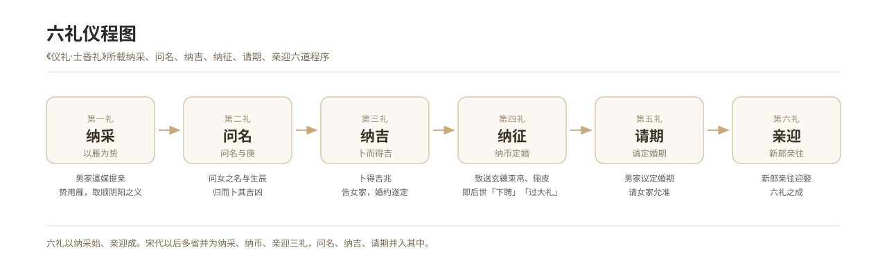

# 六礼源流与《仪礼·士昏礼》

*图 1　六礼（纳采—问名—纳吉—纳征—请期—亲迎）程次示意图。*

## 一、释义

本条通考六礼的文本依据、适用等级与诠释史，以《仪礼·士昏礼》为核心材料，说明六礼不是一部「成文法典」，而是一套记录士人阶层婚礼程序的礼仪文本，其形成、定名与解释均有历史层次。

## 二、历史源流

### 文本

- 《仪礼》十七篇，其中《士昏礼》是现存最早、最完整的婚礼仪节记录，全篇记「纳采—问名—纳吉—纳征—请期—亲迎」六道程序，并附「妇见舅姑」「醴妇」「飨送者」等婚后仪节。
- 《礼记·昏义》为义理阐释，提出「昏礼者，将合二姓之好，上以事宗庙，而下以继后世也」，并论「六礼」的伦理意义。
- 《周礼·地官·媒氏》记官媒职能，属制度层面的材料，与《仪礼》的仪式层面互补。

### 「六礼」之名何时成立

- 《仪礼》原文并未以「六礼」为名统称六道程序，各节径称纳采、问名等。
- 「六礼」作为固定称谓，见于汉以后礼书（如《白虎通·嫁娶》相关论述）与注疏传统。

### 适用等级

- 《士昏礼》所记为士人之礼。天子、诸侯、大夫另有其制：《周礼》记天子聘礼用谷圭，《礼记》记诸侯嫁女有媵从之制。
- 礼制上的等级差异主要体现在「礼数」与「器物」的规格，而非程序的有无。

### 主要争议

1. **纳采与问名是否一礼**：郑玄注主张分别为二；部分礼家认为实为一次奉命、两节仪节。
2. **「雁」的使用次数**：礼经于纳采、问名、纳吉、请期、亲迎皆言「用雁」，但雁难得，历代多容许代物。
3. **「御妇车」的解释**：亲迎时新郎为妇驾车，一说为亲爱之义，一说为古俗遗迹。
4. **请期抑或告期**：宋以后礼书改为「告期」，反映男家主婚的现实。

## 三、仪节流程

六礼的整体结构如下（详见各分条）：

| 次序 | 礼目 | 施行者 | 核心动作 | 关键器物 |
| --- | --- | --- | --- | --- |
| 一 | 纳采 | 使者（宾） | 提亲、受允 | 雁 |
| 二 | 问名 | 使者 | 问名与生辰 | 雁 |
| 三 | 纳吉 | 使者 | 以吉相告，婚姻定 | 雁 |
| 四 | 纳征 | 使者 | 纳币成婚 | 玄纁束帛、俪皮 |
| 五 | 请期 | 使者 | 请定婚期 | 雁 |
| 六 | 亲迎 | 新郎 | 亲往迎娶 | 墨车、雁、烛 |

前五礼由使者代行，第六礼由新郎亲行——这一结构安排本身就是礼义所在。

## 四、地域与民族变体

六礼在汉人社会下渗为「提亲—合婚—下定—送日子—迎娶」的民俗链条，环节名称地域差异极大，但结构大体对应「议、定、聘、期、娶」五段。详见「汉族各地域婚俗变体」各条。

## 五、器物与文书

- 《仪礼·士昏礼》郑玄注、贾公彦疏：经学解释的奠基文献。
- 礼图与「昏礼陈器图」：宋聂崇义《新定三礼图》等，为仪节的空间复原提供依据。
- 历代礼书：《大唐开元礼》《政和五礼新仪》《朱子家礼》《明集礼》《大清通礼》。

## 六、文献与参考

- 《仪礼·士昏礼》（郑玄注、贾公彦疏）
- 《礼记·昏义》
- 《周礼·地官·媒氏》
- 《新定三礼图》（宋·聂崇义）
- 彭林：《仪礼》全译与研究，中华书局
- 杨宽：《古史新探·「亲迎」礼新探》
- 陈鹏：《中国婚姻史稿》，中华书局
- 日·滋贺秀三：《中国家族法原理》
