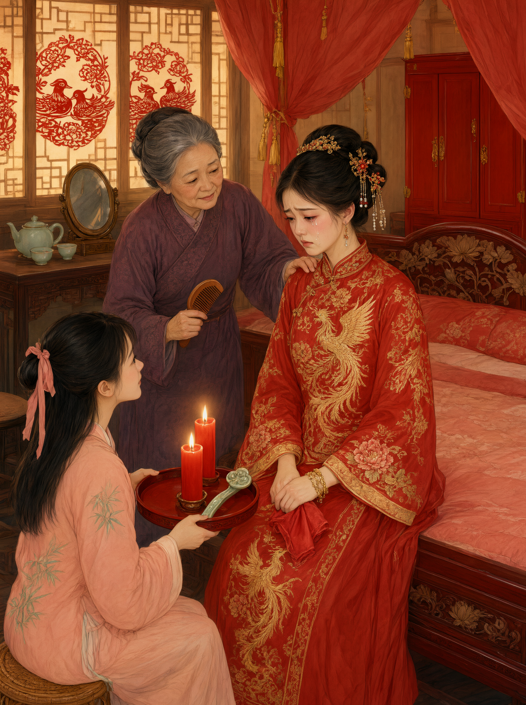

# 哭嫁

## 一、释义

哭嫁，是女子出嫁前（及上轿时）以哭泣与歌唱的方式表达离别之情的习俗。其哭泣是**礼俗规定的哭**，不是失态：不哭反被视为不祥（「不哭不热闹」「不哭不发家」）。

哭嫁的唱词称「哭嫁歌」「哭嫁调」「哭歌」，有固定的句式、韵律与内容结构，是口传文学的重要类型。

## 二、历史源流

- 「哭嫁」的早期形态与「婚嫁之悲」的观念有关：古礼以「嫁女之家，三夜不息烛」（《礼记·曾子问》）表达离别之痛。
- 《礼记·曾子问》记孔子语：「嫁女之家，三夜不息烛，思相离也。」是哭嫁情感基础的最早文本依据。
- 唐宋以后「哭嫁」在南方尤盛。明清方志中大量记载各地哭嫁之俗。
- 哭嫁的分布以**土家、苗、侗、壮、瑶、彝、哈尼、藏（部分地区）**及汉族南方各省（湘、鄂、川、黔、桂、粤）为主，北方也有但相对简略。
- 当代在部分农村地区仍有保留，并成为非物质文化遗产保护的对象。

## 三、仪节流程

哭嫁贯穿婚前的多个环节，可分为几个「哭点」：

1. **备嫁哭**：定亲或婚期确定后开始，日常哭唱，内容多为对娘家生活的眷恋。
2. **上头哭**：上头之夜哭，内容转为对父母养育之恩的感念。
3. **辞祖哭**：拜别祖先时哭。
4. **辞亲哭**：向父母、兄妹、嫂子辞别，逐一哭唱（「哭爹娘」「哭哥嫂」「哭姊妹」）。
5. **上轿哭**：上轿（车）时哭，母女相哭，是全过程中情感最激烈的一段。
6. **哭别乡邻**：沿途告别邻里，有的地方邻居也以哭相应。

### 唱词结构

- 起句多为呼号（如「我的爹呀我的娘」）。
- 中段为叙事与抒情：回忆娘家的生活、感谢父母的养育、嘱托兄嫂照顾双亲。
- 结尾多为祝颂与告别。
- 讲究押韵、比兴，善哭者能即兴编词，被乡里称为「哭得好」。

## 四、地域与民族变体

- **土家族**：哭嫁歌最发达，有完整的「哭嫁歌」套曲（如《哭爹娘》《哭媒人》《哭上轿》），婚前十日乃至一月即开始「哭嫁」，并有陪哭、对哭（母女、姐妹、姑嫂对唱）之制。
- **湘鄂川黔汉族**：哭嫁歌多以「十月怀胎」为叙事框架，从怀胎、生育唱到出嫁。
- **客家**：称「哭嫁」「哭出门」，多在上轿时哭唱。
- **北方汉族**：多为上轿时的痛哭，无成套唱词。
- **少数民族**：苗、侗、壮、瑶、彝、哈尼等民族均有成体系的哭嫁歌，且常与「姑娘歌」「姊妹歌」连成一片，是族群口传文学的重要部分，须与汉族的哭嫁分别记录其曲调与内容。

## 五、器物与文书

- **无特定器物**：哭嫁以歌唱为核心。
- **手巾（哭帕）**：擦泪之用，常为女红用品。
- **哭嫁歌抄本**：部分地区的口头传唱在 20 世纪被记录成文，见于民间文学集成。
- **录音、记谱**：当代非遗调查的成果形式。

## 六、文献与参考

- 《礼记·曾子问》
- 《清稗类钞·婚姻类》
- 各省地方志·风俗志
- 《中国民间歌曲集成》《中国歌谣集成》相关卷
- 关于土家族哭嫁歌的专题研究
