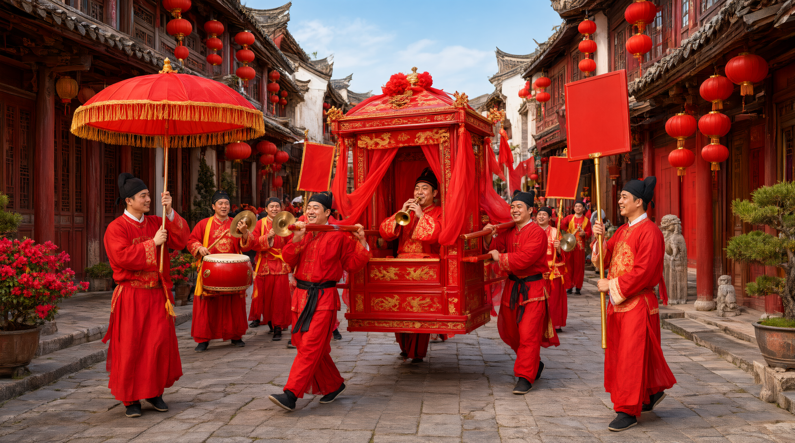

# 亲迎与迎娶仪仗

## 一、释义

本条记亲迎在**民俗层面**的展开形态——迎亲队伍的组成、仪仗序列、行进路线与时辰禁忌。

与「先秦六礼／亲迎」条的分别：后者据《仪礼·士昏礼》，记的是新郎独自乘车、奠雁而返的礼经仪节；本条记的是唐宋以后形成的「一支队伍在路上行走」的民俗形态。**礼经的亲迎重在「亲」，民俗的亲迎重在「仪仗」。**

## 二、历史源流

- 《仪礼·士昏礼》：「从车二乘，执烛前马。」这是最初的仪仗雏形——有从车、有执烛前导。
- 唐宋迎娶用花担子、鼓乐，宋《东京梦华录·娶妇》记迎娶时有「引迎花担子」「作乐」。
- 明清迎娶用「执事」（旗、牌、伞、扇、金瓜、钺斧）与鼓乐班子，规模视家境而定，其形制直接借用官宦仪仗，故有「僭越」之嫌，民间屡禁不止。
- 近代人力车、花车取代花轿，仪仗简化，但「放炮」「绕路」「撒喜钱」等俗保留。
- 当代接亲车队取代迎亲队伍，仪仗转化为车队排序、贴喜字、挂红绸。

## 三、仪节流程

1. **告庙**：出发前祭告祖先（部分家族）。
2. **集合**：知客（或大妗姐）点齐人员、器什，鸣炮出发。
3. **仪仗序列**（传统序次）：鼓乐前导 → 旗牌伞扇等执事 → 花轿（居中）→ 送亲、抬妆奁者随后。
4. **路线禁忌**：忌走回头路（来去不同路）；忌经过庙、祠堂、坟地；遇桥、井、石狮须放炮或撒喜钱（「压邪」）。
5. **至女家**：放炮报信，队伍列于门外。
6. **返程**：新妇上轿（车）后起轿，「回程不走原路」之俗多仍保留。
7. **至男家**：落轿（停车），由喜娘搀扶入门。

## 四、地域与民族变体

- **华北**：锣鼓唢呐前导，队伍讲究「长、红、响」；北京旧以杠房、棚铺承办执事。
- **江南**：水乡用「花船」迎娶，船头挂红、插彩旗，锣鼓相随。
- **闽台**：由大妗姐领队，队伍中必带「谢篮」（盛礼饼、香烛）。
- **广东**：车队贴喜字、扎彩球，讲究「去单回双」。
- **少数民族**：苗族、侗族迎亲有「拦门酒」「对歌」迎候；彝族有「背新娘」；壮族迎亲队有对歌。仪仗形态与汉族不同，多以歌声与酒代替鼓乐与执事。

## 五、器物与文书

- **花轿／花车**：迎娶主体。
- **执事**：旗、牌、伞、扇等仪仗器物。
- **锣鼓唢呐班子**：鼓乐。
- **鞭炮、喜钱（硬币、红纸）**：沿途撒放。
- **红绸、喜联、彩球**：车辆与轿子的装饰。
- **迎亲帖／礼单**：与队伍同行的文书。

## 六、文献与参考

- 《仪礼·士昏礼》
- 《东京梦华录·娶妇》《梦粱录·嫁娶》
- 《清稗类钞·婚姻类》
- 各省地方志·风俗志
