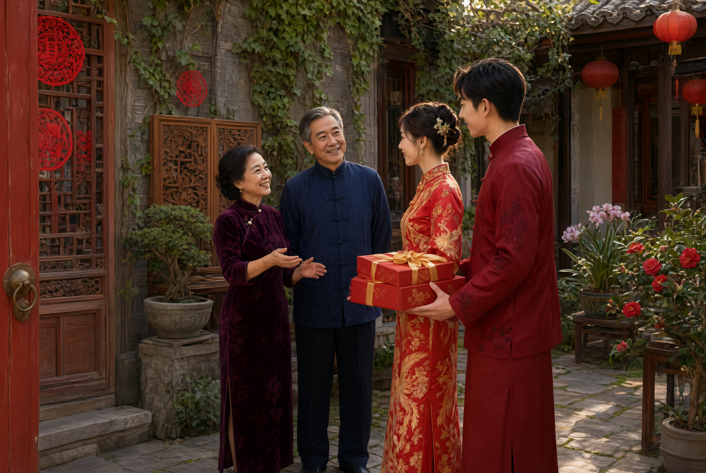

# 回门（归宁）

## 一、释义

回门，又称「归宁」「回娘家」，是新婚夫妇婚后返回女家省亲之礼。

**与「三日回门」条的界限**：本条属婚礼链条的收尾环节，重在归宁之礼的源流、行程与仪节；「婚后礼俗／三日回门」条则专记婚后第三日回门在各地形成的类型差异与后续衍生习俗（双回门、住对月等）。

## 二、历史源流

- 《诗经·周南·葛覃》：「害澣害否，归宁父母。」「归宁」二字出此，为女子回娘家省亲的早期表述。
- 《仪礼·士昏礼》记婚后「妇入三月，然后祭行」，与之相连的是新妇与娘家的往来制度。
- 唐代「归宁」有明确礼制，《唐会要》载公主归宁之制，民间亦以「回门」称之。
- 宋以后「三日回门」「七日回门」成为通例，具体日数因地而异（一日、三日、六日、九日、满月皆有）。
- 回门是**婚姻双边性的体现**：既确立新妇在夫家的身份，也维持其与娘家的联系。旧时也有「回门不许住夜」（部分地区）或「住对月」（另一部分）两种相反的俗制，反映各地对「归」的尺度把握不同。

## 三、仪节流程

1. **择日**：婚后择定回门之日，各地有一日、三日、六日、九日、满月等不同。
2. **备礼**：夫妇携礼回女家，礼品成双（酒、肉、糕点、糖），讲究「不空手」。
3. **至门**：女家鸣炮迎接，女家晚辈出门相迎。
4. **拜见**：夫妇拜见女家父母及尊长。
5. **设宴**：女家设宴款待，称为「回门酒」。
6. **当日返回**（多数地区）：日落前返回夫家，俗谓「不看见娘家的灯」。
7. **住对月**（部分地区）：新妇留住娘家一月或数日，夫家不得催促。
8. **谢礼**：女家回赠礼物（多为食品、用品），带归夫家。

## 四、地域与民族变体

- **华北**：称「回门」，多在婚后三日；讲究「去时夫妻同往，回时夫妻同回」。
- **江浙**：称「回门」「望朝」，有「三日回门、六日望朝」之说。
- **闽台**：称「作客」「回门」，礼数隆重，女家须备「回礼篮」。
- **广东**：称「回门」，女家设「回门宴」，宴请新女婿。
- **少数民族**：部分民族有婚后新妇返娘家小住之制（如「不落夫家」），时间可长达数年，与汉族「当日往返」的回门在性质上根本不同；彝族、苗族等亦各有「回门」称谓与仪节。详见各民族条目。

## 五、器物与文书

- **回门礼**：酒、肉、糕点、糖、果品，须成双。
- **回礼篮（礼担）**：盛礼之器。
- **回门宴席**：女家设宴。
- **新女婿的礼物**：部分地区新女婿另备给岳家晚辈的见面礼。

## 六、文献与参考

- 《诗经·周南·葛覃》
- 《仪礼·士昏礼》
- 《唐会要》相关条目
- 《清稗类钞·婚姻类》
- 各省地方志·风俗志
