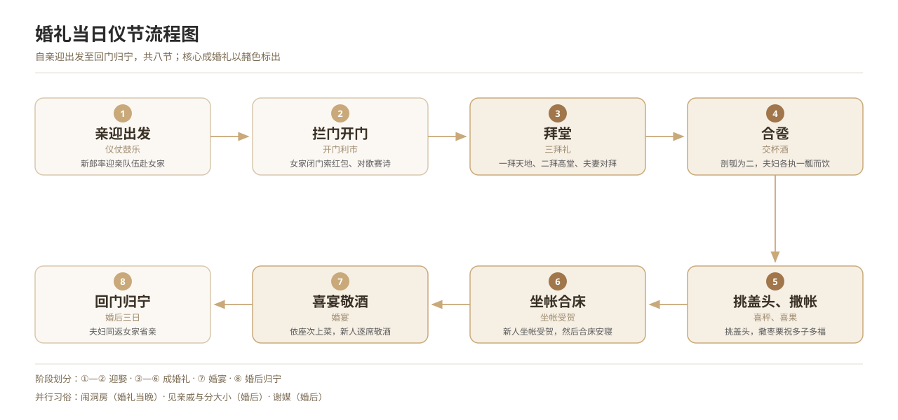

# 现代中式婚礼流程整合

*图 2　婚礼当日仪节流程：迎娶—拜堂—合卺—喜宴—洞房—见亲。*

## 一、释义

「现代中式婚礼」是 21 世纪以来流行的、以传统仪节为素材重新编排的婚礼形式，通常参照《仪礼·士昏礼》与明制婚礼进行复原，但为**表演性重构**：仪节被保留、被简化，也被重新创造。

本条目汇总其通行流程，并标注每一环节的传统来源与改造之处，供对比研究使用。

## 二、历史源流

- **1990 年代**：婚庆行业兴起，「中式婚礼」「西式婚礼」成为可选风格，中式婚礼多为「凤冠霞帔＋花轿道具」的混合形态。
- **2010 年代**：汉服运动与传统文化复兴推动「汉式婚礼」出现，开始按礼书复原仪节（三揖三让、同牢合卺、结发）。
- **同时**：非遗保护将若干地方婚俗（如浙江宁海「十里红妆」、福建「惠安女婚俗」）列入名录，推动地方性婚俗的恢复。
- **当代**：婚礼形式呈现三种并存——西式（钻戒、证婚、香槟塔）、中式（拜堂、合卺、结发）、混合式（接亲按中式，仪式按西式）。

## 三、仪节流程

一条较完整的当代中式婚礼仪程：

1. **告祖**：新郎出门前祭告祖先（「告庙」）。
2. **迎娶**：接亲队伍出发，行「拦门」「找婚鞋」之戏。
3. **别亲**：新娘拜别父母，母亲为女「系带」，新娘「哭嫁」。
4. **上轿／上车**：入轿（车），「去时不走回头路」。
5. **入门**：至夫家，行「跨火盆」「踩瓦片」（部分地区）。
6. **拜堂**：一拜天地、二拜高堂、夫妻对拜。
7. **同牢合卺**：共食一席，行交杯酒之礼。
8. **结发**：各剪发一缕，以红绳相绾，纳于锦囊。
9. **拜谢来宾**：新人向宾客行礼致谢。
10. **入洞房**：坐帐、撒帐。
11. **敬茶改口**：向双方父母敬茶，改口称「爸、妈」（多与拜堂合并）。
12. **喜宴敬酒**：入席敬酒，宴散。

### 与传统流程的差异

| 传统（《仪礼》以降） | 现代中式婚礼 |
| --- | --- |
| 庙见在婚后三月，见舅姑在次日 | 多合并入婚礼当日 |
| 亲迎在黄昏（「初昏」） | 多在上午 |
| 六礼分阶段进行，历时数月 | 压缩至一日 |
| 合卺用半瓢（卺） | 用双联杯、玻璃杯 |
| 无「证婚」「交换戒指」 | 中西合璧，并存 |

## 四、地域与民族变体

- **各城市**：婚庆公司套路不一，多依地方习惯与新人偏好调整。
- **非遗型地方婚俗**：部分地区按传统仪轨办婚礼，如浙江「十里红妆」（嫁妆队伍的复原展示）、闽南「古礼婚礼」。
- **少数民族**：各民族在当代亦有「民族婚礼」的恢复实践，如蒙古族草原婚礼、藏族传统婚礼、苗族「姊妹节」集体婚礼等，其复原依据是本民族的习俗而非汉礼，应注意区分，不可混为一谈。

## 五、器物与文书

- **汉服、凤冠霞帔、裙褂**：婚服。
- **香案、天地桌、赞礼唱本**。
- **合卺杯、红盖头、喜秤、剪刀与红绳**（结发用）。
- **婚书（当代版）**：部分婚礼设「签婚书」环节，仿古婚书格式。
- **婚礼流程单**：婚庆公司提供的仪程表。

## 六、文献与参考

- 《仪礼·士昏礼》
- 《朱子家礼·昏礼》
- 国家级非物质文化遗产代表性项目名录（民俗类）
- 当代婚礼仪式研究与社会学调查文献
