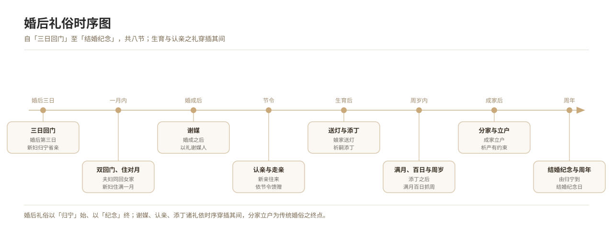

# 三日回门

*图 3　婚后礼俗时序：回门—谢媒—送灯—满月百日—认亲走亲—分家立户。*

## 一、释义

「回门」又称「归宁」「双回门」「回娘家」，指**新婚之后新妇（或夫妇同往）回娘家省亲**之礼。通行的时间节点是婚后第三日，故称「三日回门」（亦有二日、四日、七日之别）。

**要义**：
- 回门是婚礼的**收束之礼**——「娶进门」之后，新妇以「客」的身份重回娘家，完成身份转换的仪式性确认。
- 「**双回门**」指夫妇同去；「**单回门**」指新妇独归（部分地区）。
- 回门有**规矩**：须于当日或次日返回夫家，忌在娘家留宿（部分地区忌过夜，取「不空房」之意）。

## 二、历史源流

- **先秦**：《仪礼·士昏礼》有「妇见舅姑」「舅姑飨妇」诸节，为婚后礼的开端；「归宁」之礼见于《诗经》（「归宁父母」）。
- **唐宋以降**：归宁之俗普及，方志多记「三日回门」「七日回门」。
- **明清**：回门仪节定型，礼物、礼数有定规（明清地方志「风俗」门多载）。
- **当代**：城乡普遍保留「回门」（称「回门」「回娘家」「住娘家」），时间以三日或次日为主。

## 三、仪节流程

1. **备礼**：夫家备回门礼，常见为糕点、酒、肉、糖、果品（成双为吉）。
2. **归宁**：夫妇（或新妇）于婚后三日回娘家，向父母行礼。
3. **宴请**：娘家设宴，请近亲作陪（称「回门宴」「会亲」）。
4. **赠礼**：娘家回赠衣物、鞋袜、食品等「回礼」。
5. **返回**：当日或次日返回夫家，忌在娘家过夜（部分地区）。

## 四、地域与民族变体

- **华北**：多为「三日回门」，新妇当日返夫家，不然有「空房」之忌。
- **江南**：称「回门」，礼数讲究，回礼以食品、衣料为多。
- **闽台**：称「返外家」或「做客」，礼数隆重，有的在婚后二日。
- **广东**：称「回门」或「三朝回门」，以烧猪回门为著名礼俗（另见「烧猪礼」）。
- **少数民族**：部分民族的婚后归宁时间与规格不同（如行「不落夫家」婚俗的民族，归宁期长），不属汉族回门之礼，须分别记录。

## 五、器物与文书

- **回门礼**：糕饼、酒、肉、糖、果品（成双）。
- **回礼**：衣料、鞋袜、食品、红包。
- **相关文书**：礼单（回门礼单）、请柬（回门宴）。

## 六、文献与参考

- 《仪礼·士昏礼》
- 《诗经·周南·葛覃》等
- 各省地方志·风俗志
- 民俗田野调查资料
