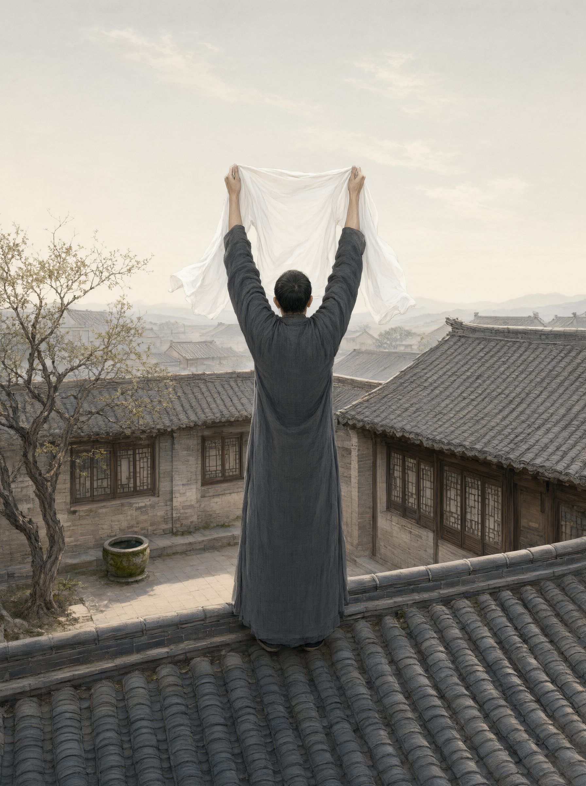

# 复礼（招魂复魄）

## 一、释义

「复」，即招魂。人初死，亲属持死者之上衣登屋（或登高），面北呼唤死者之名三声，然后将衣掷下，覆于尸身，冀其魂魄归来而复生。

复礼是**丧礼真正意义上的第一道程序**。《仪礼·士丧礼》以「复」开篇，是因为人死之初，礼义上尚不承认其死，须先「尽爱之道」——把能做的挽救做尽，而后才进入正式的丧礼。复而不生，方始办丧。

## 二、历史源流

- 《仪礼·士丧礼》：「复者一人，以爵弁服，簪裳于衣，左何之，扱领于带，升自前东荣，中屋，北面招以衣，曰『皋某复』，三，降衣于前。受以篚，升自阼阶，以衣尸。」此段明文规定了复礼的全部动作。
- 《礼记·檀弓下》释其义：「复，尽爱之道也，有祷祠之心焉。望反诸幽，求诸鬼神之道也。」又云：「北面，求诸幽之义也。」
- 《礼记·丧大记》记复者的等级差别：天子「复之以冕服」，诸侯、大夫、士各有其服，等级由所复之衣体现。
- 楚地招魂之风尤盛，《楚辞·招魂》《大招》即招魂词的文学化，可与《仪礼》的仪式互证。
- 后世演变：屋上招魂在民间演为「叫魂」「喊魂」；「衣」演为「招魂幡」「引魂幡」；「皋某复」的呼名方式演为高声呼喊死者称呼。
- 因登屋招魂在实际操作中困难且危险，宋代以后多改为在庭院搭梯（或举「魂帛」）行之。

## 三、仪节流程

1. **备衣**：取死者生前祭服（士用爵弁服），将上衣与下裳连缀，以簪固定。
2. **执衣**：复者将衣搭于左肩，把衣领插入腰带，便于登高与挥动。
3. **登屋**：复者从堂前东面的屋檐（前东荣）登屋，走到屋脊正中。
4. **招魂**：面北以衣招之，高呼「皋——某（死者名）——复」，连呼三声。「皋」为长声呼号之词。
5. **降衣**：将衣从屋上掷下。
6. **承衣**：堂下有人持「篚」（竹器）承接。
7. **覆尸**：从阼阶（东阶，主人之位）升堂，以所招之衣覆于尸上。
8. **决断**：复而不醒，乃行沐浴、饭含等后续仪节。

## 四、地域与民族变体

- **北方**：称「叫魂」，多由孝子登梯上房（或站上凳、桌）面向北方呼喊「×××回来吧」。
- **江浙**：称「招魂」「喊魂」，兼有请道士或僧人诵经招魂之俗。
- **闽台**：称「叫脚尾」，并设「魂帛」「招魂幡」；道教「招魂」科仪在此地尤为常见。
- **湖南、湖北（楚地）**：招魂习俗与《楚辞》文本形成呼应，部分地区仍有唱招魂歌之俗。
- **少数民族**：纳西族有《挽歌》与「招魂」仪式，由东巴主持；苗族、瑶族、彝族均有本民族的招魂古歌与专门的送魂路线（「指路歌」），把亡魂送回祖先故地，这一功能与汉族的复礼不同——前者是「送回」，后者是「召回」，属两种灵魂观。

## 五、器物与文书

- **复衣**：死者祭服，等级有别。
- **篚**：承接复衣的竹器。
- **招魂幡／引魂幡**：后世的替代物，以纸、布制成，写死者姓名、生卒。
- **魂帛**：宋代以后以帛书死者姓名以代「重」，作为神灵凭依。
- **梯、凳**：民间登高代屋之具。

## 六、文献与参考

- 《仪礼·士丧礼》
- 《礼记·丧大记》《礼记·檀弓下》
- 《楚辞·招魂》《楚辞·大招》
- 《朱子家礼·丧礼》
- 江绍原：《发须爪》
- 林惠祥：《文化人类学》关于灵魂观的章节
