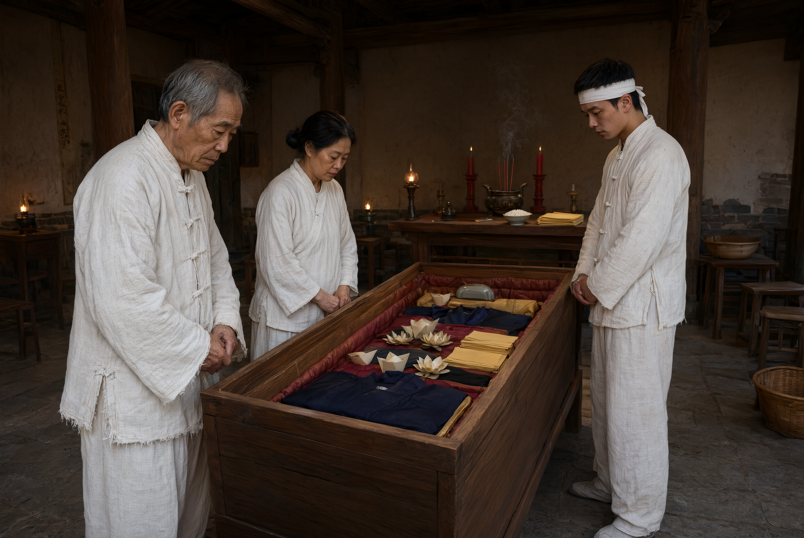

# 大殓

## 一、释义

大殓，又称「入棺」「入木」「入殓」，是小殓之次日（士礼）将尸体举入棺中、加盖成殡之礼。

大殓是丧礼的第一个重大分界：**入棺之后，死者与生者永隔，亲属的哭不再对着「人」而是对着「棺」。** 因此大殓的哭踊最为激烈，《仪礼》记「主人哭踊无算」（哭踊的次数已无从计算，即痛哭到极处）。

## 二、历史源流

- 《仪礼·士丧礼》：「厥明，陈衣于房……乃大殓。」大殓的时间为小殓之次日。
- 大殓的衣数依等级：士三十称，大夫五十称，君百称（各本略有差异）。
- 《礼记·丧大记》记大殓时「举尸迁于棺」，「棺入自西阶」，并有「殡」的方位规定。
- 大殓之后「殡」——即停棺待葬，「殡」的期限依等级：天子七月、诸侯五月、大夫三月、士逾月（《礼记·王制》）。
- 《朱子家礼》将大殓的时间压缩至死后三日，并把「殡」与「灵堂」结合，成为后世「停灵」制度的直接来源。
- 民间「入殓」即大殓，多定于死后第三日（「三日入殓」），至今通行。

## 三、仪节流程

1. **陈衣**：大殓之衣按等级陈设于房。
2. **备棺**：备棺，棺内铺垫（灰、木炭、灯心草、绸布），并置随葬之物。
3. **举尸**：由丧主与亲属、执事者将尸体从床（或小殓床）举入棺内，头朝北（或依方位）。
4. **加衣填实**：将大殓之衣覆盖、填塞于尸体四周（「实」，即填实空隙），使棺内稳定。
5. **加饰**：盖棺内之被、加棺内装饰。
6. **哭踊**：举尸入棺时，亲属哭踊（「主人哭踊无算」）。
7. **加盖**：暂不加钉，待亲属最后告别（部分地区保留到出殡前才钉棺）。
8. **设奠**：设大殓之奠。
9. **成服**：大殓之后，亲属按服制正式成服（穿丧服），见「丧服规制」各条。

## 四、地域与民族变体

- **华北**：称「入殓」「入木」，多在死后三日；入殓时亲属须回避生肖相冲者。
- **江南**：称「入殓」「收殓」，讲究「时辰」，入殓前后放炮、哭灵。
- **闽台**：称「入殓」「入木」，讲究「时辰」与「方位」，由「土公」协助。
- **部分地区**：入殓时不许人哭（「哭则尸不宁」）或必须大哭，两种相反的俗信并存，说明此类禁忌的地方性极强。
- **少数民族**：多数民族无「棺」的制度或棺制不同。苗族、彝族等有棺者，其入殓时辰与仪轨受本民族信仰制约；藏族天葬以遗体直接供鹫，无入殓；回族、维吾尔族以白布裹身直接入土。**「入殓」是汉族棺葬制度的产物，不能作为普适的丧礼阶段。**

## 五、器物与文书

- **棺**：核心器物，详见「棺椁形制与选材」条。
- **大殓之衣**：按等级。
- **棺内铺垫**：灰、木炭、灯心草、绸布——有防潮、防腐之意。
- **随葬品**：生前用品、明器。
- **奠席、酒食**。
- **丧服**：成服所用。

## 六、文献与参考

- 《仪礼·士丧礼》（郑玄注）
- 《礼记·丧大记》《礼记·王制》
- 《书仪》（宋·司马光）
- 《朱子家礼·丧礼》
- 各省地方志·丧葬志
