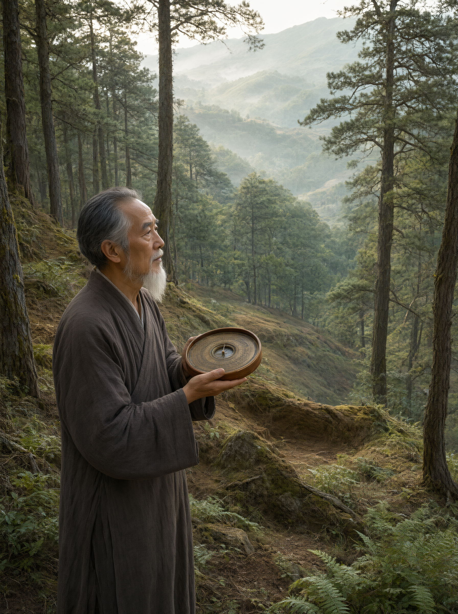

# 墓地选择与阴宅堪舆

## 一、释义

阴宅堪舆（相墓、看风水），是依传统堪舆学说选择墓地位置与坐向的方术。

堪舆分两大流派：

- **形势派（江西派）**：以观察山川形势为主，讲究「龙、穴、砂、水、向」的配合，追求「藏风聚气」。
- **理气派（福建派）**：以罗盘分金、八卦九星、干支理气为主，讲究「坐度」与「水法」的推算。

两者实际操作中常结合使用。

（本条目作民俗与方术的记录，**不作科学主张**；风水观念在传统社会中具有实际的选址、规划与环境经验成分，须作批判性的历史理解。）

## 二、历史源流

- 风水之说在汉代已有雏形，魏晋以后成型。**《葬书》**（旧题晋·郭璞撰，实为唐宋以后的作品）是阴宅理论的总结性文献，提出「葬者，乘生气也」「气乘风则散，界水则止」等核心命题。
- 唐宋以后堪舆术大盛，形成为专业行业（「地理先生」「风水先生」）。
- 明清是相墓的鼎盛期，**《地理五诀》**（清·赵九峰）等书籍把「龙穴砂水向」的操作系统化。
- 历代有反风水的言论（如东汉王充《论衡》对「葬历」「讳忌」的批判），也有「停丧不葬，以求吉地」的社会问题——因择地过久而不葬，是明清时期的严重弊病。
- 当代农村仍普遍相墓，城市公墓则以规划代替相地。

## 三、仪节流程

### 相地（形势）

1. **寻龙**：观察山势（龙脉）的来去起伏，寻找结穴之处。
2. **察砂**：观察穴地周围的砂山（前后左右的山），讲究「青龙、白虎、朱雀、玄武」四神砂的配置。
3. **观水**：观察水流方向与聚散，讲究「水聚则气聚」「水抱为吉」。
4. **点穴**：在结穴处确定具体下棺的位置。
5. **立向**：确定墓穴的坐向（详见「点穴定向与分金」条）。

### 避忌（「十不葬」等）

常见的避忌原则（各书所列略有不同）：

1. 不葬急流冲激之地；
2. 不葬孤峰独耸、无遮无护之处；
3. 不葬草木不生、石砾裸露之地；
4. 不葬穴后无靠（无靠山）；
5. 不葬穴前无明堂（无开阔处）；
6. 不葬水流直冲或反跳（「水去不顾」）；
7. 不葬昔为战场、刑场、屠场之地；
8. 不葬旧有祠庙、废寺之基；
9. 不葬泥泞积水、草木腐朽之地；
10. 不葬被人畜践踏的通道。

## 四、地域与民族变体

- **江西、福建**：堪舆传统最盛，形势派（赣派）与理气派（闽派）的发源地，从业者众多。
- **广东、福建沿海**：讲究「水法」与「向」，重视朝案。
- **华北**：讲究「后靠山、前开阔」，相地较为简明。
- **少数民族**：藏族选择天葬台有宗教性考量（如面向某神山），不作风水推算；彝族等有本族的择地方式（占卜决定）；苗族的坟地选择依族规与占卜。**各民族择地逻辑不同，须分别记录。**

## 五、器物与文书

- **罗盘（罗经）**：定坐向的核心器具，分三合盘、三元盘等。
- **风水书籍**：《葬书》《地理五诀》《阳宅三要》等。
- **地契、买地券**：墓地的书面凭证。
- **族谱中的墓图**：家族墓地位置图。

## 六、文献与参考

- 《葬书》（旧题晋·郭璞）
- 《地理五诀》（清·赵九峰）
- 《清稗类钞·方术类》
- 王充：《论衡》（对葬历讳忌的批判）
- 各省地方志·风俗志
