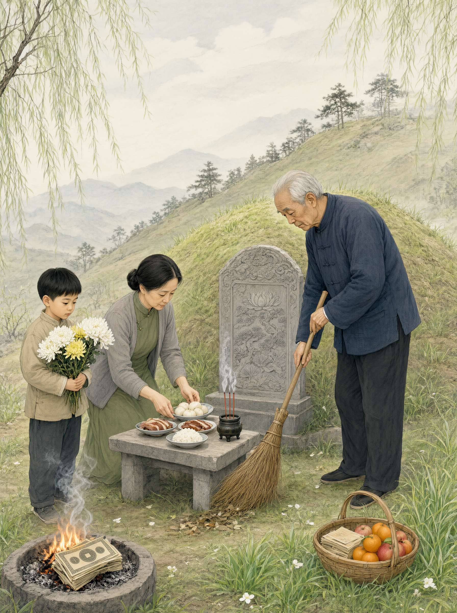

# 清明扫墓

## 一、释义

清明扫墓（上坟、拜山、祭扫），是清明时节到祖先墓前除草、培土、设供、焚纸的祭祀活动。

它是岁时祭祖体系中最普及的一种，且具有公共性：**不限于一姓一家，而成为全社会性的祭扫活动**。2006 年，清明节被列入第一批国家级非物质文化遗产名录；2008 年起成为法定假日。

## 二、历史源流

- **寒食与清明的合流**：
  - 寒食节在冬至后一百零五日，旧俗禁火、吃冷食，相传与纪念介子推有关（《荆楚岁时记》等有载）。
  - 清明节为二十四节气之一，时在春分后十五日。
  - 唐代寒食扫墓已成风俗（《唐会要》载开元年间「寒食上墓」之诏，因民间拜扫成俗，朝廷从而承认）。
  - 因寒食与清明日期相近，唐宋以后二者逐渐合流，「清明扫墓」成为通称。
- **上古已有墓祭**：《周礼·春官·冢人》「祭墓为尸」记墓祭之职，说明墓祭起源甚早。
- **「纸钱挂树」与「培土」**：扫墓的两种基本动作——「挂纸」（以白纸压在坟头）与「培土」（添土修坟）——在明清方志中记载普遍。
- **地域差异**：南方多在清明当日扫墓（「拜正清」），部分地区在清明前后十日、或上巳（三月三）扫墓；广东、广西某些地区在重阳（九月九）扫墓；闽南在「三月节」。
- 当代扫墓形式多元：亲往扫墓、委托代祭、网上祭扫。

## 三、仪节流程

1. **择日**：清明当日或前后数日（各地规定不同）。
2. **备物**：备香烛、供品（酒、果、糕点，有的备「三牲」）、纸钱、白纸（挂纸用）、除草工具。
3. **至墓**：全家（或家族）至墓地。
4. **除草培土**：清除坟上杂草，添土修补坟头与坟圈。
5. **挂纸**：以白纸（或五色纸）压在坟头、坟圈上，称为「挂纸」「压纸」「标墓」。这是**扫墓最有标识性的动作**，用以表示此坟有后人祭扫。
6. **摆供**：在墓前摆供品，摆杯盏。
7. **上香跪拜**：依辈分长幼依次上香、跪拜（或鞠躬）。
8. **奠酒**：酹酒于地。
9. **焚纸**：焚化纸钱、纸扎（当代提倡以鲜花代替纸钱，防火与环保）。
10. **修整墓碑**：擦拭碑文、补描碑字。
11. **返程**：收拾供品，部分留于坟前。

## 四、地域与民族变体

- **华北**：称「上坟」，讲究「清明上坟不过午」，供品以糕点、水果为主。
- **江南**：称「扫墓」「上坟」，讲究「青团」（艾草糕）为必备供品。
- **闽台**：称「拜山」「扫墓」，讲究「挂纸」，供品备「润饼」；清明节前后「培墓」。
- **广东**：称「拜山」，多在清明前后十日或重阳；供品有烧猪，讲究「太公分猪肉」（族产祭祖后分肉）。
- **广西部分地区**：三月三（上巳）扫墓。
- **少数民族**：部分民族在清明亦有祭祖，但更多民族有自己的祭祖节日（详见「少数民族丧葬习俗」与各族条目）。清明祭扫以汉族及受汉文化影响的民族为主。

## 五、器物与文书

- **白纸（挂纸）、五色纸**：标示祭扫。
- **香烛、供品、酒盏**。
- **纸钱、纸扎**。
- **除草工具**（锄、镰、筐）。
- **族谱、墓图**：查找墓位。
- **祭祖祝文**：部分地区宣读。

## 六、文献与参考

- 《荆楚岁时记》
- 《唐会要》（寒食上墓）
- 《周礼·春官·冢人》
- 《清稗类钞·丧祭类》
- 各省地方志·祭祀志
- 国家级非物质文化遗产名录（清明节）
