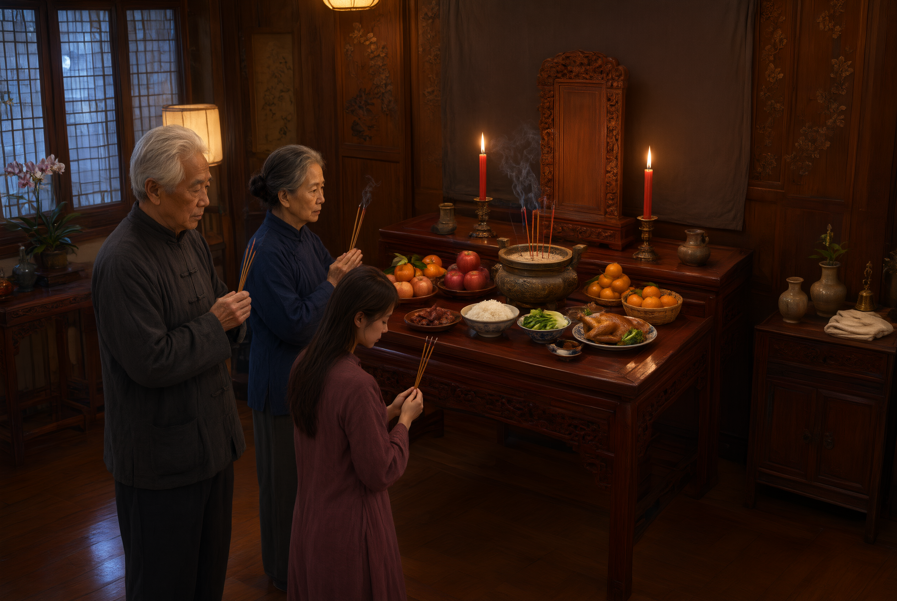

# 家庙与祠堂祭祀

## 一、释义

- **家庙**：依礼制设立的祭祀祖先的专所，其规制与等级挂钩（见「庙制与祭祖制度」条）。
- **祠堂**：明清以来民间（宗族）所建的祭祖场所，规模与规制取决于宗族实力，是宗族组织的物质载体与活动中心。

两者的区别在于：家庙是**礼制性**的（有庙数、庙主的等级规定），祠堂是**民间性**的（宗族合建，供奉始祖与历代祖先）。

## 二、历史源流

- 《礼记·王制》定庙制：「天子七庙，诸侯五庙，大夫三庙，士一庙，庶人祭于寝。」——庶人无庙，只能在家中（「寝」）祭祀，这是家庙制度的礼制起点。
- 宋代《朱子家礼》突破「庶人无庙」的限制，首创「祠堂」之制：在正寝之东建祠，供奉高祖以下四世祖先，为「四龛」之制。这是祠堂制度的直接来源。
- 明代允许民间建祠祭祖（嘉靖年间「大礼议」后，民间建祠之风大盛），祠堂在南方（闽粤、徽州、江浙）迅速普及，成为宗族的核心建筑。
- 清代的宗族发达，祠堂成为**宗族权力运作的中心**：不仅祭祀，还管族产（祠田、祭田）、族规、族学、调解纠纷、发放赈济。
- 近代以来宗族制度弱化，祠堂多改为他用（学校、仓库、民居）；当代部分地区修复祠堂，作为村史与文化活动场所。

## 三、仪节流程

### 祠堂的构成

1. **正厅（享堂）**：供奉祖先牌位的正厅，设神龛、神主（祖牌）。
2. **龛位**：始祖居中，历代祖先依昭穆次序排列。
3. **祭器**：香炉、烛台、供桌、簋、笾、豆等（视规制）。
4. **两厢**：藏族谱、碑记、族规。
5. **祠田（祭田）**：以田产收益供祭祀与族务开支。

### 祠祭（族祭）

1. **择日**：在春秋二祭（春分、秋分）或冬至、清明、祖先忌日举行（依族规）。
2. **清扫陈设**：提前清扫祠堂、陈设祭器、悬挂灯笼。
3. **摆供**：备三牲、酒、果、糕点，摆于供桌。
4. **击鼓鸣钟**：示意开始。
5. **就位**：族长（或宗子）主祭，各房子弟依辈分列位。
6. **迎神**：上香、跪拜，迎请祖先之灵。
7. **三献礼**：初献、亚献、终献（详见「儒礼家奠三献礼」条）。
8. **读祝文**：宣读族祭祝文，追述先祖德业，申明族规。
9. **颁胙（分肉）**：祭毕将祭肉分给族人（「颁胙」「分胙」），按功名、辈分、年龄分配，是宗族秩序的物质体现。
10. **唱名、议族事**：部分宗族在祠祭时宣读族谱、训诫族规、处理族务（如「祠堂议事」「鸣鼓告罪」）。
11. **撤馔、焚祝**：礼成。

## 四、地域与民族变体

- **闽粤**：祠堂制度最发达，一村一姓一祠，甚至一村多祠；祠祭与「太公分猪肉」之俗相配。
- **徽州**：宗族组织严密，祠堂规格高（如「宗祠」「支祠」「家祠」三级）。
- **江浙**：祠堂多与义庄（族产赈济机构）结合。
- **华北**：祠堂相对少见，多在家中设祖先牌位祭祀。
- **少数民族**：多数民族无「祠堂」制度。彝族有「祖灵筒」（存放祖先灵牌的神圣器物）与特定的祭祀场所；侗族的「鼓楼」「萨坛」有族群 ceremonial 功能；藏族有「佛龛」与家庙。**这些是本民族的信仰空间，与汉族的宗族祠堂不是同一制度。**

## 五、器物与文书

- **神龛、神主（祖牌）、公妈牌**。
- **香炉、烛台、供桌、祭器（簋、笾、豆）**。
- **祠田（祭田）契书**。
- **族谱（家谱、宗谱）**。
- **族规、祠规、碑记**。
- **族祭祝文**。
- **灯笼、鸣钟、鼓**。

## 六、文献与参考

- 《礼记·王制》
- 《朱子家礼·祭礼》（祠堂之制）
- 《明会典》相关记载（嘉靖大礼议与民间建祠）
- 《清稗类钞·丧祭类》
- 各省地方志·祭祀志
- 关于闽粤、徽州宗族与祠堂的研究（如弗里德曼《中国东南的宗族组织》）
