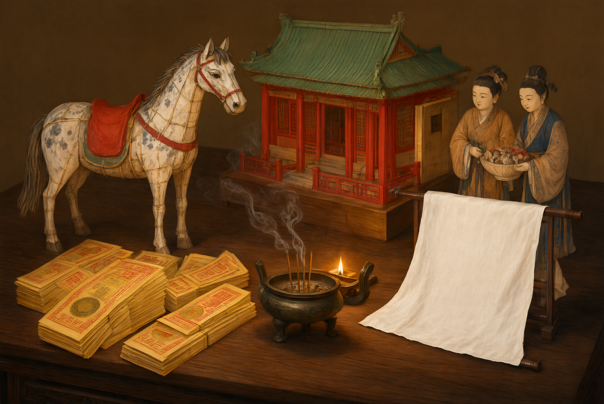

# 纸扎（纸人、纸马、纸屋）

## 一、释义

纸扎，又称「扎彩」「纸活」「纸码」「糊纸」，是以竹篾（或秫秸、铁丝）为骨架、外糊彩纸的**纸质明器**，为宋以后民间丧事中最普遍的明器形态。它取代了汉唐实物明器的地位，体现了「**以纸代物、以焚代埋**」的丧葬观念转变。

**常见品类**：

| 类别 | 例举 |
| --- | --- |
| 人物 | 纸人（童男童女、仆役、戏曲人物） |
| 走兽 | 纸马、纸牛、纸羊、纸鹿 |
| 居所 | 纸屋（纸厝）、纸楼、纸院落 |
| 用器 | 纸轿、纸车、纸船、纸箱、纸柜、纸电视机、纸手机 |

**礼义与争议**：纸扎被视作「事死如事生」的延伸，然历代亦有「焚纸扎伤财害俗」之批评（如明清地方官的禁约），近代移风易俗亦以禁烧纸扎为要目。

## 二、历史源流

- **基础条件**：东汉造纸术普及，为纸质明器提供可能；唐代已见以纸代钱的习俗。
- **唐宋**：《东京梦华录》《梦粱录》记汴京、临安丧事有「纸马铺」「纸扎」行业，焚化纸人、纸马、纸屋成风。
- **宋元明清**：纸扎业成为专门行业，品类随时代扩充（明清有纸轿、纸船、纸屋），技艺精进。
- **近代以来**：纸扎与城市化、殡葬改革相冲突，城市多禁烧，农村（尤以闽台、华北、江南）仍盛行。
- **当代**：纸扎出现「现代化」品类（纸汽车、纸别墅、纸手机），闽台「纸厝」工艺精细，被列入一些地方非物质文化遗产名录。

## 三、仪节流程

1. **订购或自制**：丧家向纸扎铺订购，报死者性别、年龄、随葬需要，匠人依样扎制。
2. **陈设**：纸扎陈于灵堂外或庭院，供亲友观览（称「摆纸」）。
3. **出殡前列队**：纸扎随送葬队伍而行，纸人纸马在前。
4. **焚烧**：在坟前、路口或指定焚化点焚化，有的讲究「三把火」「择时焚化」。
5. **回灵**：焚化后将纸扎灰烬处理，完成「送纸」仪节。

## 四、地域与民族变体

- **闽台**：纸扎工艺最精，「纸厝」（纸屋）体量大、结构可拆，含家具、电器；焚化称「烧厝」。
- **华北**：纸扎以纸人、纸马、纸车为主，出殡当日集中焚化。
- **江南**：纸扎相对简省，多以纸箱、纸柜为主，配锡箔元宝。
- **少数民族**：部分民族丧俗中亦有焚纸、剪纸的做法，但多为本民族信仰与工艺系统（如剪纸招魂），与汉族纸扎明器不同源，须分别记录。

## 五、器物与文书

- **骨架材料**：竹篾、秫秸、铁丝、木条。
- **贴糊材料**：各色彩纸、蜡光纸、金银纸、糨糊。
- **工艺**：劈篾、扎架、糊纸、彩绘、组装。
- **相关文书**：纸扎清单（「纸扎单」）常列于治丧单，注明品名与数量。

## 六、文献与参考

- 宋·孟元老：《东京梦华录》
- 宋·吴自牧：《梦粱录》
- 《清稗类钞·丧祭类》
- 各省地方志·丧葬志
- 民俗田野调查资料（纸扎工艺相关）
