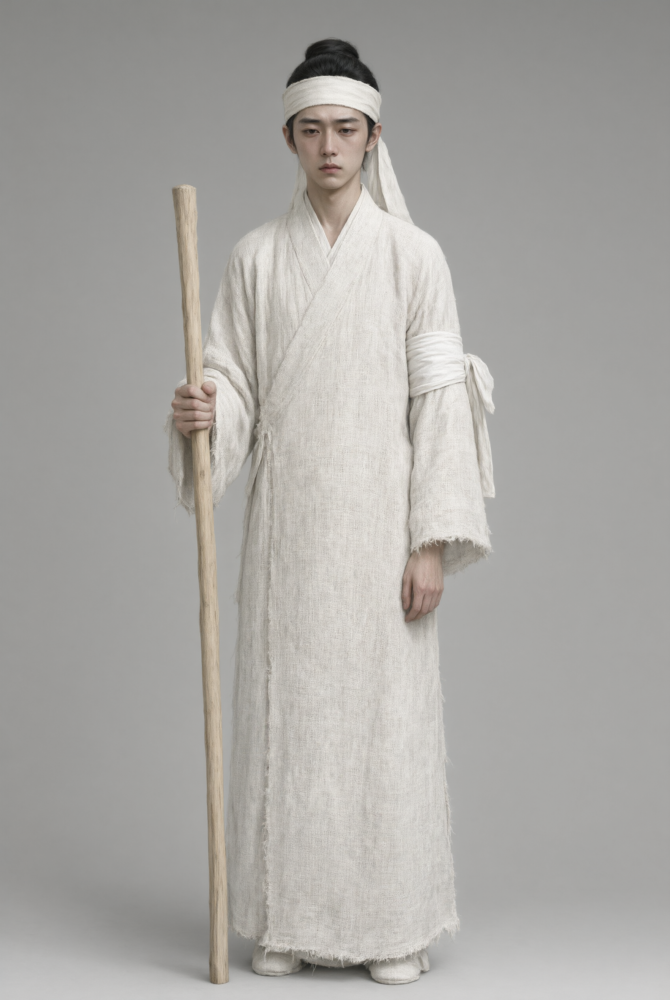

# 丧服形制

## 一、释义

丧服形制指**五等丧服各部件的外观与裁剪方式**。一套完整的丧服由下列部件组成：

| 部件 | 说明 |
| --- | --- |
| **衰（上衣）** | 丧服上衣，胸前缀「衰」；斩衰以粗麻，缉边者称「齐」 |
| **裳（下裳）** | 下体之服，斩衰「前三幅、后四幅」 |
| **冠** | 丧冠，斩衰用绳缨，齐衰用布缨 |
| **绖** | 首绖（首服之带）、腰绖（腰间之带），以麻为之 |
| **带** | 绞带（斩衰用苴麻绞结）、布带（齐衰以下用布） |
| **杖** | 苴杖（竹）、削杖（桐） |
| **屦** | 菅屦、疏屦、绳屦（以草、麻绳编成） |

**「斩」与「齐」之别**即在裁剪：「**斩**」谓裁剪后**不缉边**（斩断而不缝边），示痛甚无饰；「**齐**」谓**缉边**（缝齐其边），示痛稍杀。

## 二、历史源流

- **《仪礼·丧服》**：系统规定五服形制与二十余种服的差别，其经文与子夏传为后世一切丧服制度的源头。
- **《礼记·间传》**：解释「斩衰何以服苴」「齐衰何以服母」等形制背后的礼义与「哀之杀」的递减原则。
- **汉唐**：注疏家（郑玄、贾公彦、孔颖达）对形制细节（尺寸、升数、裁剪）逐条详解；《大唐开元礼》将服制编入国家典制。
- **宋元明清**：《朱子家礼》《大明会典》《大清通礼》以图、表形式保存丧服形制。
- **近代以来**：实物形制退出日常使用，仅在宗族家礼文本、戏曲与学术复原中留存。

## 三、仪节流程

1. **成服**：大殓之明日，亲属按服等换上相应丧服（「成服」）。
2. **服衰**：先着衰、裳，次加冠、绖、带、屦。
3. **执杖**：斩衰、齐衰杖期者执杖。
4. **变服**：小祥、大祥时依礼改换（见「丧服变除」条）。
5. **除服**：服满除之。

## 四、地域与民族变体

- **汉族各地**：礼制形制在宗族地区（闽粤、徽州）的族谱家礼中保留较完整；一般民间早已简化为「孝服」。
- **少数民族**：各族丧服形式各异（白布、麻布、反穿羊袄、断发等），其服装体系并非以「衰、裳、绖、带」为框架，须分别记录。

## 五、器物与文书

- **丧服实物**：衰、裳、冠、绖、带、杖、屦。
- **服制图**：本宗九族五服图、丧服形制图（见于《家礼》《通礼》）。
- **礼书**：《仪礼·丧服》及注疏、历代丧服图说。

## 六、文献与参考

- 《仪礼·丧服》（郑玄注、贾公彦疏）
- 《礼记·间传》《礼记·服问》
- 《大唐开元礼》《朱子家礼》
- 《大清通礼·凶礼》
- 历代丧服图说与丧服制度研究论著
