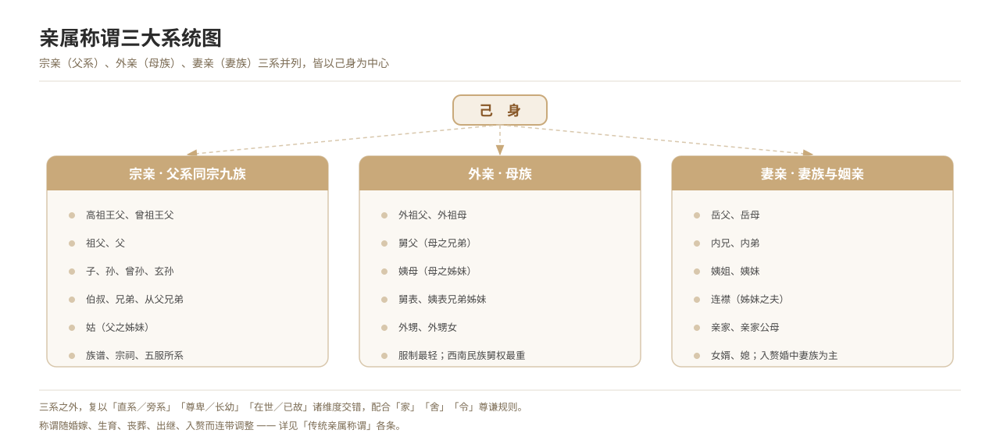

# 亲属称谓体系总述

*图 9　亲属称谓三大系统：宗亲、外亲、妻亲。*

## 一、释义

中国传统亲属称谓以**宗亲**（父系同宗）、**外亲**（母族）、**妻亲**（妻族）三大系统为骨架，再以「直系／旁系」「尊卑／长幼」「在世／已故」「血亲／姻亲」诸维度交错，构成层次严密的称谓网络。

| 系统 | 范围 | 举例 |
| --- | --- | --- |
| **宗亲** | 父系同宗九族（自高祖至玄孙） | 伯叔、兄弟、堂侄 |
| **外亲** | 母族（外祖父母、舅、姨及其子女） | 外祖父、舅父、姨表兄弟 |
| **妻亲** | 妻族（岳父母、内兄弟） | 岳父、内兄、连襟 |

《尔雅·释亲》即按「宗族」「母党」「妻党」「婚姻」四类分列，为传统分类之滥觞。

## 二、历史源流

- 《尔雅·释亲》分宗族、母党、妻党、婚姻四篇，奠定分类框架。
- 《释名·释亲属》以声训解释称谓得名之由。
- 《白虎通义》以宗法释亲属，强调「亲亲尊尊」。
- 唐宋以降，家礼、家训与类书（《通典》《太平御览》）续有增订。
- 清·郑珍《亲属记》、梁章钜《称谓录》集其大成；近人以人类学方法重加整理。

## 三、仪节流程

称谓的运用依「场合—对象—身份」三重条件而定，其序如下：

1. **确定关系**：先辨宗亲、外亲、妻亲，再定直系或旁系、尊长或卑幼。
2. **选择称谓**：面称（当面称呼）与叙称（向人称述）有别，书面另用尊称、谦称。
3. **写入文书**：婚帖、婚书、讣告、祭文中的称谓须依行款与服制；讣告须自称「孤子」「哀子」等。
4. **随礼变更**：婚嫁、生育、丧葬、出继、入赘等，均引起称谓与服制的连带调整。
5. **随时改口**：婚后「改口」，由「伯父」改称「爸爸」之类，为民间称谓的再确认。

## 四、地域与民族变体

- **华北、西北**：宗亲称谓严整，伯叔排行分明（大伯、二叔）。
- **江浙、徽州**：宗族发达，称谓带宗法色彩，祠堂辈分严格。
- **闽粤、客家**：保留古称较多，如「阿公」「阿婆」「家姐」「细佬」。
- **西南民族地区**：舅权突出，舅父称谓与地位相应提升（见「外亲称谓」条）。

## 五、器物与文书

- **文书**：庚帖、婚书、讣告、祭文、族谱（以称谓与世系为骨干）。
- **图籍**：本宗九族五服图、宗支图。
- **器物**：神主牌位（题名依世系、称谓与谥号）。

## 六、文献与参考

- 《尔雅·释亲》
- 《释名·释亲属》
- 《白虎通义·宗族》
- 清·郑珍：《亲属记》
- 清·梁章钜：《称谓录》
- 民俗田野调查资料
