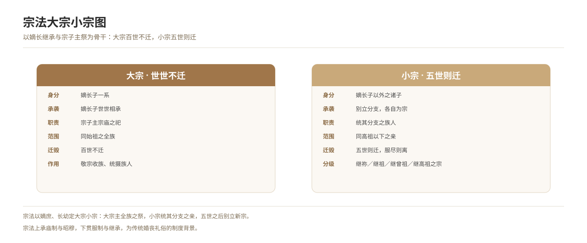

# 宗法制度

*图 12　宗法大宗、小宗与嫡长子继承关系图。*

## 一、释义

宗法制以父系血缘为纽带，按嫡庶、长幼区分**大宗**与**小宗**：嫡长子世世承祀为宗子，称「大宗」；其余诸子别立分支，称「小宗」。其核心是**嫡长继承**、**宗子主祭**与**同宗聚族**。

| 名目 | 释义 |
| --- | --- |
| **大宗** | 嫡长子一系，世世为宗，主宗庙之祀 |
| **小宗** | 庶子、余子别立之支，五世而迁 |
| **宗子** | 一族之长，主祭祀、掌族事 |
| **别子** | 自他族或他支别出者，为宗法之始 |

## 二、历史源流

- 周代确立宗法制，《礼记·大传》《丧服小记》详论其义。
- 战国以后其政治意义衰减，社会意义延续。
- 魏晋门阀重视谱牒，宗族以门第相尚。
- 宋以后宗族重建：范仲淹置义庄，《家礼》立祠堂之制，宗法下移民间。
- 明清宗族组织化，族谱、宗祠、族田、族规齐备。

## 三、仪节流程

宗族的日常运作依如下程序展开：

1. **立宗子**：选嫡长子为宗子，主祭、主事。
2. **建宗祠**：于正寝之东立祠堂，设神主。
3. **修族谱**：记录世系、行第、讳字与迁徙。
4. **置祭田、义庄**：以祭田供祭祀，以义庄赡族人。
5. **行四礼**：冠、婚、丧、祭依宗族规矩办理，须在族谱、宗祠中留痕。
6. **议族事、行族规**：族人纠纷由宗子与族老评议处置。

## 四、地域与民族变体

- **华北**：宗族组织相对松散，宗子之权较弱。
- **华南（闽粤、徽州）**：宗族强盛，祠堂林立，族规森严。
- **少数民族**：部分民族有类似组织（如哈尼族「寨老」、独龙族「卡桑」、基诺族「卓巴」），性质与汉制宗法不同，须分别记录。

## 五、器物与文书

- **文书**：族谱、族规、祭祀簿、义庄章程。
- **器物**：宗祠、神主牌位、祭田契、族印。

## 六、文献与参考

- 《礼记·大传》《丧服小记》
- 《白虎通义·宗族》
- 宋·朱熹：《家礼》（《文公家礼》）
- 民俗田野调查资料
