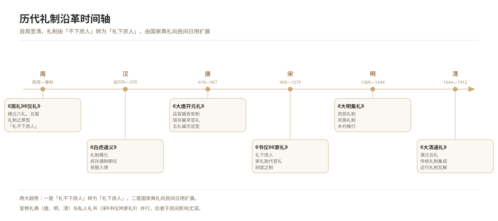

# 历代礼制沿革

*图 16　历代礼制沿革时间轴：周—汉—唐—宋—明—清。*

## 一、释义

礼制自周代定型，历代各有损益兴革，其大势为：由「礼不下庶人」到「礼下庶人」，由「国家典礼」向「民间日用」扩展。

| 时代 | 主要礼典／礼制 | 婚丧之要 |
| --- | --- | --- |
| 周 | 《周礼》《仪礼》 | 确立六礼、五服之制 |
| 汉 | 叔孙通制礼、《白虎通义》 | 礼制儒化，丧服入律 |
| 唐 | 《大唐开元礼》 | 品官婚丧之制系统化 |
| 宋 | 司马光《书仪》、朱熹《家礼》 | 「礼下庶人」，家礼兴起 |
| 明 | 《大明集礼》 | 庶民礼制，宗族礼制 |
| 清 | 《大清通礼》 | 满汉合礼，礼制集成 |

## 二、历史源流

- 汉代叔孙通为汉制朝仪，《白虎通义》以经义定礼制。
- 魏晋南北朝门阀之礼与胡汉杂糅并行。
- 唐代《大唐开元礼》为现存最早的系统官礼，品官婚丧有定制。
- 宋代礼制下移，《书仪》《家礼》取代官礼成为民间日用范本。
- 明清礼典集成，《大清通礼》为传统礼制之总结；近代礼制随帝制终结而瓦解。

## 三、仪节流程

1. **制礼**：诏命儒臣据经义起草。
2. **纂修礼典**：汇纂为官修礼书，颁行天下。
3. **颁行与推行**：由官府、学校、乡约逐级推行。
4. **家礼简化**：士绅据官礼拟为家礼，化繁为简以行于民间。
5. **民间因袭**：俗礼在礼制框架内增损，形成地方变体。

## 四、地域与民族变体

- **汉族地区**：礼典影响深入民间婚丧。
- **少数民族地区**：多依本族习惯与传统，汉制礼典影响因地而异，须分别记录。

## 五、器物与文书

- **文书**：历代礼典、家礼、乡约、方志·礼俗门。
- **器物**：礼器、祭器、冠服。

## 六、文献与参考

- 《大唐开元礼》
- 宋·司马光：《书仪》；宋·朱熹：《家礼》
- 《大明集礼》《大清通礼》
- 历代正史·礼志
- 民俗田野调查资料
