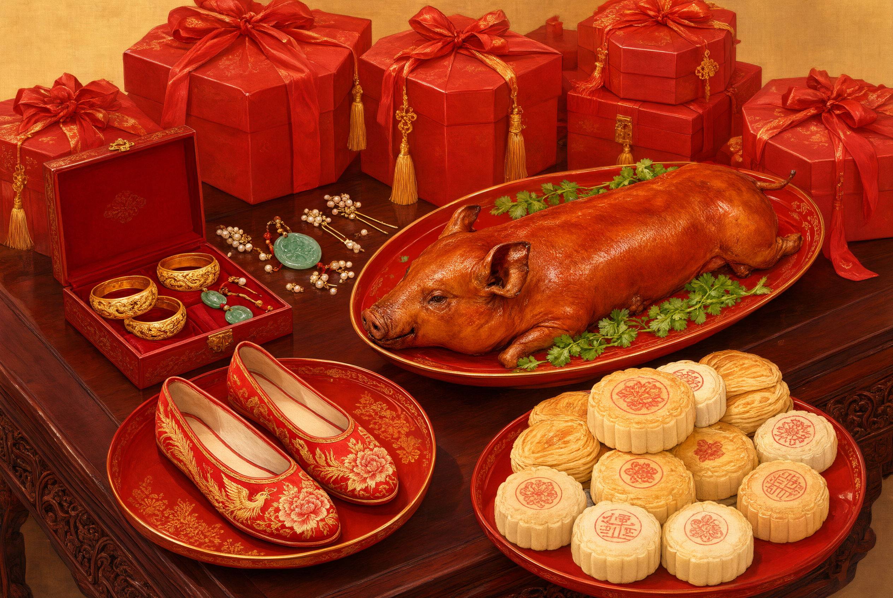

# Major Betrothal (Dading)

## 1. Definition

Major betrothal, also called “the major gift”, “presenting the betrothal” or “nabing”, is the stage at which the groom’s family sends the bride-price agreed upon to the bride’s family and the engagement is formally concluded.

It corresponds to **nazheng** among the Six Rites. Its division of labour with the minor betrothal is this: the minor betrothal is the preliminary confirmation of intention, the major betrothal the formal conclusion of the contract. After the major betrothal both sides are bound in ritual order, public opinion and village covenant to perform it, and the breaking of the promise gives rise to serious dispute.

## 2. Historical Origins

- The *Shihunli*: “Nazheng: dark-and-crimson bolts, paired hides, as in the rite of naji.” The ritual classic’s nazheng is limited to symbolic bolts and hides, the amount very small.
- Zhu Xi’s *Family Rituals* calls it “nabing”, and the amount increases somewhat.
- In the Ming and Qing the “major gift” flourished, the bride-price grew greatly, and gift lists ran to dozens of items, producing a fashion of “heavy betrothal”.
- Heavy betrothal brought social problems: poor families “could not afford to marry”, and deformed practices such as the “pawning of wives” and “exchange of brides” appeared; court and province repeatedly issued bans on heavy betrothal, with limited effect.
- The contemporary “bride-price” is the continuation of nazheng. The excessive bride-price has again become a social problem, and Article 1042 of the present Civil Code expressly “prohibits the exaction of property by way of marriage”.

## 3. Ceremonial Procedure

1. **Negotiating the bride-price**: the matchmaker settles the items and amounts between the two families, which are written into the gift list.
2. **Fixing the day**: an auspicious day is chosen for the major gift (usually from a month to a hundred days before the wedding).
3. **Preparing the gifts**: the “carrying poles” are prepared — gift boxes and panniers plastered with red paper and bound with red cord. The contents include the bride-price, jewellery, cloth, wedding cakes, tea, wine and livestock (pig, sheep, chicken).
4. **Conveying the gifts**: bearers of the groom’s own house or hired “pole-bearers” carry them to the bride’s house, accompanied by drums and music.
5. **Setting out the gifts**: the panniers are displayed in the central hall of the bride’s house and the gift list presented.
6. **Receipt and return**: the bride’s family receives the gifts and issues a reply card, and by custom returns part of them (or exchanges them for other things, such as “the son-in-law’s trousers” and “the son-in-law’s shoes”).
7. **Feasting**: the bride’s family feasts the bearers.
8. **Distributing cakes**: the bride’s family distributes wedding cakes to relatives, friends and neighbours — the public announcement of the marriage (“sending cakes”, “scattering cakes”).

## 4. Regional and Ethnic Variants

- **North China**: called “guo dali”, “guoli” or “xiapin”; the “four-colour”, “six-colour” or “eight-colour” gift is insisted upon.
- **Jiangsu and Zhejiang**: called “nabing” or “xiapin”; the panniers are “carrying trays”, and everything is in pairs.
- **Guangdong**: called “guo dali”; dragon-and-phoenix cakes, coconuts, tea and the three sacrificial meats are indispensable, and the return includes “the son-in-law’s trousers”, “the son-in-law’s shoes” and ginger vinegar.
- **Southern Fujian**: called “wanpin”; the gifts are carried in “box panniers”, counted in “pairs”, the “twelve items” being insisted upon.
- **Hakka areas**: called “zhading” or “guoding”; pork, wine, glutinous rice cakes and cloth predominate.
- **Ethnic minorities**: the forms of the bride-price and their religious backgrounds differ widely. Among the Yi the gift is chiefly silver, cattle and wine; the Miao and Dong have a system of “betrothal silver”; the Tibetans have the gift of *khatas*, butter, tea and barley; the Uyghur gift includes clothing, rock sugar and dried fruit, and the *nikah* (marriage contract) is performed by an imam. **These are not equivalents of the “bride-price”; their legal and religious meanings differ.**

## 5. Objects and Documents

- **Gift panniers and boxes**: the vessels of the gifts, plastered with red paper and bound with red cord.
- **Betrothal letter and gift list**: the written record of the gift, setting out items and amounts.
- **The reply card**: the document by which the bride’s family acknowledges receipt.
- **Wedding cakes (dragon-and-phoenix cakes)**: for distribution among relatives and friends.
- **The three sacrificial meats, tea, wine, jewellery and cloth**: the contents of the gift.

## 6. Sources

- 《仪礼·士昏礼》（郑玄注） *Yili*, “The Gentleman’s Wedding Rites”, with Zheng Xuan’s commentary
- 《朱子家礼·昏礼》 Zhu Xi, *Family Rituals*, “Wedding Rites”
- 《大清通礼·嘉礼》 *Comprehensive Rituals of the Great Qing*, “Auspicious Rites”
- 《清稗类钞·婚姻类》 *Qing bai lei chao*, “Marriage”
- 陈鹏：《中国婚姻史稿》 Chen Peng, *A Draft History of Chinese Marriage*
- 《中华人民共和国民法典》第一千零四十二条 *Civil Code of the People’s Republic of China*, Article 1042

---

[← Back to Pre-Wedding Customs](./README.md) · [Chinese original](../../../../docs/01-marriage-rites/01-02-pre-wedding-customs/05-大定.md) · [Repository home](../../../../README.md)
