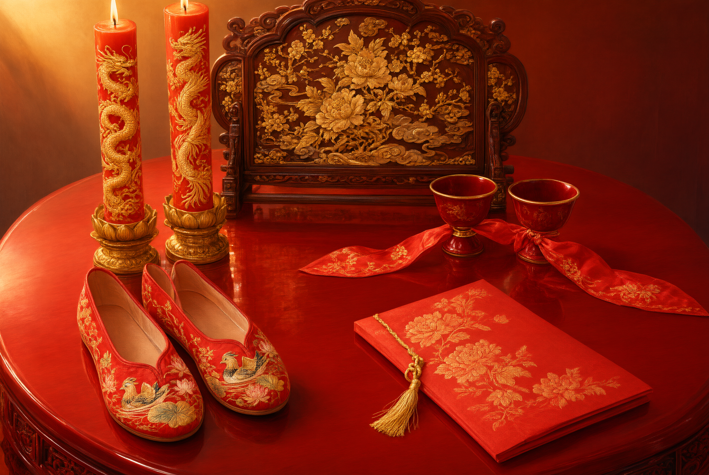

# Objects of the Six Rites: the Wild Goose, Dark-and-Crimson Silks, and Paired Hides

## 1. Definition

The core objects used in the Six Rites as recorded in the *Shihunli* of the *Yili* are the “**introductory gifts**” (*zhi*), each with its own ritual meaning:

| Object | Stage used | Ritual meaning |
| --- | --- | --- |
| **The wild goose (laying down the goose)** | Nacai, wenming, naji, qingqi, qinying | “Taking the goose for its going and coming with the yang” and “for taking no second mate” — a figure of following the seasons and of constancy |
| **Dark-and-crimson bolts** | Nazheng | Dark (black) and crimson (pale red) in five bolts; the bundle of silk as a gift, marking solemnity |
| **Paired hides (paired deer skins)** | Nazheng | “Paired” figures the matching of husband and wife |

**Substitution and evolution**: geese being hard to obtain, later ages generally used **chickens, geese, pheasants and carved wooden geese** instead; “dark-and-crimson bolts and paired hides” evolved into the “**betrothal gift**” (gold and silver, cloth, jewellery, ceremonial cakes).

## 2. Historical Origins

- **Pre-Qin**: the *Shihunli* prescribes “laying down the goose” and “nazheng with dark-and-crimson bolts and paired hides”.
- **Han and Tang**: betrothal gifts turned towards the practical and the precious (gold and silver, silk); the “goose” became increasingly symbolic.
- **Song and Ming**: Zhu Xi’s *Family Rituals* reduced the Six Rites to “negotiating the marriage, nacai, nabing, qinying”, and the objects were simplified with them.
- **Ming and Qing**: betrothal gifts were normally “ceremonial cakes, jewellery, cloth, wine and meat”; the “laying down of the goose” was mostly done with a wooden goose or a chicken.
- **Today**: the gifts have evolved into “bride-price”, the “three golds” and “ceremonial cakes”; the goose rite is no longer seen (some Chinese-style weddings reconstruct “laying down the goose” as a performance).

## 3. Ceremonial Procedure

1. **Nacai with the goose**: the envoy enters holding the goose and delivers the words of proposal.
2. **Wenming, naji, qingqi**: all use the goose as the introductory gift.
3. **Nazheng**: dark-and-crimson bolts and paired hides (in later ages the betrothal gift) are presented at the bride’s house.
4. **Laying down the goose at the personal reception**: the groom comes to the bride’s house, enters holding the goose, bows and yields precedence as they ascend the hall, and lays down the goose in front.
5. **Registration of the betrothal gift**: in later ages a “gift list” recorded the items and quantities of the betrothal gift.

## 4. Regional and Ethnic Variants

- **North China**: betrothal gifts emphasise the “four-colour gift” and the “bride-price”; the laying down of the goose is occasionally seen in reconstructed ceremonies.
- **Jiangnan**: chiefly ceremonial cakes, tea and jewellery, the “tea gift” being the essential element.
- **Fujian and Taiwan**: betrothal gifts are reckoned in “twelve-card letters” and distinguished as “major” and “minor”; ceremonial cakes and pork and mutton are the norm.
- **Guangdong**: the betrothal gift is called “the major presentation”, chiefly ceremonial cakes, dried seafood and the three sacrificial meats.
- **Ethnic minorities**: the forms of betrothal gift differ (cattle and horses, silver ornaments, wine, cloth) and are not of the same origin as the Han goose rite; they must be recorded separately.

## 5. Objects and Documents

- **Objects**: the goose (or a chicken, a gander or a wooden goose), dark-and-crimson bolts, paired hides, ceremonial cakes, jewellery.
- **Documents**: the marriage letter, the gift list (of the betrothal gift), the dragon-and-phoenix card.

## 6. Sources

- 《仪礼·士昏礼》 *Yili*, “The Gentleman’s Wedding Rites”
- 《朱子家礼·昏礼》 Zhu Xi, *Family Rituals*, “Wedding Rites”
- 《事物纪原》 *Shiwu jiyuan* (The Origin of Things)
- 各省地方志·风俗志 Provincial gazetteers, “Customs”
- 博物馆藏品著录 Museum collection catalogues

---

[← Back to Wedding Objects and Attire](./README.md) · [Chinese original](../../../../docs/01-marriage-rites/01-05-wedding-objects/01-六礼器物.md) · [Repository home](../../../../README.md)
