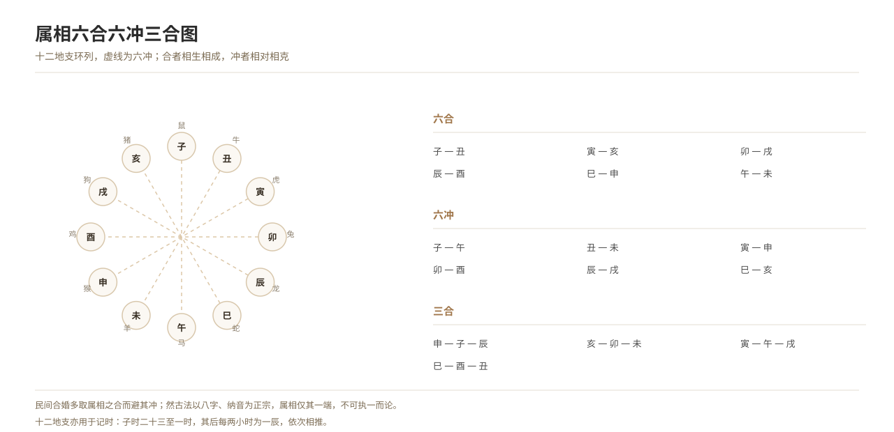

# Zodiac Clashes and the Six Conflicts

*Figure 4. The twelve zodiac animals in their relations of six harmony, six clash and three harmony.*

## 1. Definition

The twelve zodiac animals are matched to the earthly branches, and their relations of **clash, harmony, harm and punishment** are used to judge matches and to judge what is suitable or unsuitable in a wedding.

| Relation | Combinations | Auspicious or not |
| --- | --- | --- |
| **Six harmonies** | zi-chou, yin-hai, mao-xu, chen-you, si-shen, wu-wei | auspicious (a “six-harmony marriage”) |
| **Three harmonies** | shen-zi-chen, hai-mao-wei, yin-wu-xu, si-you-chou | auspicious (a “three-harmony marriage”) |
| **Six clashes** | zi-wu, chou-wei, yin-shen, mao-you, chen-xu, si-hai | avoided (a “six-clash marriage”) |
| **Mutual harm (the six harms)** | zi-wei, chou-wu, yin-si, mao-chen, shen-hai, you-xu | avoided |
| **Mutual punishment** | yin-si-shen, chou-xu-wei, zi-mao, chen-wu-you-hai (self-punishment) | avoided |

**Gradation**: the **six clashes** are most to be avoided (betokening “discord” and “separation”), then mutual harm, then mutual punishment. Further, when the bride mounts the chair and enters the house, those whose zodiac animals clash with the couple’s must also withdraw (see the entry “Taboos Concerning Persons”).

## 2. Historical Origins

- **Han**: the matching of earthly branches and zodiac animals was completed, and the doctrine of clash and harmony appears in the *Day Books* and in works of divination.
- **Tang and Song**: matching by zodiac animal spread, and the notebooks and tales often record “zodiac animals not agreeing”.
- **Ming and Qing**: the almanacs and proverbs became systematic, and the “six clashes” and “six harmonies” became household phrases.
- **Today**: “zodiac match tables” are still current among the people; many treat them as entertainment.

## 3. Ceremonial Procedure

1. **Asking the zodiac animals**: at the negotiation the animals of both are asked first.
2. **Judging clash and harmony**: six and three harmonies are auspicious; six clashes and mutual harm are avoided.
3. **Withdrawal at the wedding**: those whose animals clash with the couple’s withdraw when the bride mounts the chair, alights and enters the bridal chamber.
4. **Counteraction**: where necessary, methods such as “tying a red cord” or “wearing a charm” are used.
5. **Choosing the day**: when choosing a day, days clashing with the couple’s animals are also avoided.

## 4. Regional and Ethnic Variants

- **North China**: the “six clashes” are emphasised, especially proverbially “the dragon and tiger fight” (chen-yin) and “the cock and monkey do not reach the end”.
- **Jiangnan**: the doctrine of zodiac animals is judged together with matching the eight characters.
- **Fujian and Taiwan**: those whose animals clash withdraw from the wedding, with particular attention to the “baleful direction” and the “zodiac animal”.
- **Ethnic minorities**: some peoples have systems of naming years by animals and of prohibitions in matching; these must be recorded separately.

## 5. Objects and Documents

- **Documents**: the horoscope card (bearing the zodiac animal and birth data), the date-choosing slip.
- **Textual basis**: the *Xieji bianfang shu*, the *Yuxia ji*, the almanacs.
- **Objects**: charm paper and red cord (for counteraction).

## 6. Sources

- 清·允禄等：《协纪辨方书》 Yunlu and others (Qing), *Xieji bianfang shu*
- 《玉匣记》 *Yuxia ji*
- 睡虎地秦简《日书》 The Shuihudi Qin bamboo *Day Books*
- 各省地方志·风俗志 Provincial gazetteers, “Customs”
- 民俗田野调查资料 Folklore fieldwork materials

---

[← Back to Auspicious Dating and Taboos in Marriage](./README.md) · [Chinese original](../../../../docs/01-marriage-rites/01-07-wedding-auspicious-taboos/03-属相冲克.md) · [Repository home](../../../../README.md)
