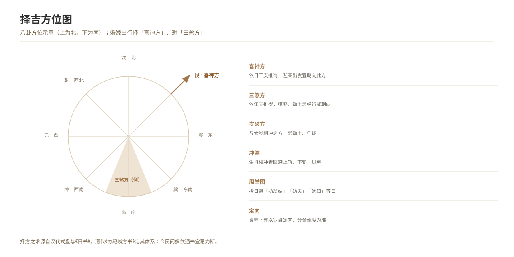

# Taboos on Routes and Directions

*Figure 5. Auspicious directions and the line of the bridal procession.*

## 1. Definition

The **route and directions** of the reception must be settled in advance, on the principles of “smoothness”, “auspiciousness” and “no clash”.

| Rule | Content |
| --- | --- |
| **Do not retrace the road** | The outward and return routes differ; returning by the same road is avoided |
| **Avoid the baleful direction** | The direction of the three baleful influences and annual destruction, as reckoned by date selection; travelling through or facing it is avoided |
| **Avoid inauspicious places** | Ancestral halls, temples, graveyards, hospitals and prisons are avoided (varying from place to place) |
| **Set out towards the “god of joy”** | At the start of the reception the party faces the direction in which the “god of joy” lies (fixed by the day’s stem and branch) |
| **Avoid “colliding in the lane”** | Colliding with another family’s wedding car is avoided (see “Wedding Meeting Wedding”) |
| **Entry route and door orientation** | Going out by the “ill door” and in by the “good door” is avoided (according to the orientation of the house) |
| **Rules for fords and bridges** | In some regions coins must be thrown and wedding fruit scattered when crossing a bridge |

## 2. Historical Origins

- **Han onwards**: the choice of direction in travel, and the doctrines of the “god of joy” and the “three baleful influences”, appear in the *Day Books* and in works of divination.
- **Tang, Song, Ming and Qing**: the art of choosing directions entered the almanacs, and wedding travel had to take an auspicious direction.
- **Modern times**: with changing transport the route taboos turned largely into the choice of “places to avoid”.
- **Today**: wedding car fleets are mostly arranged for convenience, but retracing the road and passing funeral parlours are still avoided.

## 3. Ceremonial Procedure

1. **Fixing the route**: the road is walked in advance and the outward and return routes fixed.
2. **Choosing the auspicious direction**: the “direction of the god of joy” is taken from the almanac, and the party sets out facing it.
3. **Avoiding the baleful direction**: the reckoned ill directions are avoided.
4. **On the road**: wedding fruit is scattered and firecrackers set off; stopping is avoided (“the chair is not set down”).
5. **The return**: the party returns by another road and does not enter by the “ill door” of the groom’s house.

## 4. Regional and Ethnic Variants

- **North China**: “not retracing the road” and “avoiding the baleful direction” are emphasised.
- **Jiangnan**: the route is carefully walked in advance; graveyards and temples are avoided.
- **Fujian and Taiwan**: the “array” of the reception party proceeds according to direction, the “baleful direction” being avoided.
- **Ethnic minorities**: the direction of the reception is mostly decided by divination; the systems differ and must be recorded separately.

## 5. Objects and Documents

- **Basis for choosing**: the *Xieji bianfang shu*, the *Yuxia ji*, the almanacs.
- **Documents**: the reception route sheet, the day slip.
- **Objects**: the compass, wedding fruit, firecrackers.

## 6. Sources

- 清·允禄等：《协纪辨方书》 Yunlu and others (Qing), *Xieji bianfang shu*
- 《玉匣记》 *Yuxia ji*
- 各省地方志·风俗志 Provincial gazetteers, “Customs”
- 民俗田野调查资料 Folklore fieldwork materials

---

[← Back to Auspicious Dating and Taboos in Marriage](./README.md) · [Chinese original](../../../../docs/01-marriage-rites/01-07-wedding-auspicious-taboos/07-路线与方位禁忌.md) · [Repository home](../../../../README.md)
