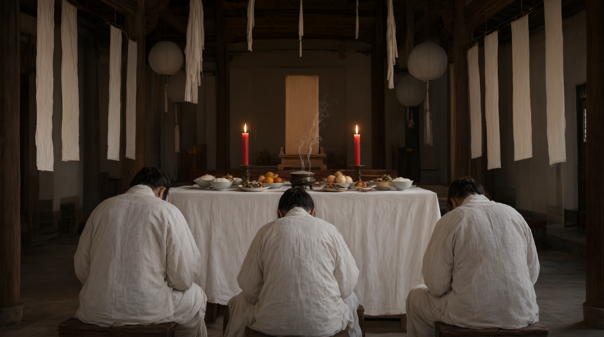

# Arranging the Mourning Hall

## 1. Definition

The mourning hall (*ling tang*) is the place, during the lying-in-state, where the coffin rests, the spirit tablet is set, and kin keep vigil and guests condole.

Its arrangement has three functions: **partition** (curtains divide the worlds of life and death, the ancient "curtaining the hall"), **seat** (the tablet establishes the dead's "presence" and the kin's "place"), and **display** (the furnishings show the family's status and filial devotion to visitors).

## 2. Historical Origins

- The ancient "curtaining the hall" and "offering east of the corpse" are its direct source (*Yili*, "Shisangli").
- The Song *Shuyi* and *Family Rituals* introduced the "spirit seat" and "soul-silk" (a silken tablet bearing the name) into family rites, set at the hall's centre.
- Ming-Qing layout fixed: coffin (centre), tablet/soul-silk (centre), incense altar, mourning curtain, couplets/banners (sides), paper effigies (front/side).
- The portrait entered with photography; modern cities use a standardised "mourning hall" in the funeral home.

## 3. Ceremonial Procedure

1. **Choose the place**: the home's main hall (rural); a funeral-home hall (urban).
2. **Hang the curtain**: white or blue cloth dividing coffin from wailers.
3. **Set the coffin**: centre or side, head by orientation; on blocks, not the ground.
4. **Set the tablet**: before the coffin, facing the door.
5. **Set the altar**: censer, candles, fruit, wine, tea, rice ("serving meals").
6. **Hang couplets/banners**: sides; a "offering" banner above.
7. **Set paper effigies, wreaths**: sides or outside.
8. **Prepare items**: mourning kerchiefs, dress, gift-book, candles, brazier.
9. **Arrange kin seats**: men east, women west, with kneeling mats.

## 4. Regional and Ethnic Variants

- **North**: a "mourning shed" in the yard; white paper and "age-paper" (strips by age) outside.
- **Jiangnan**: the "filial hall", with unbroken incense.
- **Min-Tai**: "filial lamp", "soul-silk", a paper "spirit house" (by the "master").
- **Guangdong**: a paper "spirit house", banners, "seven-star lamp" before the tablet.
- **Ethnic minorities**: most have no such hall. Muslims hold the funeral at mosque or home on the *tabut* (bier), **no incense or offering table**; Tibetans a chanting chapel by lamas; Yi a house shrine with a "ancestor-tube". Each people's lying-in-space has its own religious basis, not to be equated with the Han hall.

## 5. Objects and Documents

- **Curtain, filial screen**: the partition.
- **Tablet, soul-silk, portrait**: the symbol of presence.
- **Altar, censer, candles, vessels**: the offerings.
- **Couplets, banners, wreaths**: condolence gifts.
- **Paper effigies**: houses, figures, horses.
- **Gift-book, kerchiefs, brazier**: affairs.

## 6. Sources

- 《仪礼·士丧礼》 *Yili*, "Ceremony of Initial Mourning"
- 《书仪》（宋·司马光） Sima Guang, *Book of Ritual Forms*
- 《朱子家礼·丧礼》 Zhu Xi, *Family Rituals*, "Mourning"
- 《清稗类钞·丧祭类》 *Qingbai leichao*, "Mourning"
- Provincial gazetteers, funeral records

---

[← Back to Lying in State](./README.md) · [Chinese original](../../../../docs/02-funeral-rites/02-03-lying-in-state/01-灵堂布置.md) · [Repository home](../../../../README.md)
