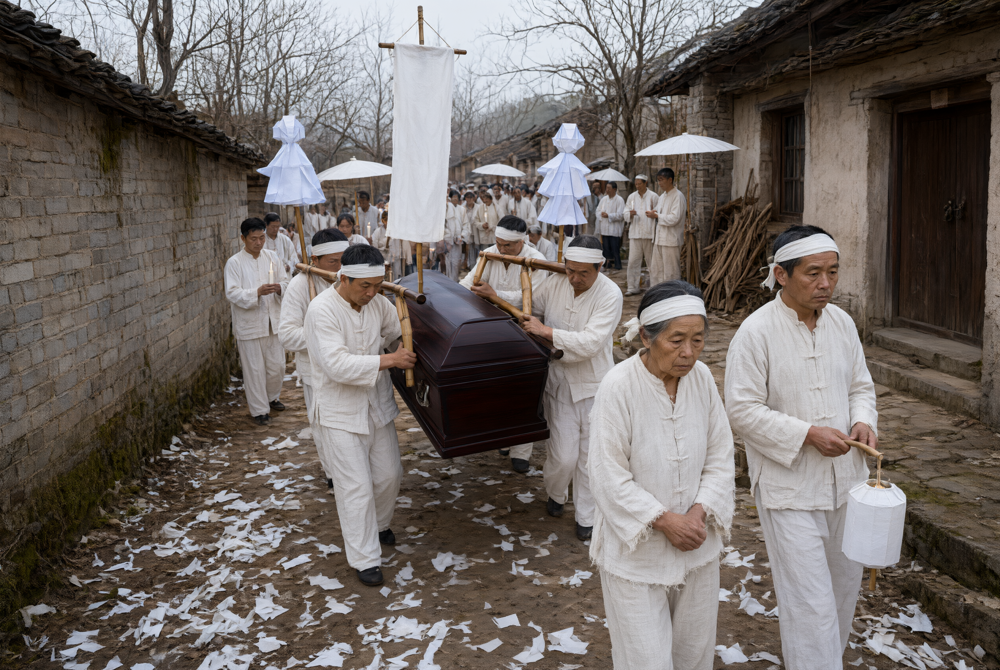

# The Funeral Procession and Its Insignia

## 1. Definition

The funeral procession (*songzang duiwu*, the sending-off column) is the marching sequence made up of the coffin, the bereaved, the functionaries, the insignia, the drums and music, and the guests. Its composition and order are strictly ruled, and it is a public display of the funeral's scale and social relations.

The core concept of the column is "holding the rope" (*zhifu*): the mourners hold the cords that draw the hearse, signifying "walking with the dead".

## 2. Historical Origins

- The *Yili* ("Jixi li") records the procession and its objects in detail: the **name banner** (*mingjing*, a flag bearing the deceased's name and rank, leading the column), **holding the rope** (*zhifu*, those who draw the hearse), the **dispatch cart** (*qianche*, the cart bearing the mingqi), and the **bao-shao-weng-wu** (vessels holding the offerings).
- The *Liji* ("Tan'gong") records the procession array of "Confucius's funeral", showing the column was already important in the pre-Qin.
- The Han "dirge songs" (*wange*) were sung on the procession, showing there was song in the march.
- From the Tang and Song the column grew, adding drums and music, monks and Daoists, paper effigies, and mourning hangings.
- The Ming and Qing fixed the procession shape; gazetteers record "the name banner and soul-guiding banner in front, then drums and music, then paper effigies, then the coffin, with the bereaved and guests behind".
- Modern times added wreaths and couplet teams; today the motorcade replaces the walking column, but the sense of order remains.

## 3. Ceremonial Procedure

(The typical traditional order)

1. **Clearing the way**: those scattering paper money (road-buying money) go first; crackers and the way-clearing gong follow.
2. **Soul-guiding banner**: the eldest grandson or a designated person raises the "soul-guiding banner" (*yinhun fan*, the guiding banner).
3. **Name banner**: a white flag bearing the deceased's name, rank and age.
4. **Drum-and-music troupe**: suona, gongs and drums, sheng and pipes.
5. **Monks and Daoists (if a rite is held)**: the sutra-chanting and instrument teams.
6. **Paper effigies and hangings**: paper houses, paper figures and horses, paper chests; mourning couplets and hangings (today mostly wreaths).
7. **The coffin (the core)**: covered by the coffin canopy, borne by eight or sixteen bearers, or carried on a vehicle.
8. **The bereaved**: the chief mourner walks with the coffin holding the filial staff (the old system had "the chief mourner before the coffin" or "behind it", with ritual and folk differences); the women follow weeping.
9. **Guests and mourners**: kin and friends follow; the "rope-holders" stand on either side of the coffin.
10. **Roadside-offering points**: offering spots set along the way (see "Roadside Offerings").
11. **Tail**: the rear-guard clears what is left along the way.

## 4. Regional and Ethnic Variants

- **North China**: insists "the column must be long", with paper effigies and hangings in front and loud drums and music.
- **Jiangnan**: insists on "plainness", little drums and music, mainly name banner and mourning couplets.
- **Min-Tai (Fujian-Taiwan)**: the column has "white-banner teams" and "flower-car teams", with the customs of "filial lamps" and "weeping on the road".
- **Guangdong**: has "rite-performing" (*dajiao*) teams and paper-effigy teams of considerable scale.
- **Ethnic minorities**: the Tibetan sky-burial column is made of the corpse-bearer and close kin, very few in number; the Miao column has a lusheng team and a song team; the Yi column is led by a *bimo*. The composition of the column depends on the mode of disposal and belief, and differs from the Han logic of displaying scale through "holding the rope".

## 5. Objects and Documents

- **Name banner**: the flag bearing the deceased's identity, often set with the "spirit seat" after the Ming and Qing.
- **Soul-guiding banner (guiding banner)**: the flag that leads the dead soul.
- **Rope (holding the rope)**: for drawing the hearse.
- **Coffin canopy, hearse**.
- **Paper effigies, hangings, wreaths**.
- **Drum-and-music instruments**: gongs, drums, suona, sheng and pipes.
- **Paper money (road-buying money)**.
- **Filial staff**: held by the filial son.

## 6. Sources

- 《仪礼·既夕礼》（郑玄注） *Yili*, "Jixi li" (Zheng Xuan's commentary)
- 《礼记·檀弓》 *Liji*, "Tan'gong"
- 《清稗类钞·丧祭类》 *Qingbai Leichao*, "Funeral and Sacrifice"
- Provincial gazetteers, funeral records

---

[← Back to Funeral Procession and Burial](./README.md) · [Chinese original](../../../../docs/02-funeral-rites/02-04-funeral-procession-burial/04-送葬队伍与仪仗.md) · [Repository home](../../../../README.md)
