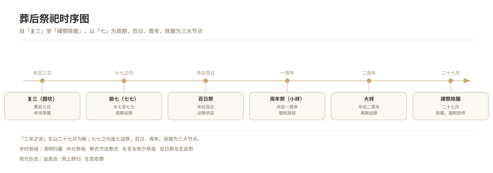

# The Seven-Day Rites (Zuoqi)

*Figure 7. Timeline of post-burial sacrifices: third-day — seven sevens — hundredth day — anniversary — removal of mourning.*

## 1. Definition

The seven-day rites (*zuoqi*, also *shaoqi*, *qigi zhai*) are the system of sacrificing once every seven days after death, seven times in all (forty-nine days). The names: **first seven, second seven, third seven, fourth seven, fifth seven, sixth seven, seventh seven (breaking the seven)**.

The time frame of the seven-day rites relates to the Buddhist idea of the *antara-bhava* (intermediate state): the dead are held to be in the intermediate state for forty-nine days after death, to be reborn by their karma; each seven-day sacrifice and sutra-chanting can "dedicate merit" to them, aiding birth in a good realm.

## 2. Historical Origins

- **Doctrinal basis**: the *Ksitigarbha Bodhisattva's Fundamental Vows Sutra* spends much length on the merit of doing good, chanting and invoking names for the dead within the "seven sevens" (forty-nine days).
- **Historical formation**: the custom of the seven-sevens fast arose with the spread of Buddhism, already flourishing in the Tang (Dunhuang documents hold many seven-sevens texts and vows).
- **Ritual fusion**: joined with the Han system of "morning and evening offering" and "new-moon and full-moon offering", forming a sacrificial rhythm where "seven" and "ten-day" run in parallel.
- **Local difference**: places differ in how much they stress each seven; **the "fifth seven" is generally held most important** (folk says "the fifth seven comes first", or that the dead only know they are dead by the fifth seven), though some hold the first seven or the seventh seven as weightiest.
- **Contemporary**: under cremation the seven-day rites are still widely kept (especially rural), mostly simplified to three times — "first seven", "fifth seven", "seventh seven".

## 3. Ceremonial Procedure

1. **Count the days**: count from the day of death (or the next day, by local habit), each seven days a period.
2. **Set the offering**: each period an offering richer than daily (some areas stress "third seven" and "fifth seven" with "meat").
3. **Chant sutras** (if a rite is held): invite monks to chant and bow in penance, or the family chants the Buddha-name and dedicates merit.
4. **Wail**: kin wail before the spirit, the daughters and daughters-in-law chiefly.
5. **Burn paper**: burn paper money and paper effigies (some areas burn different objects each seven, e.g. a "paper umbrella" on the fifth seven).
6. **Fifth seven**: mostly a grander sacrifice (some areas invite a Daoist or monk for a rite).
7. **Seventh seven (breaking the seven)**: the last period, marking the end of the intermediate state, with a fuller rite, meaning "removing the spirit" and "sending off the dead".
8. **Pass to the anniversary**: after the seven sevens, turn to the hundredth-day and anniversary sacrifices (see the relevant entries).

## 4. Regional and Ethnic Variants

- **North China**: stresses the "fifth seven", holding "the fifth seven, thirty-five, the dead is just suffering" — so the fifth seven must be solemn.
- **Jiangnan**: each seven has its name, insisting "do the seven not empty" — sacrifice on every seven.
- **Min-Tai (Fujian-Taiwan)**: the sevens join Buddhist and Daoist rites; the "fifth seven" mostly invites the *sigong* to do merit.
- **Guangdong**: "doing the seven", a fast each seven, stressing the "fast seven".
- **Ethnic minorities**: some peoples, also Buddhist-influenced, have the "seven sevens" (e.g. parts of the Bai and Naxi); the Yi "making the fast" has its own cycle (irregular, mostly in the slack farming season, large in scale); the Tibetan take the sutra-chanting in the "seven sevens" as the main sacrifice, led by lamas. The same "seven" cycle differs in doctrinal background and rite-content and must be recorded separately.

## 5. Objects and Documents

- **Offerings**: wine, dishes, fruit, cakes; the fifth seven mostly with meat.
- **Incense, candles, paper money, paper effigies**.
- **Sutras, ritual instruments** (if a rite is held).
- **Seven-period schedule**: the family's internal record.
- **Elegy, petition** (*shuwen*): read at the seven-day rites.

## 6. Sources

- 《地藏菩萨本愿经》 *Ksitigarbha Bodhisattva's Fundamental Vows Sutra*
- Dunhuang seven-sevens fast vows (excavated)
- 《清稗类钞·丧祭类》 *Qingbai Leichao*, "Funeral and Sacrifice"
- Provincial gazetteers, funeral records

---

[← Back to Post-Burial Sacrifices](./README.md) · [Chinese original](../../../../docs/02-funeral-rites/02-05-post-burial-sacrifices/02-做七.md) · [Repository home](../../../../README.md)
