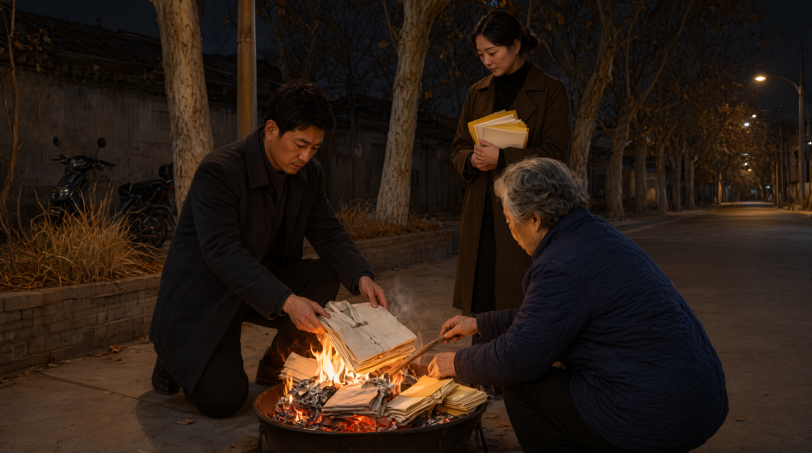

# Sending Winter Clothes at the Cold-Clothes Festival

## 1. Definition

The Cold-Clothes Festival, the first day of the tenth lunar month, also "tenth-month dawn" (*shiyuezhao*), "sending cold clothes" (*songhanyi*), "ancestor-sacrifice festival" (*jizuxie*). On this day paper winter clothes and paper money are burned to "send cold clothes" to the ancestors, to prepare them against the winter cold.

It is **one of the Han's three great ghost festivals** (the other two Qingming and Zhongyuan), and the last important node of the seasonal ancestor-sacrifice system.

## 2. Historical Origins

- The origin relates to the seasonal meaning of "the first of the tenth": the tenth lunar month enters winter; the ancients "gave out clothes" (issued winter clothes), and by extension gave clothes to the ancestors too.
- The Song *Dongjing Menghua Lu* records "on the first of the tenth, from the ministers down they receive cotton clothes … the gentry and commoners give new clothes to one another" and "on the new moon they go out of the city to feast the grave, as at Zhongyuan", showing the Song already had the first-of-tenth grave-visiting custom.
- Ming and Qing gazetteers record "on the first of the tenth, cut paper into clothes and burn before the grave" and "cut five-colour paper into caps and gowns and burn at the door" — the common form of "sending cold clothes".
- On the link with the Meng Jiangnü legend: folk have the story of "Meng Jiangnü sending cold clothes a thousand miles", and some areas tie the first of the tenth to Meng Jiangnü sending clothes, but this is a later accretion, not the festival's origin.
- Contemporary: some northern areas still "burn cold clothes"; cities mostly replace it with civilised sweeping.

## 3. Ceremonial Procedure

1. **Prepare objects**: five-colour paper (cut paper clothes), paper money, incense, candles, offerings.
2. **Cut paper clothes**: cut coloured paper into clothing shapes (or buy ready-made paper clothes), some inscribed with the ancestor's name.
3. **Home or grave sacrifice**: home sacrifice before the ancestral tablet with offerings, incense, kneeling; grave sacrifice at the grave with offerings and kneeling (some areas).
4. **Burn the cold clothes**: at the door (or before the grave) burn the paper clothes and paper money, chanting as you burn: "sending cold clothes to so-and-so; it is cold, wear more."
5. **Sprinkle ash circle**: some areas sprinkle ash in a circle and burn inside it (to keep "wild ghosts from grabbing the clothes").
6. **Thank the ancestors**: kneel to thank, gather the offerings.
7. **Matching customs of some areas**: on the first of the tenth the custom of "eating dumplings" or "eating glutinous cakes".

## 4. Regional and Ethnic Variants

- **North China**: "the first of the tenth", "sending cold clothes", insisting on cutting paper clothes and burning before the grave.
- **Jiangnan**: "tenth-month dawn", mostly burning at the house door, with "dumplings" as offering.
- **Min-Tai (Fujian-Taiwan)**: some places do not stress the first of the tenth, but take "winter solstice" as an important ancestor day (see "Ancestral Offerings at Midwinter and on New Year's Eve").
- **Guangdong**: some areas take the first of the tenth as ancestor day, insisting on "burning clothes".
- **Ethnic minorities**: some peoples have a winter ancestor sacrifice — the Yi "tenth-month year" (Yi new year), the Qiang "Qiang year" (first of the tenth), the Hani "tenth-month year". These are the peoples' own new-year festivals; their time coincides with the Han Cold-Clothes Festival but the meaning is wholly different, and they must not be conflated.

## 5. Objects and Documents

- **Five-colour paper, paper clothes (cold clothes)**.
- **Paper money, incense, candles, offerings**.
- **"Burden"**: some areas put the cold clothes into a paper packet inscribed with the ancestor's name and burn together.
- **Lineage register, grave map**: to find the sacrifice object.

## 6. Sources

- 《东京梦华录》 relevant records
- 《清稗类钞·丧祭类》 *Qingbai Leichao*, "Funeral and Sacrifice"
- Provincial gazetteers, sacrificial records
- Textual studies on the Cold-Clothes Festival and the Meng Jiangnü legend

---

[← Back to Post-Burial Sacrifices](./README.md) · [Chinese original](../../../../docs/02-funeral-rites/02-05-post-burial-sacrifices/08-寒衣节.md) · [Repository home](../../../../README.md)
