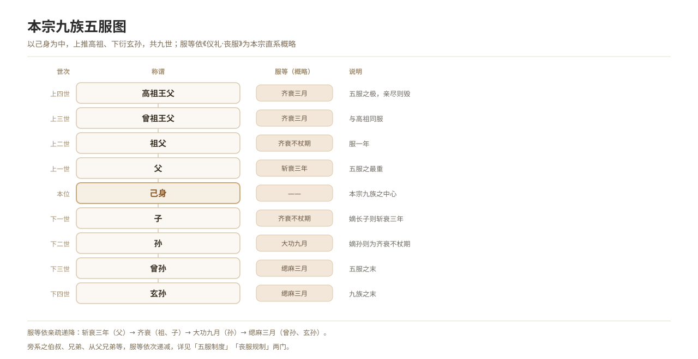

# The Five Degrees of Mourning: An Overview

*Figure 8. The chart of the nine generations and the five degrees of mourning, from great-great-grandfather to great-great-grandson.*

## 1. Definition

The system of the five degrees of mourning marks **the closeness of kinship** by **the gradation of mourning**. The five grades are:

| Grade | Term | Material of the mourning dress | Typical relations |
| --- | --- | --- | --- |
| **Zhan cui** | Three years | The coarsest raw hemp, edges unturned | A son for his father, a wife for her husband, a minister for his lord |
| **Zi cui** | Three years / with staff / without staff / three months | Raw hemp, edges turned | A son for his mother after the father’s death; a husband for his wife; for grandparents |
| **Da gong** | Nine months | Bleached hemp, relatively coarse | For paternal male cousins; for a married daughter |
| **Xiao gong** | Five months | Bleached hemp, finer | For maternal grandparents; for great-uncles |
| **Si ma** | Three months | The finest bleached hemp | For distant clansmen; for parents-in-law |

The heavier the grade, the longer the term, the coarser the dress and the stricter the restrictions of mourning. **“To go beyond the five degrees” means to fall outside the si ma range, so that no mourning is worn at all.**

## 2. Historical Origins

- **Textual basis**: the “Mourning” chapter of the *Yili* is the most systematic and earliest statement of the system, and the most highly regarded of the seventeen chapters (it attracted the largest commentarial literature); the chapters “Questions on Mourning”, “Interior Traditions”, “Great Traditions” and “Questions on the Three Years” in the *Liji* expound its meaning.
- **Rank and lineage law**: the five degrees form one body with lineage law. The two principles of “affection for kin” and “reverence for the honoured” coexist, which is why a father receives zhan cui for three years while a mother receives zi cui: a structure in which the father is honoured and the mother subordinate.
- **Changes through the dynasties**:
  - Han and Wei: dispute over whether mourning lasts twenty-five or twenty-seven months.
  - The Tang *Code of the Kaiyuan Reign*: “for the mother while the father lives” was changed from zi cui with staff for one year to zi cui for three years (under Empress Wu), then reverted, until the founding emperor of the Ming fixed the rule.
  - The Ming *Code*: “for the mother while the father lives” too was mourned in **zhan cui for three years** (raising the mourning for the mother), and “a mother for her eldest son” was changed to zi cui without staff for one year.
  - The Qing *Comprehensive Rituals*: follows the Ming, with detailed provisions for all five degrees.
- **Modern period**: after the Republic the system left the state ritual order, surviving only in popular mourning dress and mourning habit.
- **Significance**: the five degrees were not only the regulation of funerals but the fundamental classification of **kinship, clan organisation, inheritance of property and joint legal liability** in traditional China.

## 3. Ceremonial Procedure

1. **Determining closeness**: taking the “nine generations of one’s own descent line” as the axis, establishing the degree of kinship with the deceased (direct or collateral, and at how many generations’ remove).
2. **Determining the grade**: fixing the grade (zhan cui, zi cui, da gong, xiao gong, si ma, or none) according to the ritual books and family practice.
3. **Assuming the dress**: after the major dressing, kin change into the dress of their grade — the rite of *chengfu*.
4. **Mourning**: during the term, observing the corresponding restrictions on dwelling, diet, speech and marriage.
5. **Change and removal**: at set points within the term the dress is changed (the plain cap at the first anniversary, plain white at the second), and at its end it is laid aside.
6. **Reciprocal mourning**: the other party owes mourning as well, as in the correspondence between the mourning a woman owes her paternal aunts and sisters, and what they owe her as their brother’s daughter.

## 4. Regional and Ethnic Variants

- Popular mourning among Han Chinese has largely simplified; the name “five degrees” and its fine gradations survive better in areas with strong lineages (Fujian and Guangdong, Huizhou), while north China commonly uses “filial dress”, “filial cloth” and black armbands.
- **Ethnic difference**: the five degrees are a product of Han lineage law. Each people has its own periods of mourning and definitions of kin obligation — the clan mourning of the Yi, the religious mourning of the Tibetans — which **do not belong to the five-degree system** and must be recorded separately.

## 5. Objects and Documents

- **Diagrams of the five degrees**: the chart of the nine generations of one’s own line, and charts of mourning for maternal kin.
- **Actual mourning garments**: zhan cui dress, zi cui dress, gong dress, si dress.
- **Ritual books**: the “Mourning” chapter of the *Yili*, chapters of the *Liji*, the *Comprehensive Rituals of the Great Qing*, the *Family Rituals*.
- **Genealogies**: the basis for matching mourning regulation to members of the family.

## 6. Sources

- 《仪礼·丧服》（郑玄注、贾公彦疏） *Yili*, “Mourning”, with the commentaries of Zheng Xuan and Jia Gongyan
- 《礼记·服问》《礼记·间传》《礼记·大传》 *Liji*, “Questions on Mourning”, “Interior Traditions”, “Great Traditions”
- 《大明令》《大清通礼》 *Code of the Great Ming*; *Comprehensive Rituals of the Great Qing*
- 瞿同祖：《中国法律与中国社会》 Qu Tongzu, *Law and Society in Traditional China*
- 日·滋贺秀三：《中国家族法原理》 Shiga Shuzo (Japan), *Principles of Chinese Family Law*

---

[← Back to The Five Degrees of Mourning](./README.md) · [Chinese original](../../../../docs/02-funeral-rites/02-06-five-degrees-mourning/01-五服制度总述.md) · [Repository home](../../../../README.md)
