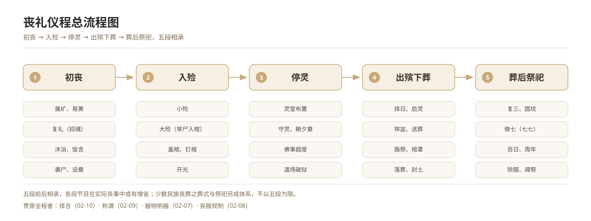

<!-- Generated by scripts/generate-skeleton.mjs. Do not edit manually. -->

# Funeral Rites (Xiongli, the Rites of Mourning)

Funerals belong to the xiongli, the mourning rites, among the traditional five categories of ceremony. This book follows twelve dimensions — initial mourning, encoffining, lying in state, procession and burial, post-burial sacrifices, the five degrees of mourning, funerary objects and mingqi, mourning attire, appellations, auspicious dating, region and ethnicity — assembling the full chain of custom from the Shisangli of the Yili down to contemporary funeral reform.

*图 6　丧礼仪程总流程：初丧—入殓—停灵—出殡下葬—葬后祭祀。*

*Figure 6. Overall flow of the funeral rites: initial mourning, encoffining, lying in state, procession and burial, post-burial sacrifices.*

This book contains 12 sub-categories and 204 entries.

## Sub-categories

| Section | Entries | Description |
| --- | --- | --- |
| [02-01 Initial Mourning](./02-01-initial-mourning/README.md) | 10 | The rites of the earliest phase: dying, summoning the soul, washing the body, filling the mouth, announcing the death, appointing the chief mourner and receiving condolences. |
| [02-02 Encoffining](./02-02-encoffining/README.md) | 10 | Minor and major dressing, and the placing of the body in the coffin, together with the regulations governing coffins and grave goods. |
| [02-03 Lying in State](./02-03-lying-in-state/README.md) | 11 | The ordering of the mourning hall, the vigil, morning and evening offerings, and rites of deliverance — the longest phase of the funeral. |
| [02-04 Funeral Procession and Burial](./02-04-funeral-procession-burial/README.md) | 15 | The complete process of raising the coffin, the procession, roadside offerings, burial and the raising of the mound, including modes of burial and the geomancy of the grave. |
| [02-05 Post-Burial Sacrifices](./02-05-post-burial-sacrifices/README.md) | 14 | The full sequence of sacrifices, from the third day and the seven-day cycle to the anniversaries and the end of mourning, together with Qingming, Zhongyuan and other seasonal offerings. |
| [02-06 The Five Degrees of Mourning](./02-06-five-degrees-mourning/README.md) | 12 | The five grades — zhan cui, zi cui, da gong, xiao gong and si ma — and their links to lineage law and inheritance. |
| [02-07 Funeral Objects and Mingqi](./02-07-funeral-objects-mingqi/README.md) | 15 | Coffins, mingqi, paper offerings, grave stelae and ritual instruments, with their ritual regulation and what excavation has revealed. |
| [02-08 Mourning Attire Regulations](./02-08-mourning-attire-regulations/README.md) | 10 | The cut, materials, headwear and staves of mourning attire, the points at which it is taken up, changed and laid aside, and the modern forms of filial dress. |
| [02-09 Funeral Appellations](./02-09-funeral-appellations/README.md) | 10 | Appellations for the deceased, the self-designations of the bereaved, the system of death euphemisms, and the titles of funeral officers. |
| [02-10 Auspicious Dating and Taboos in Funerals](./02-10-funeral-auspicious-taboos/README.md) | 10 | Date selection in mourning, the avoidance of repeated bereavement, grave geomancy, and the taboos observed during the mourning period. |
| [02-11 Han Regional Variants of Funeral Custom](./02-11-han-regional-variants/README.md) | 32 | Provincial units, together with the Huizhou, Minnan and Hakka sub-groups, are taken as the framework for recording regional variants of Han Chinese funeral custom. |
| [02-12 Funeral Customs of the Ethnic Minorities](./02-12-ethnic-minority-funeral/README.md) | 55 | Taking each of the 55 ethnic minorities in turn, this section records characteristic forms of dying, mourning, burial and post-burial sacrifice. |

## Related

- [Repository home](../../../README.md)
- [Chinese book index](../../../docs/02-funeral-rites/README.md)
- [English document index](../README.md)
