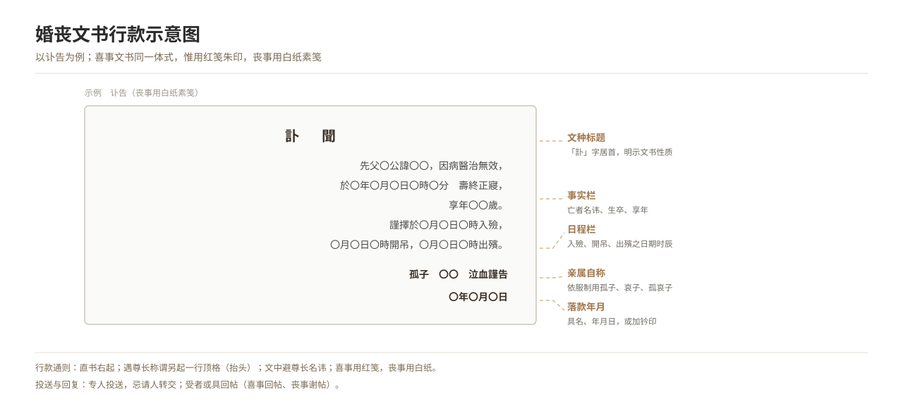

# Wedding and Funeral Documents: An Overview

*Figure 10. Layout conventions of wedding and funeral documents (rising columns, margin rules, signatures and dates).*

## 1. Definition

Wedding and funeral documents are the written texts used in the wedding and funeral rites. By use they fall into four classes:

| Class | Genres | Use |
| --- | --- | --- |
| **Card forms** | horoscope card, marriage contract, invitation, thank-you card | matchmaking, betrothal, inviting guests, acknowledging |
| **Contracts** | marriage contract, gift list, land-buying deed | proof of betrothal, list of goods |
| **Ritual words** | celebrant's formulas, invocation, ridge-raising text | chanted or read within the rite |
| **Mourning and sacrifice texts** | obituary, memorial address, mourning announcement, elegy, mourning couplet, grave inscription | announcing death, expressing grief, recounting a life |

**Shared norms**: layout (vertical columns right to left, rising-head lines, blank characters), appellations (honorific and self-deprecating), paper and colour (red paper for joy, white for mourning), and taboo avoidance (not writing the elders' personal names directly).

## 2. Historical Origins

- Pre-Qin: the *Yili* "Ceremony of a Scholar's Wedding" records the words of "presenting the gifts" and "asking the name", the start of wedding texts; the *Liji* has the rite of "announcing death to the lord" and "to the village".
- Han–Wei: letter-manual works (the *Yueyi*, etc.) set the appellations and layout of correspondence.
- Tang–Song: Sima Guang's *Book of Ritual Correspondence* and Zhu Xi's *Family Rites* fixed the forms of the documents for capping, marriage, mourning and sacrifice.
- Ming–Qing: daily-use encyclopaedias (the *Complete Letter-Writer*, the *Brocard for the World*, etc.) widely carried card forms and model texts; the forms settled and gained legal force.
- Contemporary: paper card forms simplify, electronic documents rise (see "Modern Electronic Obituaries and Memorial Messages").

## 3. Ceremonial Procedure

1. **Fix the genre**: choose the document by the matter (matchmaking, betrothal, inviting, announcing death, expressing grief).
2. **Choose paper and ink**: red note and gold-dust for joy, white paper and plain note for mourning; avoid old or torn paper.
3. **Fix the appellation**: first tell kin from stranger, elder from junior; honour the other with "ling", refer to oneself with "jia"/"she".
4. **Arrange the layout**: vertical columns from the right; the elder's appellation starts a new line at the margin (rising head); avoid the elders' names in the text.
5. **Sign and seal**: give the name, write the year-month-day, or add a seal.
6. **Deliver and reply**: send by a special person; the receiver may send back a reply card at once.

## 4. Regional and Ethnic Variants

- **North China**: plain card forms, valuing the gift list.
- **Jiangnan**: refined card forms, fine envelopes and note paper.
- **Fujian, Guangdong**: wedding cards use "double cards" and "combined cards", insisting on "all red".
- **Ethnic minorities**: mostly oral rites replace documents (e.g., singing to fix the match); some borrow the Han card forms and overlay their own script; record separately.

## 5. Objects and Documents

- **Paper**: red note (joy), white paper (mourning), dragon-phoenix note.
- **Tools**: brush, ink and stone, card box, envelope, name card, seal.
- **Documents**: the various card forms, letter manuals, daily-use encyclopaedias.

## 6. Sources

- Song, Sima Guang: *Book of Ritual Correspondence*
- Song, Zhu Xi: *Family Rites* (the *Wengong Family Rites*)
- Ming–Qing daily-use encyclopaedias (*Complete Letter-Writer*, etc.)
- Folk fieldwork materials

---

[← Back to Wedding and Funeral Document Templates](./README.md) · [Chinese original](../../../../docs/03-appendix/03-02-document-templates/01-婚丧文书总述.md) · [Repository home](../../../../README.md)
