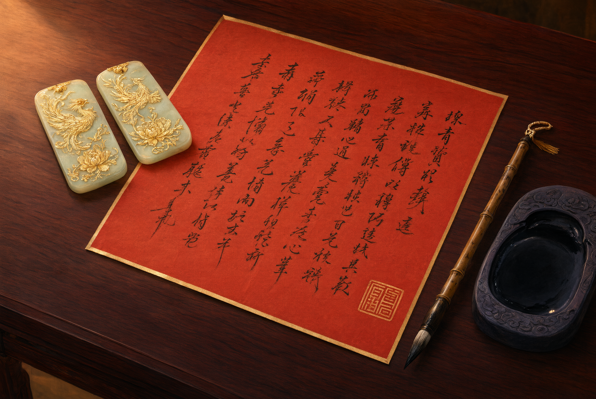

# Model Marriage Contract: the Dragon-and-Phoenix Card




## 1. Definition

The marriage contract (*hunshu*) is the proof of betrothal; because it often bears a dragon-phoenix design it is called the "dragon-phoenix card" (*longfengtie*). The one made at the affiancing stage is the "rough card" (*caotie*, the small betrothal); the one made at the bride-price stage is the "fixed card" (*dingtie*, the great betrothal). The groom's family's is the "request letter" (*qiushu*), the bride's family's the "consent letter" (*yunshu*); each side keeps one, completing the pair. In the Ming and Qing the marriage contract had legal force and was the essential of "betrothal".

## 2. Historical Origins

- The Zhou wedding had no marriage contract, but the rite of the matchmaker's relaying words and the "agreement".
- Tang marriage contracts already appear; Dunhuang letter-manuals keep the "marriage letter" and "reply marriage letter" formats.
- The Song *Dream of the Eastern Capital* records the "presenting the betrothal gifts" and "swapping cards" rites; the contract gradually became the norm.
- The *Great Qing Code* explicitly stated "at the first betrothal, each side makes a marriage contract", with penalties for breaking it.
- After the Republic, the contract was renamed "marriage certificate"; today it is the legal marriage registration.

## 3. Ceremonial Procedure

1. **Agree the match**: the go-between shuttles; the two sides settle the marriage and the bridal wealth.
2. **Make the rough card**: at the small betrothal, first make the rough card, showing the engagement is first set.
3. **Present the bride-price and make the contract**: at the bride-price rite, both families each make a marriage contract.
4. **Sign and seal**: the contract bears the names of the bride and groom (or the marriage principals) and the matchmaker, with a seal added.
5. **Exchange**: the two sheets are exchanged, each kept as proof.
6. **Archive**: kept with the gift list and horoscope card.

## 4. Regional and Ethnic Variants

- **North China**: the contract's wording is plain, valuing the amount of bridal wealth.
- **Jiangnan**: mostly parallel four-six prose, valuing fine phrasing.
- **Fujian, Guangdong**: adds auspicious words like "a match made in heaven", with the doubled-joy character.
- **Ethnic minorities**: most peoples traditionally do not use the contract as proof, but rely on customary law, village elders and rite to recognise the engagement; record separately.

## 5. Objects and Documents

- **Marriage contract**: red note or dragon-phoenix note, with gold dust and vermilion seal.
- **Matching**: horoscope card, gift list, invitation.
- **Objects**: card box, vermilion seal, brush and ink.

**Model example (request letter)**:

```text
With reverence: the alliance of Qin and Jin, a marriage fated by heaven.
Relying on the matchmaker,
humbly we request your daughter to be the wife of so-and-so.
We pray you deign to consent; how honoured we shall be.
      ○ year ○ month ○ day   so-and-so   respectfully made
```

**Model example (consent letter)**:

```text
In response to your command, through the matchmaker's matching,
you grant your son to be the son-in-law of our daughter.
Respectfully we obey your command; how dare we not comply.
      ○ year ○ month ○ day   so-and-so   respectfully made
```

## 6. Sources

- Song, Sima Guang: *Book of Ritual Correspondence*
- Song, Meng Yuanlao: *Dream of the Eastern Capital*
- *Great Qing Code*, "Household", "Marriage"
- Dunhuang letter-manual documents
- Folk fieldwork materials

---

[← Back to Wedding and Funeral Document Templates](./README.md) · [Chinese original](../../../../docs/03-appendix/03-02-document-templates/03-婚书范本.md) · [Repository home](../../../../README.md)
