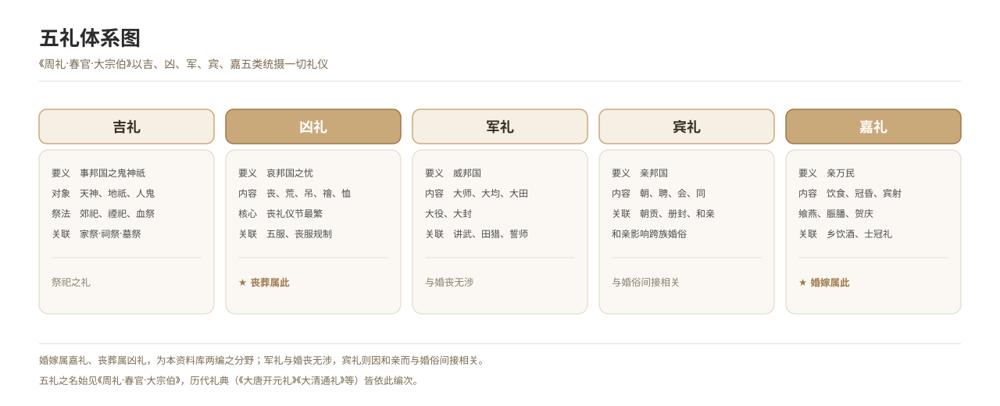

# The Five Rites: Ji, Xiong, Jun, Bin and Jia

*Figure 11. The Five Rites: the auspicious, mourning, military, guest and festive categories, and their principal contents.*

## 1. Definition

The “Office of the Great Ancestor” chapter of the *Rites of Zhou* (*Zhouli*) subsumes every ceremony under five categories — ji (auspicious), xiong (mourning), jun (military), bin (guest) and jia (festive) — and this is the general framework of the traditional ritual order.

| Category | Sense | Principal contents | Marriage and funerals |
| --- | --- | --- | --- |
| **Ji (auspicious)** | Serving the spirits of the state | Sacrificing to the spirits of heaven, the deities of earth and the human dead | Ancestral sacrifice belongs here |
| **Xiong (mourning)** | Grieving for the sorrows of the state | Mourning, famine, condolence, exorcism, relief | Funerals belong here |
| **Jun (military)** | Overawing the state | Great levies, great hunts, great labour, great investitures | —— |
| **Bin (guest)** | Bringing the state close | Audiences, embassies, conferences, alliances | —— |
| **Jia (festive)** | Bringing the people close | Food and drink, capping and marriage, archery, banquets, sacrificial meat, congratulations | Marriage belongs here |

This corpus therefore divides itself into **marriage as a festive rite** and **funerals as a mourning rite**, which accords exactly with the five categories.

## 2. Historical Origins

- The “Office of the Great Ancestor” chapter of the *Rites of Zhou* established the names of the five rites, the beginning of the classification.
- The Han *Baihu Tongyi* matched the five rites to the five agents, giving them a cosmological foundation.
- Successive dynastic codes were compiled according to the five categories: the *Great Tang Code of the Kaiyuan Reign*, the *New Ritual Code of the Zhenghe Reign* of the Song, the *Collected Rites of the Ming* and the *Comprehensive Rituals of the Great Qing* all follow it.
- Marriage and funerals appear in these codes under the festive and mourning categories respectively, each with its own ceremonial agenda.

## 3. Ceremonial Procedure

Through the dynasties the five rites were performed according to a hierarchy that runs from the top of society downwards:

1. **State ceremonies**: suburban sacrifices, ancestral temples, court assemblies, each with a detailed ceremonial agenda.
2. **Ranked officials**: officials of each grade performed capping, marriage, mourning and sacrifice according to rank, with differences in the number of vessels and in mourning attire.
3. **Family rites of the gentry and commoners**: from the Song *Family Rituals* onwards, the rites performed by commoners, chiefly marriage and funerals.
4. **Popular custom**: within the ritual framework, additions and omissions made according to local custom, producing regional variants.

## 4. Regional and Ethnic Variants

- **Han Chinese areas**: the five-fold framework is complete, and marriage and funerals fall under the festive and mourning categories respectively.
- **Ethnic-minority areas**: most do not classify their rites in these five categories but possess their own ceremonial systems; where Chinese institutions have left their mark, the five names are sometimes borrowed to perform a people’s own customs. These must be recorded separately.

## 5. Objects and Documents

- **Documents**: the dynastic ritual codes (*Great Tang Code of the Kaiyuan Reign*, *Comprehensive Rituals of the Great Qing*), ceremonial agendas and ritual diagrams.
- **Objects**: ritual vessels (ding and gui, baskets and stands, jades and silks), sacrificial vessels, musical instruments.

## 6. Sources

- 《周礼·春官·大宗伯》 *Rites of Zhou*, “Office of the Great Ancestor”
- 《礼记·王制》 *Book of Rites*, “Royal Regulations”
- 《白虎通义》 *Baihu Tongyi*
- 《大清通礼》 *Comprehensive Rituals of the Great Qing*
- Fieldwork records of folk custom

---

[← Back to Foundational Concepts of the Ritual Order](./README.md) · [Chinese original](../../../../docs/03-appendix/03-03-ritual-concepts/01-五礼体系.md) · [Repository home](../../../../README.md)
