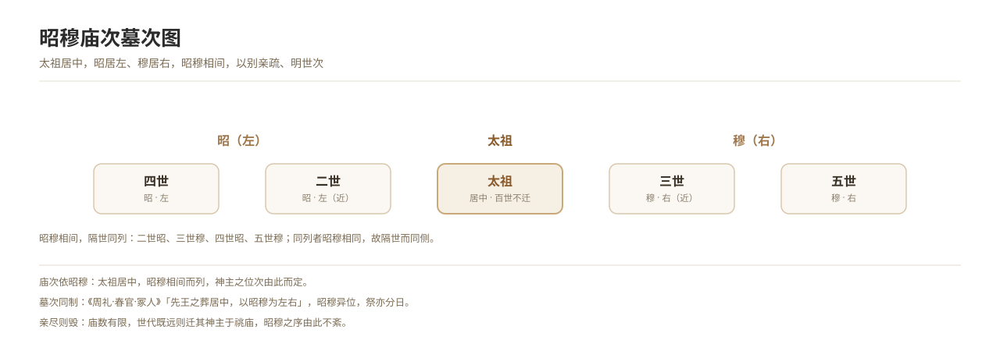

# The Zhao-Mu System

*Figure 13. The arrangement of zhao and mu in temple order and in cemetery order.*

## 1. Definition

*Zhao* and *mu* are the order in which ancestors are arranged in the ancestral temple and in the cemetery: the founding ancestor occupies the centre, and below him **the father is zhao and the son is mu**, zhao and mu alternating, generation by generation, so as to distinguish closeness of kin and make the order of descent clear.

| Generation | Position | Temple position |
| --- | --- | --- |
| Founding ancestor | Centre | Temple of the founding ancestor |
| Second generation | Zhao | Left |
| Third generation | Mu | Right |
| Fourth generation | Zhao | Left |
| Fifth generation | Mu | Right |

At sacrifice, zhao and mu occupy different positions and are offered to on different days; the sequence is therefore also called the order of “ranked attachment”.

## 2. Historical Origins

- The “Grave Officers” section of the “Offices of Spring” in the *Zhouli*: “The kings of old were buried at the centre, with zhao and mu to left and right” — the basis for zhao and mu in burial.
- The “Meaning of Sacrifice” and “Royal Regulations” chapters of the *Liji* discuss the meaning of zhao and mu, which is the counterpart of temple regulation.
- From the Han onwards temple order was largely arranged by zhao and mu, and the imperial ancestral temples of successive dynasties followed this sequence.
- In the Ming and Qing the imperial ancestral temple still alternated zhao and mu, as the ritual codes record in detail.

## 3. Ceremonial Procedure

1. **Ordering the generations**: first determining the founding ancestor and the sequence of generations.
2. **Fixing zhao and mu**: the second generation is zhao and sits to the left, the third is mu and sits to the right, and so on in turn.
3. **Arranging temple order**: placing the tablets in the ancestral temple according to zhao and mu.
4. **Arranging cemetery order**: the cemetery too is divided into left and right, zhao and mu alternating.
5. **Performing sacrifice**: zhao and mu are offered to at different positions, or on different days, and the order may not be confused.

## 4. Regional and Ethnic Variants

- **North China**: cemetery order by zhao and mu (zhao left, mu right) still survives in some villages.
- **South of the Yangtze**: the tablets in ancestral halls are mostly arranged by zhao and mu.
- **Ethnic minorities**: some peoples have rules for ordering graves or spirit seats within the lineage, but they are not of the same origin as zhao and mu and must be recorded separately.

## 5. Objects and Documents

- **Documents**: zhao-mu charts, genealogies (tables of descent), ritual codes.
- **Objects**: imperial ancestral temples, tablets in ancestral halls, grave stelae.

## 6. Sources

- 《周礼·春官·冢人》 *Zhouli*, “Offices of Spring: Grave Officers”
- 《礼记·王制》《祭统》 *Liji*, “Royal Regulations” and “Meaning of Sacrifice”
- 《大清通礼》 *Comprehensive Rituals of the Great Qing*
- Fieldwork records of folk custom

---

[← Back to Foundational Concepts of the Ritual Order](./README.md) · [Chinese original](../../../../docs/03-appendix/03-03-ritual-concepts/04-昭穆制度.md) · [Repository home](../../../../README.md)
