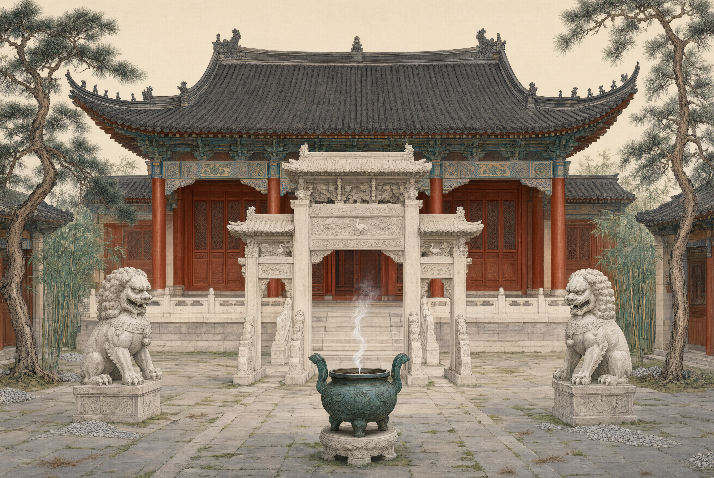
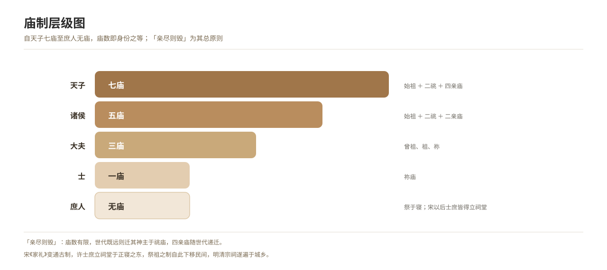

# Temple Regulations and Ancestral Sacrifice

*Figure 14. The hierarchy of ancestral temples, from the sovereign’s seven temples down to the knight’s single temple.*

## 1. Definition

Temple regulation prescribes how many temples each rank, from the sovereign down to the commoner, may establish. Its central principle is that **when the bond of kinship is exhausted the temple is demolished** — once the generations are far enough removed, the tablet is moved to a remote temple.

| Status | Number of temples | Explanation |
| --- | --- | --- |
| Sovereign | Seven temples | Founding ancestor + two remote temples + four temples of immediate forebears |
| Feudal lords | Five temples | Founding ancestor + two remote temples + two temples of immediate forebears |
| Great officers | Three temples | Great-grandfather, grandfather, father |
| Knights | One temple | The temple of the father |
| Commoners | No temple; sacrifice in the chamber | Later permitted to build ancestral halls |

The Song *Family Rituals* adapted the ancient regulation by allowing knights and commoners to build an **ancestral hall** east of the main chamber, and the system of ancestral sacrifice descended from that point among the people.

## 2. Historical Origins

- The “Royal Regulations” and “Patterns of Sacrifice” chapters of the *Liji* record the number of temples and the principle that when kinship is exhausted the temple is demolished.
- The regulations for establishing temples were repeatedly revised under the Han and Tang, and the system of the imperial ancestral temple gradually became complete.
- The Song *Family Rituals* fixed the institution of the ancestral hall, providing a norm for ancestral sacrifice by commoners.
- In the Ming and Qing commoners were all permitted to build halls, ancestral halls spread through town and country, and ancestral sacrifice became a popular institution.

## 3. Ceremonial Procedure

1. **Establishing the temple or hall**: choosing a site and building the hall, installing the tablets.
2. **Installing the tablets**: arranged in zhao and mu order.
3. **The four seasonal sacrifices**: the spring *ci*, summer *yue*, autumn *chang* and winter *zheng*, each with offerings set out at the proper season.
4. **Offering on the death day, and attendance at new and full moon**: sacrifice on the anniversary of death, and the burning of incense at the new and full moon.
5. **Moving tablets when kinship is exhausted**: once the generations are far enough removed, the tablet is moved to a remote temple or buried beside the grave.

## 4. Regional and Ethnic Variants

- **Fujian and Guangdong**: ancestral halls stand everywhere, spring and autumn sacrifices are grand occasions, and clan sacrifice is on a large scale.
- **North China**: small household shrines predominate and the offerings are plain.
- **Ethnic minorities**: ancestor veneration takes varied forms (the ancestral spirit tubes of the Yi, the *nankan* sacrifice of the Jingpo), not of the same origin as Han temple regulation, and must be recorded separately.

## 5. Objects and Documents

- **Documents**: hall rules, sacrificial registers, genealogies, invocations.
- **Objects**: ancestral tablets, incense stands, offering vessels, deeds to sacrificial land, sacrificial vessels.

## 6. Sources

- 《礼记·王制》《祭法》《祭统》 *Liji*, “Royal Regulations”, “Patterns of Sacrifice”, “Meaning of Sacrifice”
- 宋·朱熹：《家礼》（《文公家礼》） Zhu Xi (Song), *Family Rituals*
- 《大清通礼》 *Comprehensive Rituals of the Great Qing*
- Fieldwork records of folk custom

---

[← Back to Foundational Concepts of the Ritual Order](./README.md) · [Chinese original](../../../../docs/03-appendix/03-03-ritual-concepts/05-庙制与祭祖制度.md) · [Repository home](../../../../README.md)
