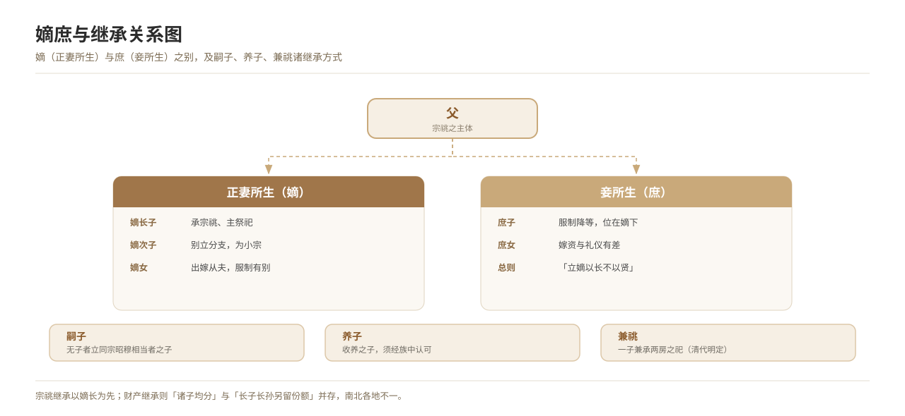

# Legitimate and Secondary Descent, and Inheritance

*Figure 15. The distinction between legitimate and secondary descent, and the order of succession.*

## 1. Definition

**Legitimate** (*di*) denotes sons born of the principal wife; **secondary** (*shu*) denotes sons born of concubines. Inheritance has two levels: **succession to the lineage** (inheriting the lineage sacrifices and status) and **inheritance of property** (the division of the family estate). Succession to the lineage follows the principle “the legitimate heir is chosen by seniority, not by worth”.

| Term | Meaning |
| --- | --- |
| **Son of the principal wife** | A son born of the principal wife |
| **Son of a concubine** | A son born of a concubine |
| **Adopted heir** | Where there is no son, a son of a clansman of corresponding zhao-mu standing is taken as heir |
| **Adopted son** | A son of another surname, or of the same clan, taken into the family |
| **Joint succession** | One son carrying the sacrifices of two branches (fixed by the Qing) |

## 2. Historical Origins

- The Zhou established the rule of legitimate succession, and the *Spring and Autumn* carries the maxim “the legitimate heir is chosen by seniority, not by worth”.
- From the Qin and Han onwards statutes and ordinances prescribed the order of succession.
- The codes of the Tang, Song, Ming and Qing record it in detail: the *Tang Code with Commentary* contains an article on “unlawful establishment of a legitimate heir”, which the *Great Ming Code* and the *Substatutes of the Great Qing* follow.
- The Qing also fixed the institution of **joint succession**, to solve the difficulty of an only son carrying the sacrifices of two branches.

## 3. Ceremonial Procedure

1. **Determining legitimacy**: establishing legitimate or secondary status by the identity of the birth mother.
2. **Establishing an heir**: where there is no son, choosing a clansman’s son of corresponding zhao-mu standing as heir, with the consent of the clan.
3. **Announcing to the ancestors**: reporting the establishment of an heir at the ancestral temple.
4. **Entering it in the genealogy**: recording the heir in the genealogy and making his place in the order of descent clear.
5. **Dividing the estate**: on the division of the household, property is distributed according to statute and lineage rule; in the north sons commonly share equally, while in the south an extra portion for the eldest son and eldest grandson is often reserved.

## 4. Regional and Ethnic Variants

- **North China**: property is generally divided equally among the sons.
- **South China**: “fields for the eldest son and eldest grandson” are common, and succession to the lineage continues to be valued.
- **Ethnic minorities**: distribution generally follows customary law (the Yi, for instance, have “the eldest son inherits the estate”, and some peoples practise ultimogeniture), which differs from the Han codes and must be recorded separately.

## 5. Objects and Documents

- **Documents**: genealogies, wills, deeds of household division (the “lot documents”), and marriage contracts, which serve to establish legitimacy.
- **Objects**: ancestral tablets in the lineage hall, lineage seals, contracts and bonds.

## 6. Sources

- 《礼记·丧服小记》 *Liji*, “Small Records of Mourning Dress”
- 《唐律疏议》 *Tang Code with Commentary*
- 《大明律》《大清律例》 *Great Ming Code*; *Substatutes of the Great Qing*
- Fieldwork records of folk custom

---

[← Back to Foundational Concepts of the Ritual Order](./README.md) · [Chinese original](../../../../docs/03-appendix/03-03-ritual-concepts/06-嫡庶与继承制度.md) · [Repository home](../../../../README.md)
