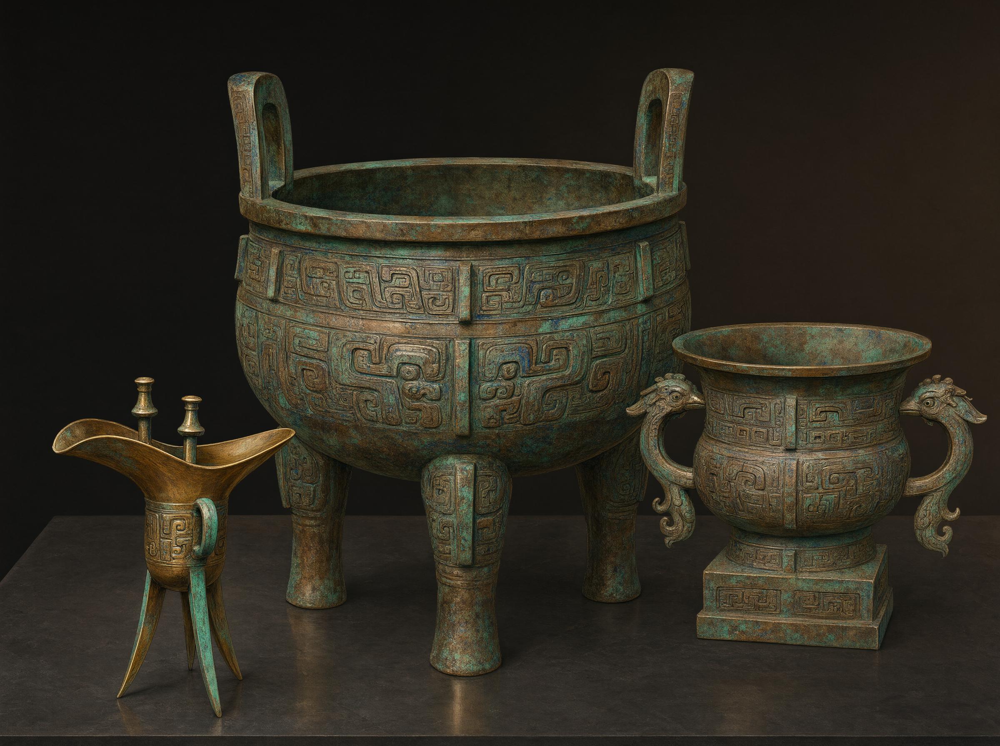
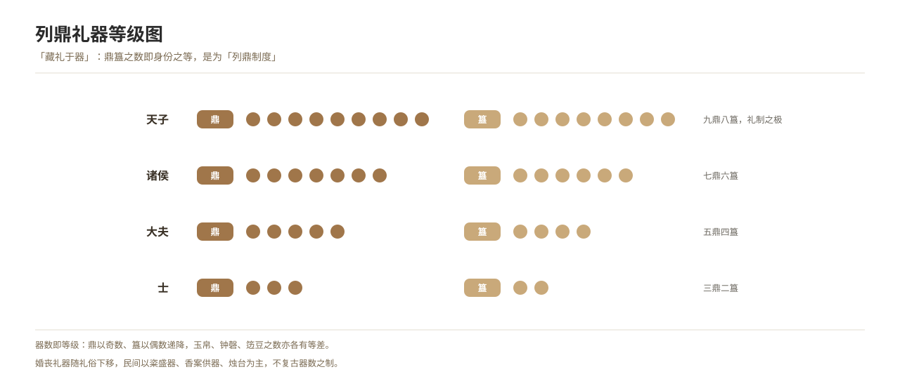

# Ritual Vessels and the Hierarchy of Rank

*Figure 17. The ranking of ritual vessels: from the sovereign’s nine ding to the knight’s single ding.*

## 1. Definition

Ritual vessels are the objects used in the performance of ritual; their form, number and combination were fixed according to rank — hence the saying that “ritual is stored in the vessels”: the number of vessels is the rank.

| Status | Ding (in ranked sets) | Gui |
| --- | --- | --- |
| Sovereign | Nine ding | Eight gui |
| Feudal lords | Seven ding | Six gui |
| Great officers | Five ding | Four gui |
| Knights | Three ding | Two gui |

The same applied to the numbers of jades and silks, bells and chime stones, and offering baskets and stands. Wedding and funeral vessels followed custom downwards, developing into vessels for grain offerings, incense stands and offering vessels.

## 2. Historical Origins

- Shang and Zhou bronze ritual vessels and the “ranked ding system” are visible in archaeology (for instance the sets of ding recovered from Zhou tombs).
- The *Rites of Zhou* lists the number of vessels and the officials who managed them, which broadly agrees with what excavation has found.
- From the Han and Tang onwards ritual vessels shifted from bronze to pottery, porcelain, lacquer and wood, tending towards practical use.
- In the Song, works such as the *Diagrams of the Three Rituals* verified the forms of ancient ritual vessels and influenced later manufacture.
- In the Ming and Qing popular wedding and funeral vessels consisted chiefly of incense stands, offering vessels and candlesticks.

## 3. Ceremonial Procedure

1. **Fixing the number of vessels by rank**: before the rite, the number of vessels is determined by grade.
2. **Setting them out**: offerings are prepared and the vessels set out before the spirits or in the hall.
3. **Presenting the vessels**: each is presented in turn during the rite.
4. **Removing the vessels**: when the rite is over the vessels are cleared away, and sacrificial vessels are stored in a dedicated place.
5. **The rule of keeping the vessels**: sacrificial vessels are not lent to others, a point the ritual order treats as important.

## 4. Regional and Ethnic Variants

- **Han Chinese areas**: the ancient rules on the number of vessels are no longer strict, but popular custom still insists on “in pairs” and “in sets”.
- **Ethnic-minority areas**: systems of ritual vessels differ from people to people (the sacrificial vessels of the Yi, the offering vessels of the Tibetans) and must be recorded separately.

## 5. Objects and Documents

- **Objects**: ding and gui, offering baskets and stands, jades and silks, bells and chime stones, incense stands, candlesticks.
- **Documents**: diagrams of ritual vessels (*Diagrams of the Three Rituals*), ritual codes, lists of grave goods.

## 6. Sources

- 《周礼·天官·冢宰》 *Zhouli*, “Offices of Heaven: Prime Minister”
- 《礼记·礼器》 *Liji*, “Ritual Vessels”
- 宋·聂崇义：《三礼图》 Nie Chongyi (Song), *Diagrams of the Three Rituals*
- Archaeological excavation reports
- Fieldwork records of folk custom

---

[← Back to Foundational Concepts of the Ritual Order](./README.md) · [Chinese original](../../../../docs/03-appendix/03-03-ritual-concepts/13-礼器与礼制等级.md) · [Repository home](../../../../README.md)
