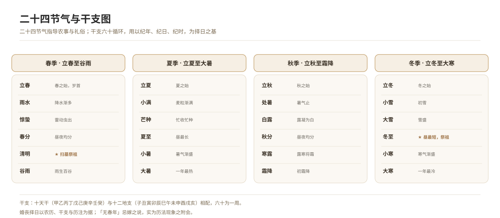

# The Traditional Calendar, the Sexagenary Cycle and the Twenty-Four Solar Terms

*Figure 18. The twenty-four solar terms and the correspondence of the sexagenary cycle to time.*

## 1. Definition

The traditional Chinese calendar is **lunisolar** (today called the agricultural calendar): months are fixed by the new and full moon, the year by the tropical year, and intercalary months reconcile the two. The **sexagenary cycle** runs through sixty combinations and is used to reckon years, days and hours. The **twenty-four solar terms** divide the sun’s apparent annual motion and guide both farming and ceremonial custom.

| Item | Contents |
| --- | --- |
| Sexagenary cycle | The ten heavenly stems paired with the twelve earthly branches, sixty to a round |
| Solar terms | Beginning of Spring, Rain Water, Awakening of Insects … Great Cold, twenty-four in all |
| Common almanac notes | The twelve *jianchu* gods, yellow and black roads, what is fitting and what is to be avoided |

The choice of a date for a wedding or a funeral is made on the basis of the agricultural calendar, the sexagenary cycle and these almanac notes.

## 2. Historical Origins

- The Xia and Shang already had calendars, and the oracle bones of Yinxu show days reckoned by the sexagenary cycle.
- The Han *Taichu Calendar* fixed the first month as the beginning of the year and the method of intercalation.
- The Tang and Song *Dayan Calendar* and *Shoushi Calendar* made calendrical calculation ever more precise.
- The Ming and Qing used the *Shixian Calendar*, and after the Republic the Gregorian and agricultural calendars ran side by side.
- Popular almanacs and yellow calendars combine the calendar with auspicious and inauspicious notes, and are still in use.

## 3. Ceremonial Procedure

1. **Consulting the calendar**: first converting the Gregorian date into its agricultural equivalent.
2. **Fixing the solar term**: establishing the solar term and the monthly order.
3. **Choosing the day**: avoiding the month breach, the year breach and years without a spring, and choosing an auspicious day for the rite.
4. **Fixing the hour**: setting the hour for escorting the bride, encoffining or the funeral procession.
5. **Writing it into documents**: recording the Gregorian date, the agricultural date and the hour together on the invitation or the obituary.

## 4. Regional and Ethnic Variants

- **Han Chinese areas**: the belief that a “year without a spring” (popularly a “widow year”) is unfit for marriage prevails in some regions; it is in fact a calendrical phenomenon to which meaning has been attached.
- **Ethnic-minority areas**: dates for weddings and funerals are mostly fixed by the people’s own calendars (the Tibetan, Dai and Yi calendars), and must be recorded separately.

## 5. Objects and Documents

- **Documents**: almanacs, yellow calendars, perpetual calendars, date cards.
- **Objects**: calendrical boards, the abacus.

## 6. Sources

- 《太初历》《授时历》相关研究著作 Studies of the *Taichu* and *Shoushi* calendars
- 清·允禄等：《协纪辨方书》 Yunlu and others (Qing), *Book of the Concordance of Times and the Distinction of Directions*
- Fieldwork records of folk custom

---

[← Back to Foundational Concepts of the Ritual Order](./README.md) · [Chinese original](../../../../docs/03-appendix/03-03-ritual-concepts/16-传统历法与干支.md) · [Repository home](../../../../README.md)
